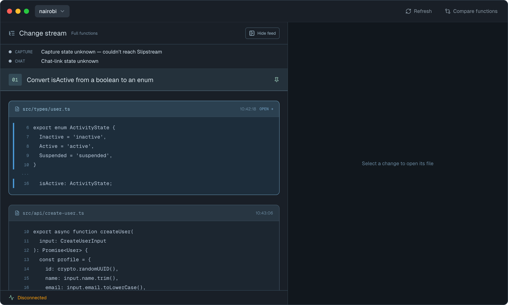
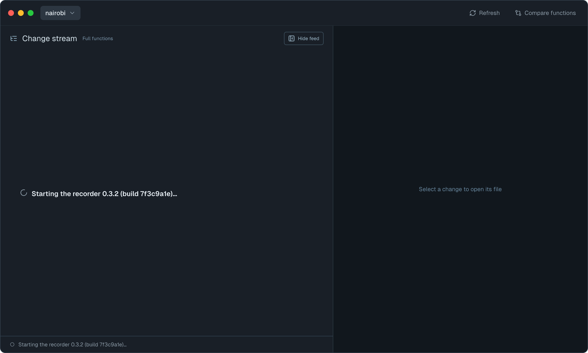
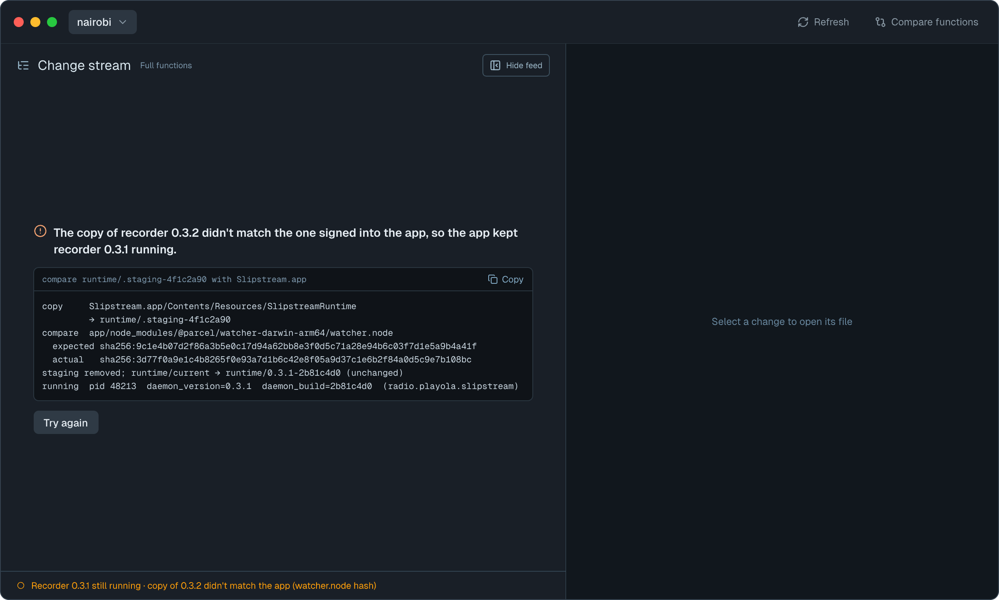
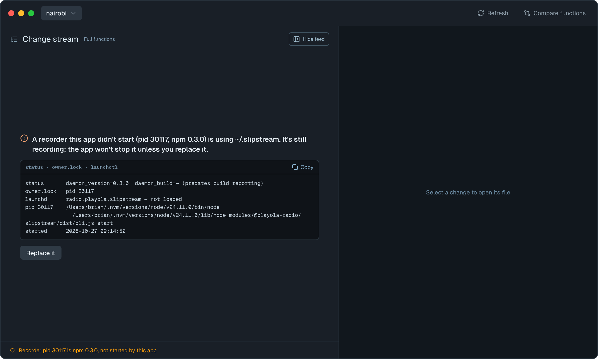
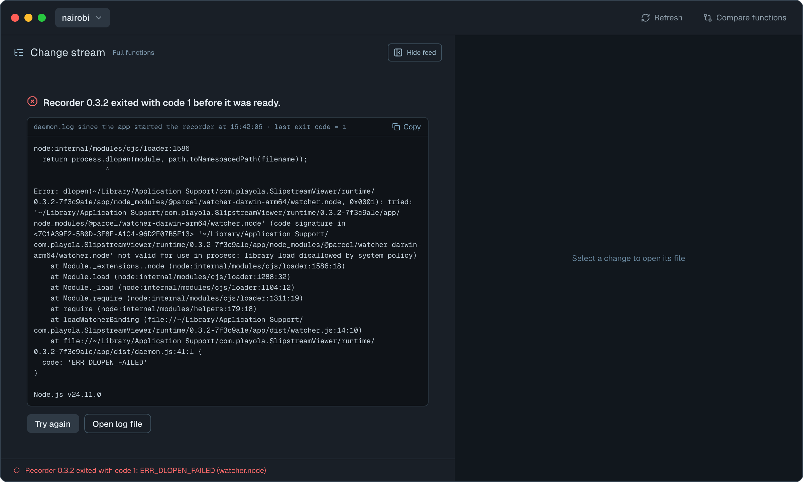
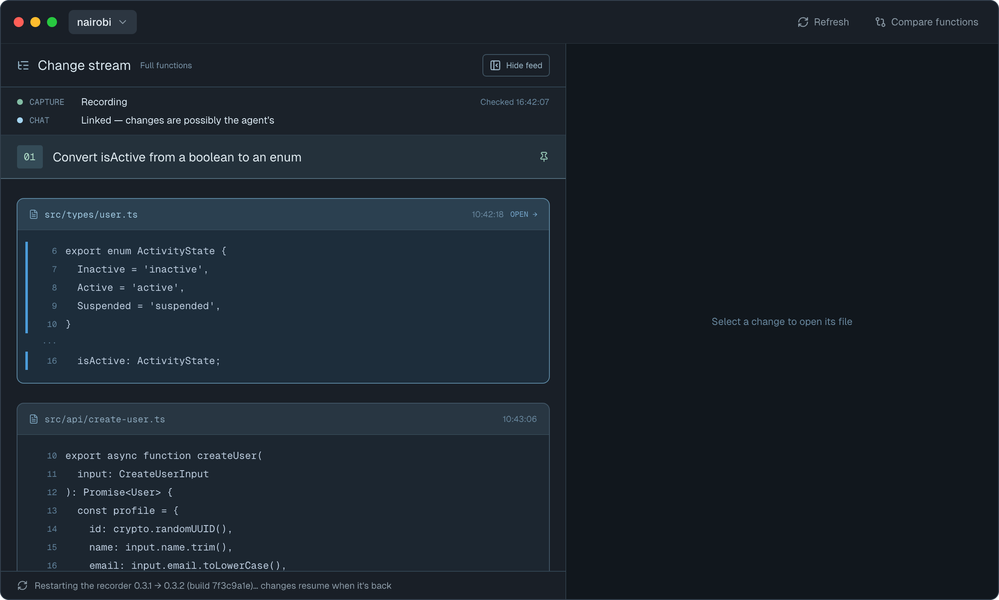
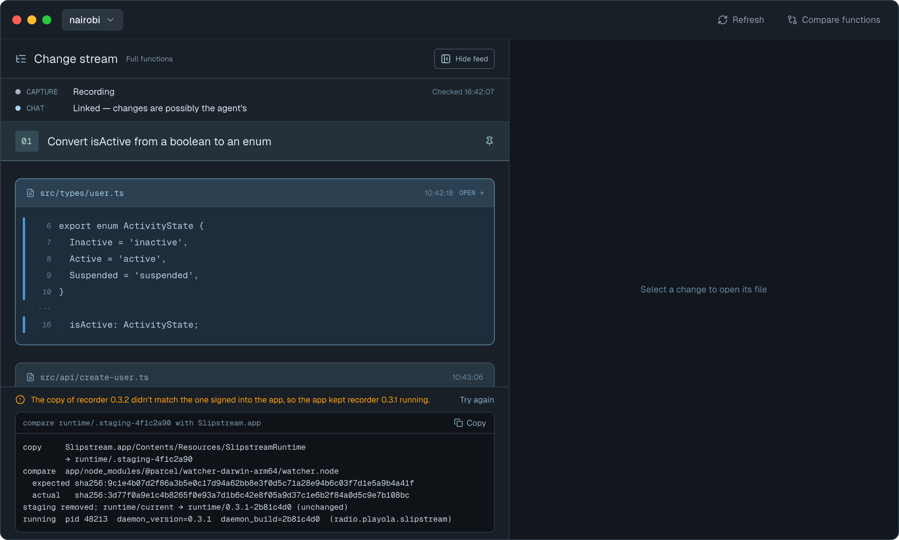
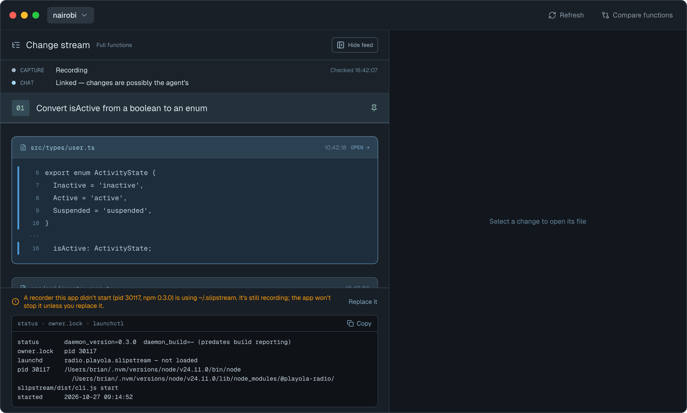
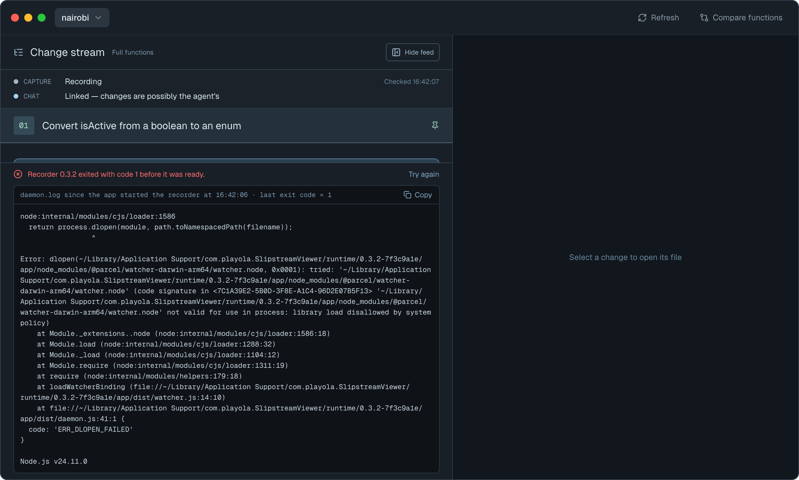
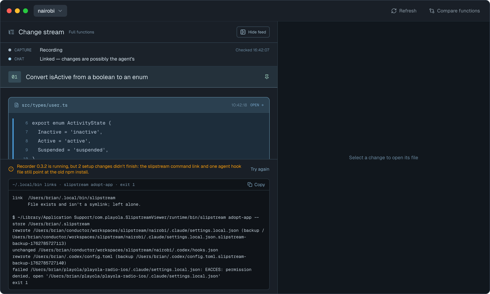

# Bundled daemon — Screens

Pen file: `design/slipstream.pen`. The approved state frames are in zone "16 · Bundled recorder"
(title `uSI5e`), below "15 · Conductor top bar". They are instances of the `CS · Window`
component (`AyBoP`), like the capture states in zone 12.

## Navigation map
| Screen | Surface | Address | Reached from |
|---|---|---|---|
| Change stream | client | n/a (native): the stream column of `Window("Slipstream", id: "main")` | Launching the app |

## Change stream
- **Status:** Changed
- **Surface:** client
- **Address:** n/a (native). The feed column of the app's one window.
- **Access:** anyone using the app on this Mac
- **Navigated to from:**
  - Launching the app, including the relaunch after a Sparkle update
- **Navigates to:**
  - **Try again** → reruns the failed step: switching to the bundled build or starting the
    recorder; from "Migration incomplete", only the `~/.local/bin` links and `adopt-app`
  - **Replace it** → re-reads `owner.lock` and checks it is still the same process (pid and start
    time), then sends that recorder SIGTERM. It waits for the store lock to be released, never
    force-kills, then runs `slipstream service install` for the bundled one
  - **Open log file** → `~/Library/Logs/slipstream/daemon.log` in the default app
  - **Copy** → the full error block text to the clipboard
- **Changed from today:**
  - Today a missing daemon shows one generic line, "The Slipstream daemon isn't running" or
    "Couldn't reach the Slipstream daemon", and the workspace flow says to `npm i -g`. Those
    texts are removed.
  - Every failure now has a headline that names the specific failure and a monospace block with
    the raw evidence: full stderr or stack trace, exit code, pid, daemon version and build, paths, the
    OS status. The block is selectable and has **Copy**. The bearer token is never shown.
  - With no stream open, the message fills the feed. With a stream open, the cached stream stays
    (the app already keeps loaded sessions and the feed when the recorder goes away) and the
    message docks above the footer, for every state.
  - The footer line states the specific condition in place of "Disconnected".

  Current state for comparison: 

| State | When it shows | Node | Mockup |
|---|---|---|---|
| Starting | No stream open; the app's service is starting and `status` hasn't answered with the bundled build yet | `K7uP6` |  |
| Update didn't finish | No stream open; preparing the new runtime failed before anything was stopped (the copy, or its byte comparison with the bundle), so the app's recorder keeps running the old build. The block shows the failed step, the file, expected and actual values | `PsvtW` |  |
| Another recorder | No stream open; the pid in `owner.lock` isn't the pid launchd reports for `radio.playola.slipstream` (for example a detached npm daemon), or it is a newer build than this app bundles. Release builds only | `o3IPH` |  |
| Won't start | `slipstream service install` failed (for example "Bootstrap failed: 5: Input/output error" when Slipstream is off in Login Items; the block shows its full output), or launchd reports the recorder exited before `status` answered, including after an update's SIGTERM. Then the block shows everything `daemon.log` gained since the app started the recorder, not a tail | `HZDOk` |  |
| Stream open · restarting | A stream is open while the app switches its recorder to the bundled build, from SIGTERM until `status` answers with the bundled build | `aZBNS` |  |
| Stream open · update didn't finish | As "Update didn't finish", with a stream open | `sLAQ5` |  |
| Stream open · another recorder | As "Another recorder", with a stream open; the stream keeps working through that recorder | `RbXdB` |  |
| Stream open · won't start | As "Won't start", over the cached stream | `pIu3P` |  |
| Migration incomplete | The recorder runs the bundled build, but a `~/.local/bin` link or `slipstream adopt-app` failed after a switch or first install. Always docked, with or without a stream open. The block lists the link problems, then the command and its full output | `Y1Pnk` |  |
