# Capture states — Screens

Pen file: `design/slipstream.pen`, zone `SP9Ol` ("12 · Capture states — is each workspace really
recording?"). Every change-stream frame is an instance of the `CS · Window` component (`AyBoP`), so a
change to the window propagates to all of them.

Workspace labels in the mockups are short folder names (`nairobi`, `lisbon`, …) for legibility. The
app keeps the stream-names labelling rules unchanged; only the status suffix is new.

## Navigation map
| Screen | Surface | Address | Reached from |
|---|---|---|---|
| Change stream window | client | `n/a (native)`, the main window | App launch; stream picker → a workspace row |
| Stream picker | client | `n/a (native)`, toolbar menu in the Change stream window | Change stream window toolbar → picker title |
| Ask Agent composer | client | `n/a (native)`, sheet on the Change stream window | Select source lines in a change → "Ask agent" |

## How the app learns the state

- Capture state comes from `GET /v1/captures` ([endpoints.md](./endpoints.md)). It is a snapshot.
- The snapshot is fetched, alongside `GET /v1/sessions`, on the existing triggers only: the window
  appearing, Refresh, selecting a workspace, the event follower going live again, and a
  recording-ended or session-resumed event on the watched stream. There is no new polling.
- Because it is a snapshot, the CAPTURE row always shows "Checked HH:mm:ss", the time of the last
  successful read.
- A workspace that is waiting or queued usually has no change history yet, so it has no
  `/v1/sessions` row. The picker therefore lists the union of sessions and captures, joined by
  session id. Such a row is selectable; its feed shows "No change history is available yet. Refresh
  to check again." and it has no footer.
- So a waiting workspace (for example the 17th, when 16 capture slots are in use) reads "Not
  recording — waiting for a free capture slot" and flips to "Recording" the next time one of the
  triggers above fetches a snapshot that says `recording`. It does not flip on its own between
  triggers.

## Change stream window
- **Status:** Changed
- **Surface:** client
- **Address:** `n/a (native)`, the main window
- **Access:** the local user of the app (daemon bearer token in memory)
- **Navigated to from:**
  - App launch
  - Stream picker → a workspace row
- **Navigates to:**
  - Stream picker (toolbar), Ask Agent composer (selected lines) — unchanged
- **Changed from today:**
  - A two-row **status strip** sits under the feed header.
    - CAPTURE row: a dot, the capture text, "Checked HH:mm:ss" on the right, and an optional
      detail line under it (what the reason means, or "Retry scheduled MMM d HH:mm:ss").
    - CHAT row: a dot and the chat-link text.
  - Dot colours. Capture: green `#83BDA4` recording; amber `#D8BE89` for every not-recording
    state; grey `#A4B4C3` unknown or unavailable. Chat: blue `#A4D5F1` linked; amber `#D8BE89`
    waiting for setup or unavailable; `#68879E` no chat; grey `#A4B4C3` unknown.
  - The footer no longer guesses capture state from events. "Live · New changes appear below"
    becomes "Connected · New changes appear below", and the "Recording ended" footer texts are
    removed. The other connection texts (Connecting…, Reconnecting…, Disconnected, …) are
    unchanged.
  - The feed marker on `session.resumed` is renamed from "Recording resumed" to "Capture
    restarting", because a resume does not prove capture is recording again.
  - Nothing reads "Recording" unless the latest snapshot says `state == recording`.
  Current screen: 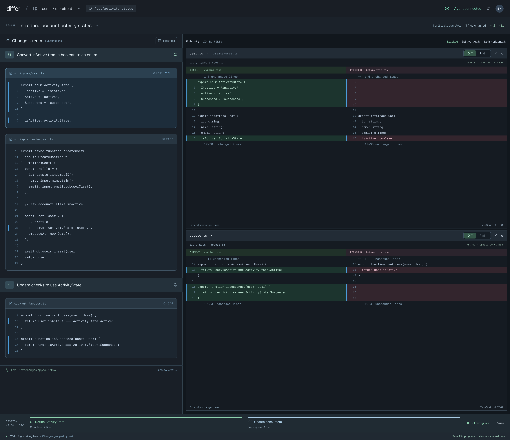

### Capture states

Capture text is "state — reason". Reasons the app doesn't recognise keep the raw code.

| State | When it shows | Node | Mockup |
|---|---|---|---|
| Recording | `state: recording` | `cQFWr` | 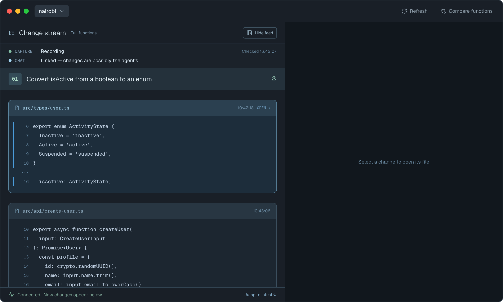 |
| Preparing | `state: baselining` — the first snapshot of the workspace is being taken. Text "Preparing — not recording yet"; detail explains that changes aren't covered until it finishes; the feed is empty ("Waiting for changes…") | `mUbdC` | 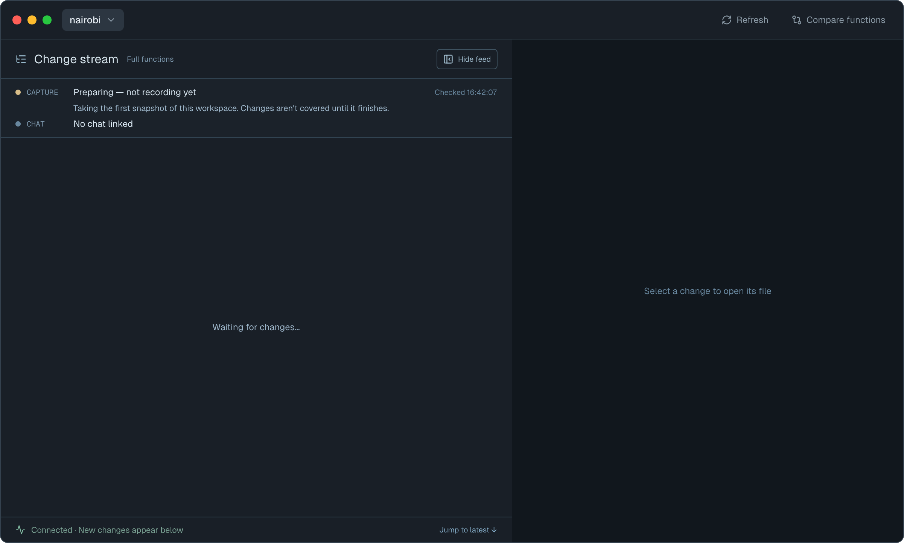 |
| Queued | `state: queued` — admitted, not started. "Queued — not recording yet" | `tUWGN` | 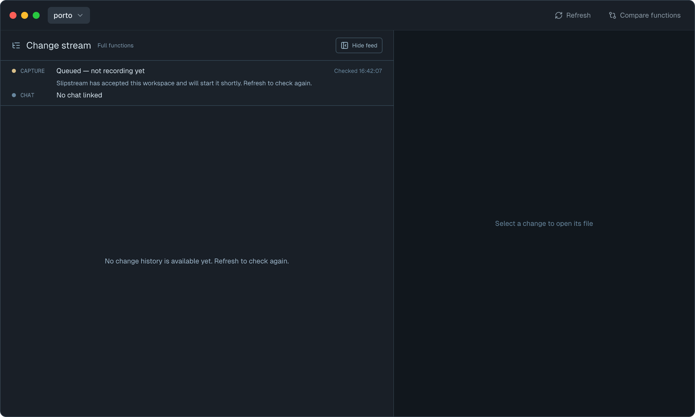 |
| Waiting for a free slot | `state: not_recording, reason: capture-limit-reached` — every capture slot is in use; it starts on its own, oldest first. Capture-only row, so no history and no footer | `wE43q` | 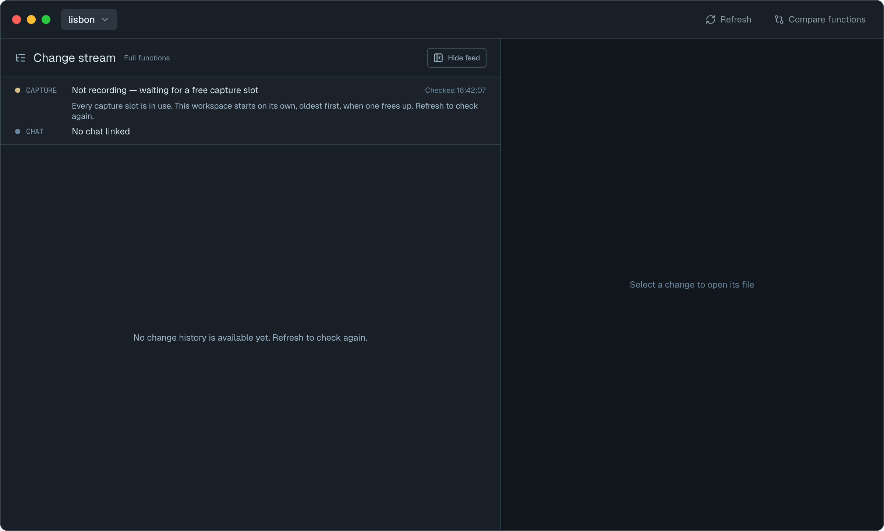 |
| Stopped — capture detached | `stopped`, `detached` (`slipstream detach`) | `A8ZMj1` |  |
| Stopped — workspace archived | `stopped`, `archived` (the workspace was archived) | `jth2g` |  |
| Stopped — maintenance in progress | `stopped`, `maintenance` (gc is running); detail says capture resumes on its own | `LMvxa` | 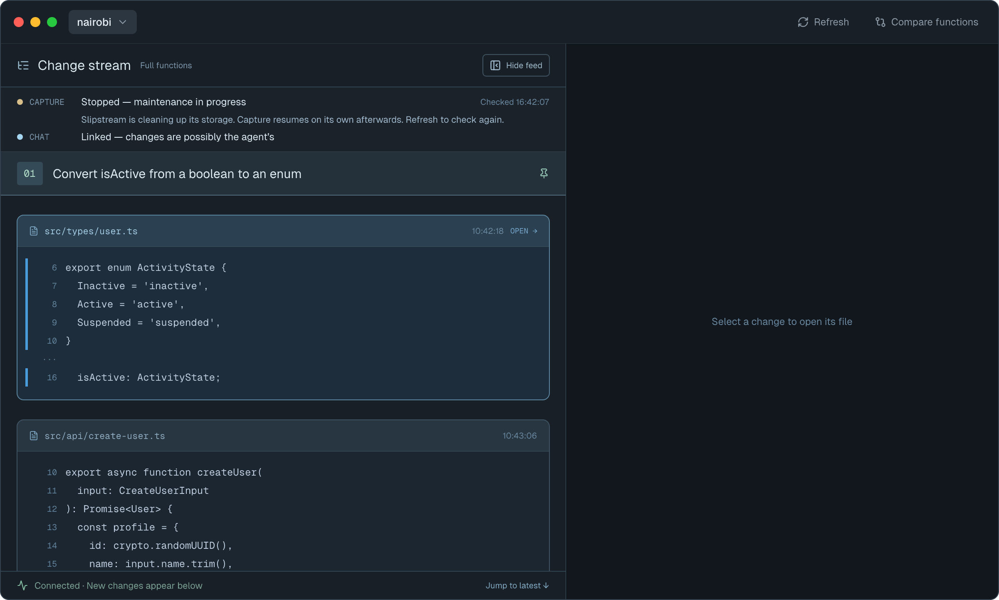 |
| Stopped — workspace folder missing or replaced | `stopped`, `root-missing` | `i7MYKR` |  |
| Stopped — file watcher failed | `stopped`, `watcher-failed` | `k36W3` |  |
| Not recording — Slipstream stopped reporting on this capture | `not_recording`, `daemon-unavailable` (no fresh heartbeat) | `WJXJG` |  |
| Not recording — folder overlaps another capture | `not_recording`, `root-overlap` | `UT2nD` | 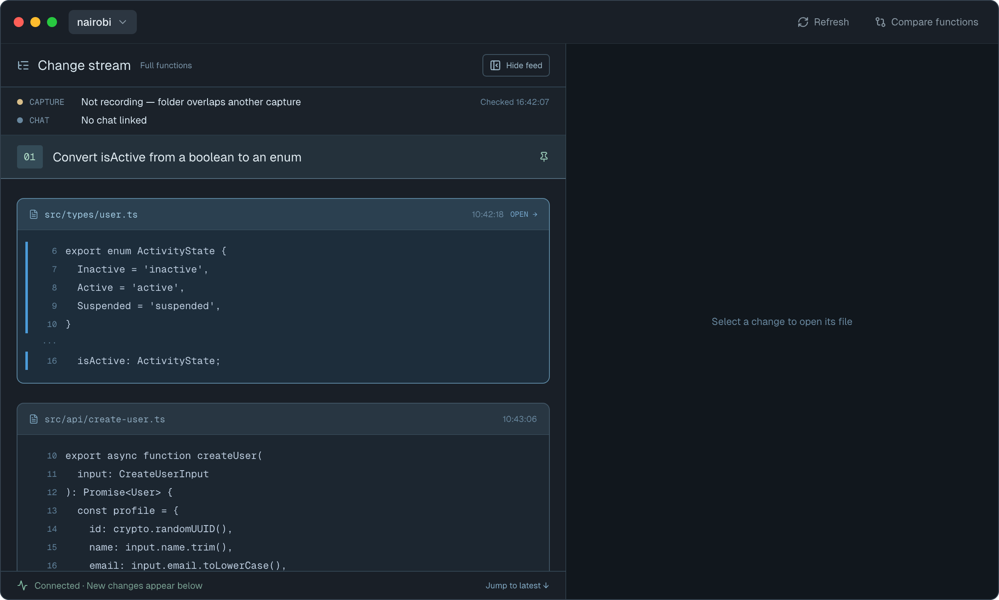 |
| Not recording — workspace folder missing or replaced | `not_recording`, `root-missing` | `wwk5l` |  |
| Not recording — first snapshot failed (with retry) | `not_recording`, `baseline-failed`, `retry.next_attempt_at_ms` set → detail "Retry scheduled Oct 18 16:45:00" | `z4bzN9` | 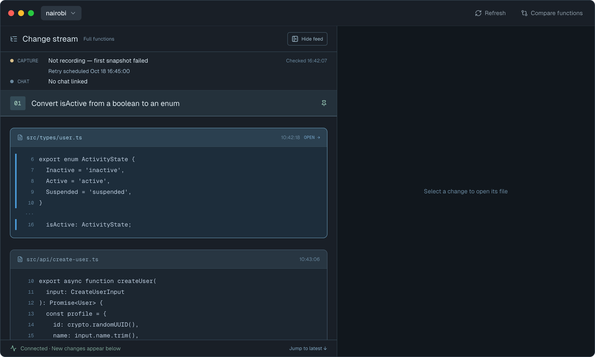 |
| Not recording — storage unavailable | `not_recording`, `storage-unavailable` | `Qk2NW` |  |
| Not recording — file watcher failed (with retry) | `not_recording`, `watcher-failed`, retry set | `eL3bA` |  |
| Not recording — capture couldn't resume (with retry) | `not_recording`, `resume-failed`, retry set | `RAC3B` | 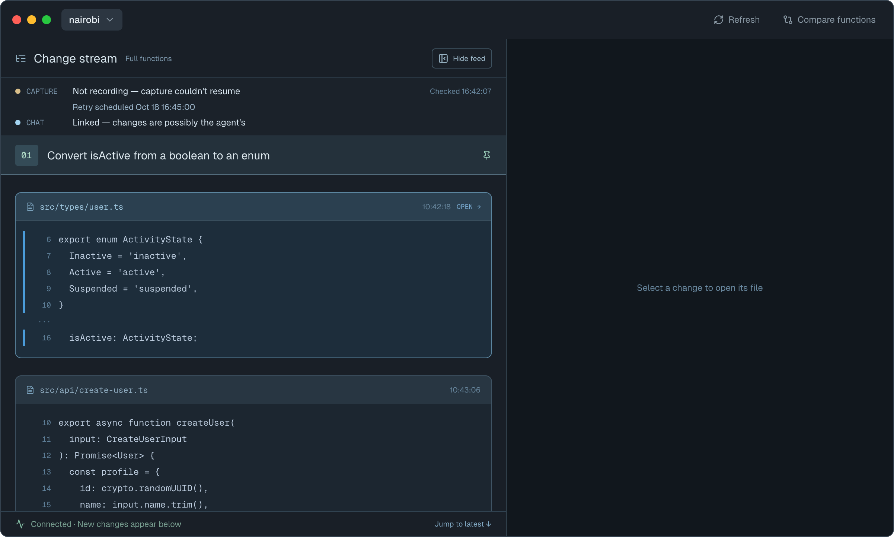 |
| Not recording — system resource limit reached | `not_recording`, `resource-limit` | `j7vUZL` |  |
| Not recording — stop couldn't be confirmed | `not_recording`, `stop-unconfirmed` — never shown as "Stopped", because the stop is what is unconfirmed | `Bye2H` | 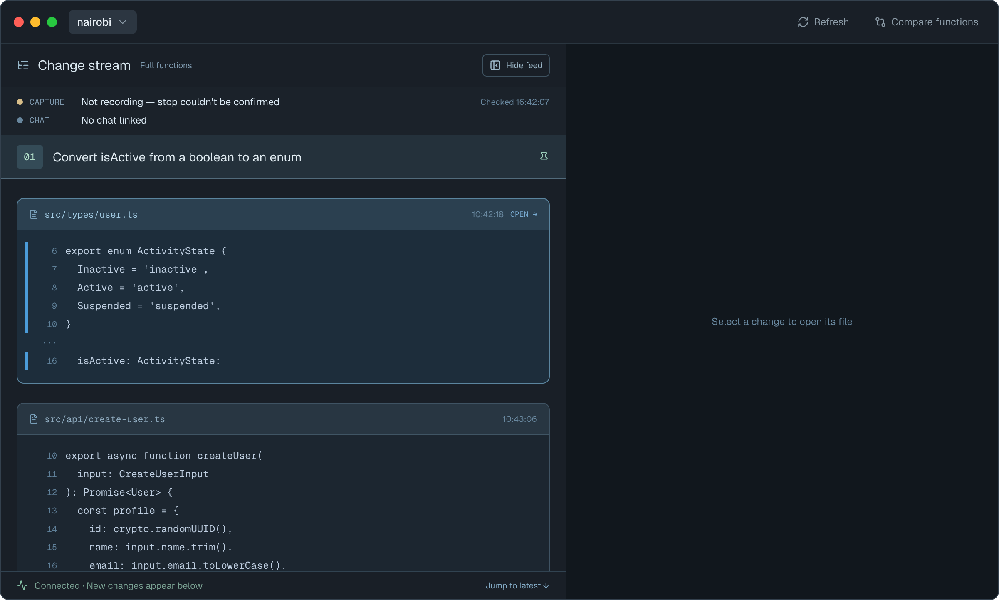 |
| Not recording — unrecognised reason | `not_recording` with a reason this app doesn't know, e.g. “disk-quota” | `M8jvNw` |  |
| Capture state unknown — unrecognised state | A state this app doesn't know, e.g. “hibernating”; detail "Update Slipstream Viewer to read this state." | `B7eRT1` | 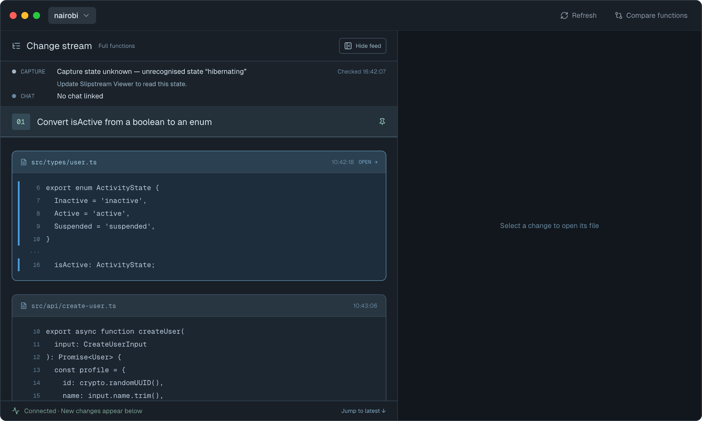 |
| Not captured | The workspace has a session but no entry in a successful captures response (history only) | `t9ThG` | 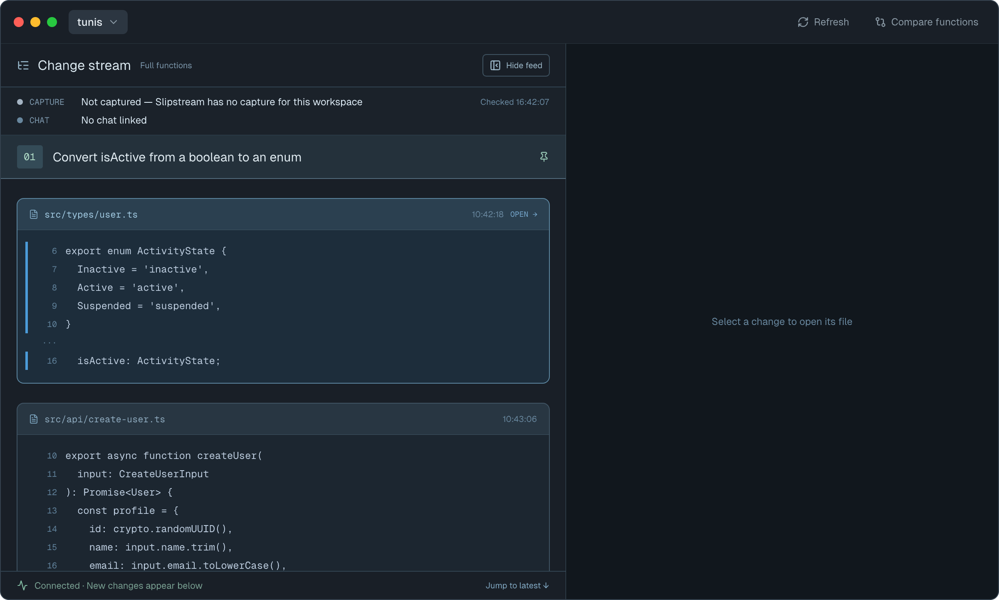 |
| Checking | First load, before the captures response arrives. Chat reads "Checking chat link…" | `o4y1YZ` | 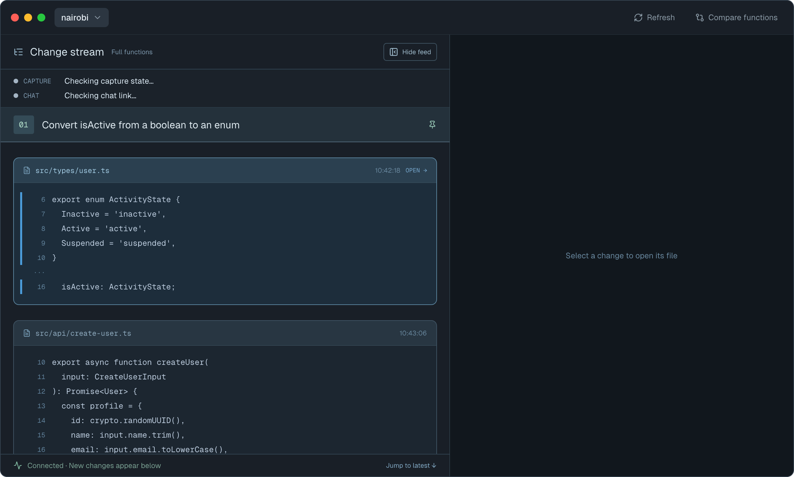 |
| Unavailable from this reader | `GET /v1/captures` returns 404 (an offline `serve` reader). Chat reads "Chat-link state unknown" | `x6egc` | 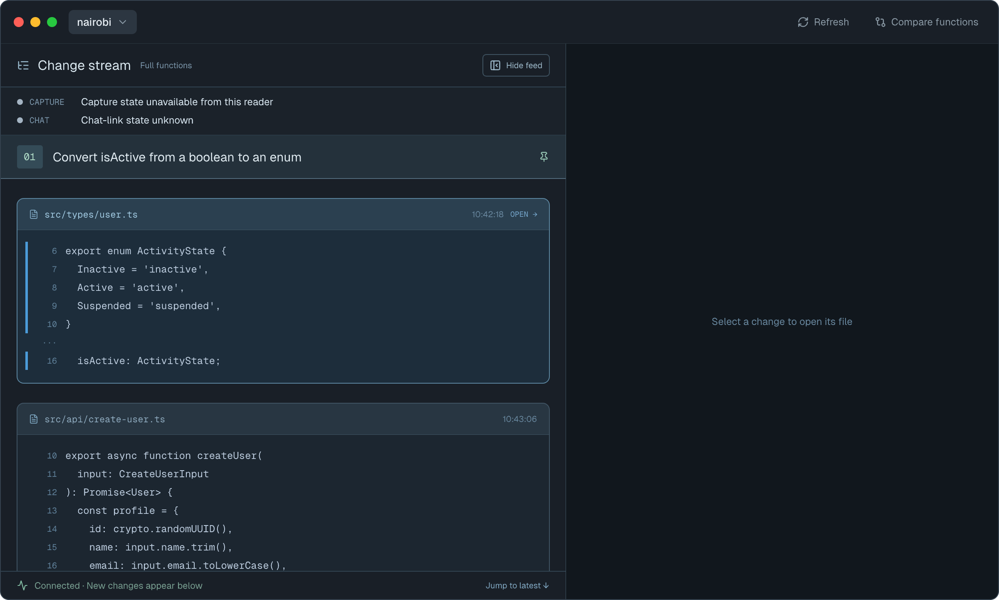 |
| Daemon unreachable | The captures request fails (transport, other HTTP status, unreadable body). "Capture state unknown — couldn't reach Slipstream"; the footer shows the existing "Disconnected" | `ARr1N` | 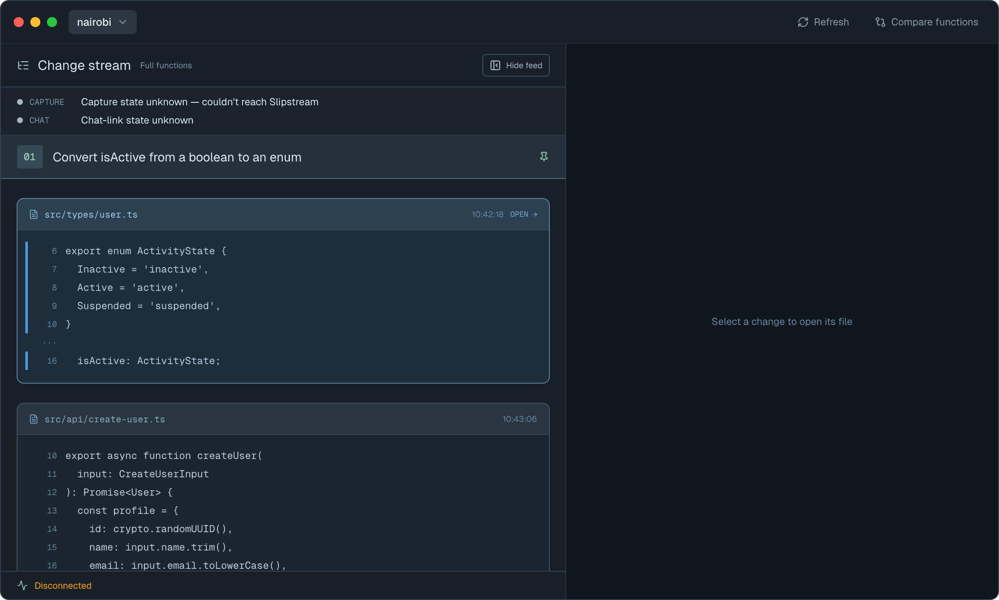 |
| Recording after maintenance | `stopped{maintenance}` then, on the next snapshot, `recording`. The feed carries the "Capture restarting · 16:43:12" marker | `D4hZil` | 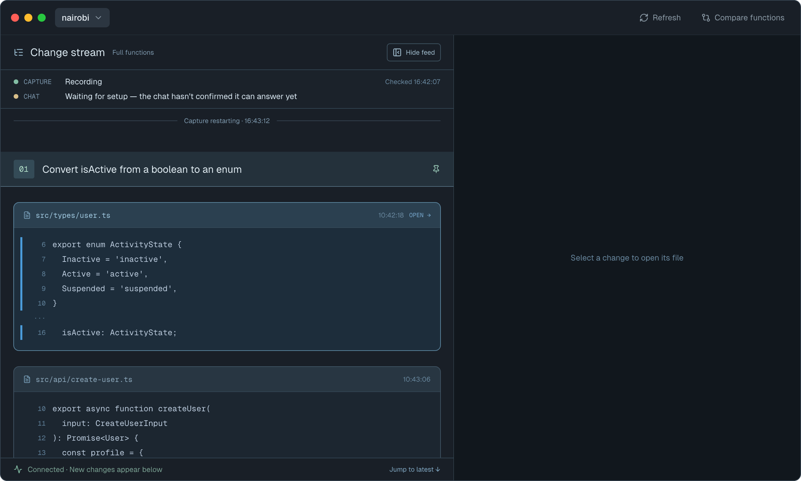 |

### Chat-link states

| State | When it shows | Node | Mockup |
|---|---|---|---|
| Linked | `binding.state: connected`. "Linked — changes are possibly the agent's" (a link, not proof of authorship) | `cQFWr` |  |
| Waiting for setup | `binding.state: setup_pending`, no reason. "Waiting for setup — the chat hasn't confirmed it can answer yet" | `D4hZil` |  |
| Waiting for setup — setup configuration missing | `setup_pending`, `config-missing` | `rWcyr` |  |
| Unavailable — chat transcript missing | `unavailable`, `transcript-missing` | `QF9NT` | 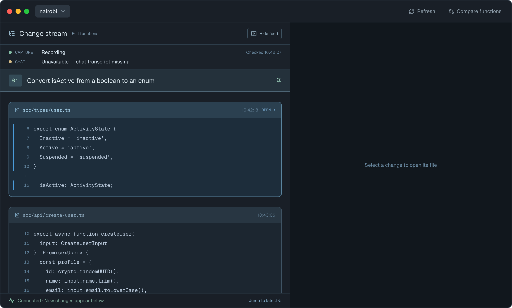 |
| Unavailable — chat transcript unreadable | `unavailable`, `transcript-unreadable` | `Y8ZIM` |  |
| Unavailable — chat identity changed | `unavailable`, `identity-changed` | `wI79K` |  |
| Unavailable — agent runtime unsupported | `unavailable`, `runtime-unsupported` | `ZHVy7` |  |
| No chat linked | `binding: null` or `binding.state: unlinked` | `o9x3LY` | 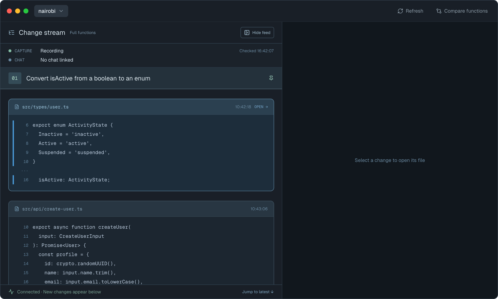 |
| Chat-link state unknown — unrecognised state | A binding state this app doesn't know, e.g. “paused” | `HhoZi` |  |

Chat-link text is "Chat-link state unknown" (no reason) whenever the capture itself is unknown,
unavailable or unreachable, and "Checking chat link…" while checking.

## Stream picker
- **Status:** Changed
- **Surface:** client
- **Address:** `n/a (native)`, the `Menu` on the Change stream window's toolbar
- **Access:** the local user of the app
- **Navigated to from:**
  - Change stream window → click the picker title
- **Navigates to:**
  - A workspace row → switches the window to it (unchanged); "Rename Stream…" (unchanged)
- **Changed from today:**
  - Rows are the union of sessions and captures, joined by session id. A capture with no session
    (waiting, queued, failed before its first event) is labelled by its root's folder name, with
    the stream-names collision rules.
  - Every row gets a short state suffix replacing today's " · Recording" (which was guessed from
    events): "· Recording", "· Waiting for a free slot", "· Queued", "· Preparing", "· Stopped",
    "· Not recording", "· Not captured" (session with no capture entry), "· State unknown"
    (unrecognised state, 404, or failed request). The full reason shows after selecting.
  - The picker title is the label only, no suffix.

| State | When it shows | Node | Mockup |
|---|---|---|---|
| Menu open | Captures response available; one row of each suffix | `kIilE` | 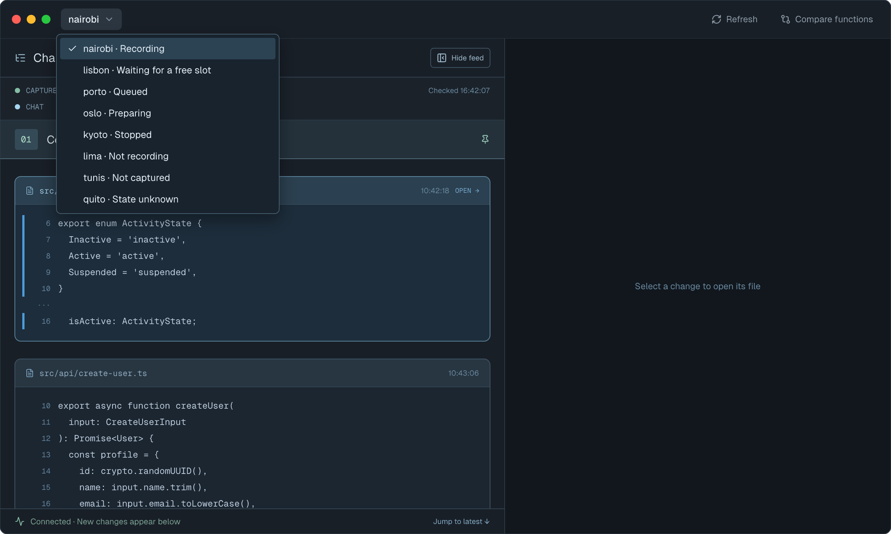 |
| State unavailable | Captures 404 or failed; every row reads "· State unknown" | `eGE4q` | 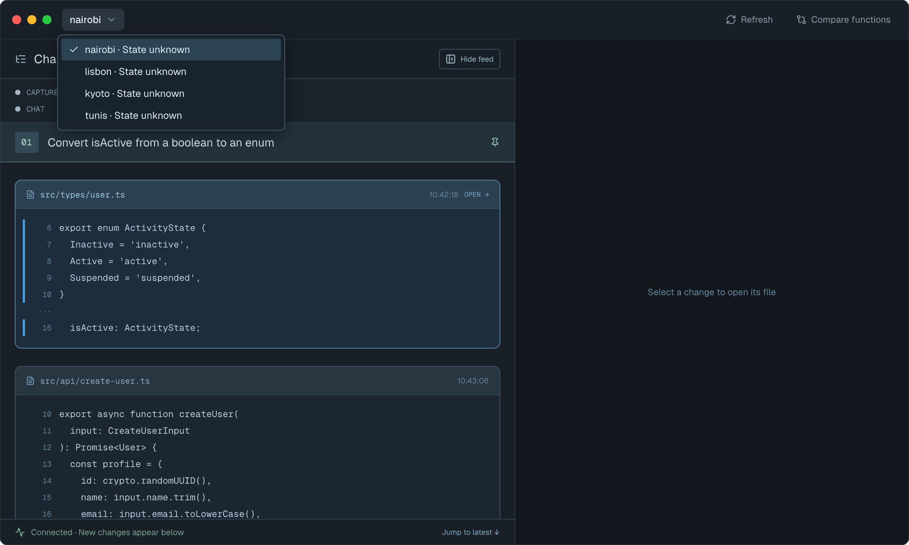 |

## Ask Agent composer
- **Status:** Changed
- **Surface:** client
- **Address:** `n/a (native)`, sheet on the Change stream window
- **Access:** the local user of the app
- **Navigated to from:**
  - Change stream window → select source lines → "Ask agent"
- **Navigates to:**
  - Ask → sends the question to the selected workspace's own linked chat (unchanged flow)
  - Cancel → closes
- **Changed from today:**
  - Ask is enabled only when the selected workspace's capture is `recording`, its binding is
    `connected`, and the live runtime readiness for that session is connected (today it only
    checks the last one). The request carries that workspace's `binding_generation`, so the
    daemon rejects it with `STALE_BINDING` if the chat was relinked meanwhile.
  - The composer is pinned to the workspace it was opened on; switching workspace never
    retargets its draft or a pending request.
  - The notice above the actions explains why Ask is disabled, in the precedence below. The
    button is dimmed (opacity 0.4) when disabled.

| State | When it shows | Node | Mockup |
|---|---|---|---|
| Linked | All three gates pass; no notice; Ask enabled | `gETof` | 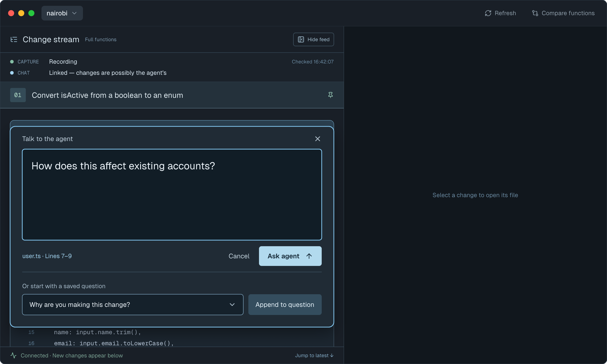 |
| Not recording | Capture not `recording` (shown: "Stopped — workspace archived"). "This workspace isn't recording, so its chat can't receive questions." | `J7Gw4` | 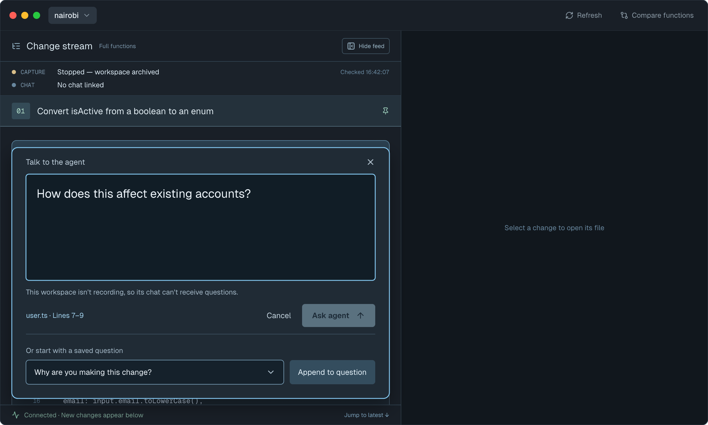 |
| Waiting for setup | Binding `setup_pending`, or binding connected but runtime not yet ready. Existing text: "The agent chat hasn't confirmed it can answer yet. It confirms on its next tool call after `slipstream attach`." | `y3rtsC` | 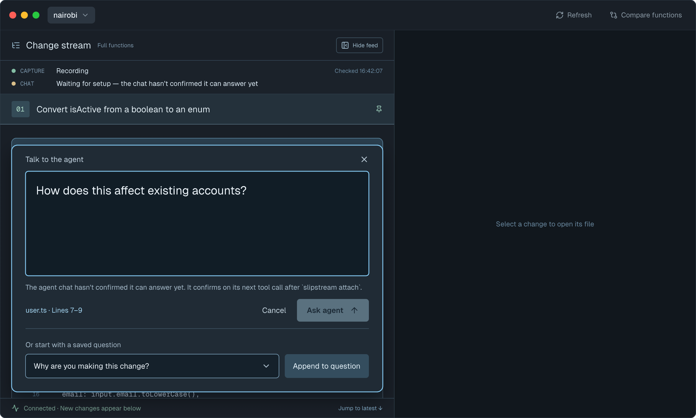 |
| Chat unavailable | Binding `unavailable`. "The linked chat is unavailable (chat transcript missing), so questions are disabled." — the reason is the CHAT wording | `ssOml` | 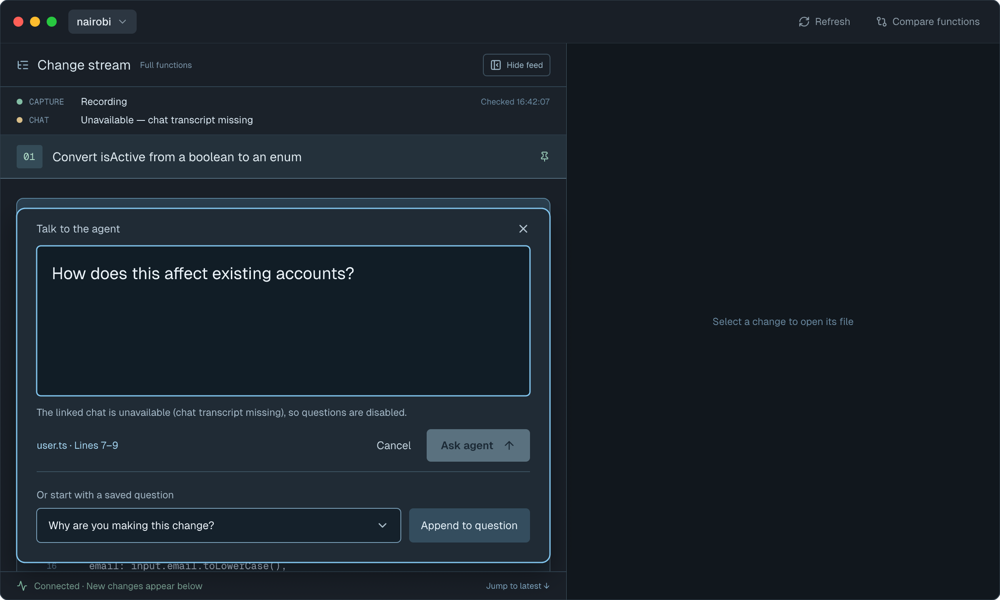 |
| No chat | Binding null or `unlinked`. "No agent chat is linked to this workspace. Run `slipstream attach` inside the agent chat to link one." | `TX08u` | 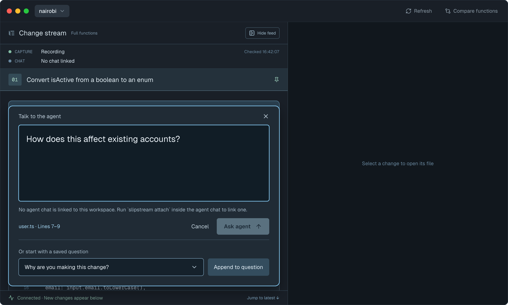 |
| State unknown | Capture unknown, unavailable (404) or unreachable, or an unrecognised binding state. "Capture state is unknown, so questions are disabled. Refresh to check again." | `WCdUs` | 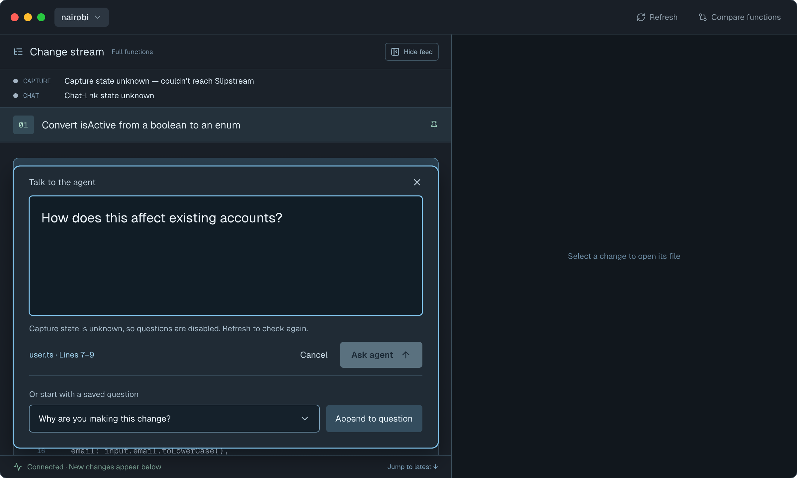 |

Notice precedence: state unknown → not recording → no chat → chat unavailable → waiting for setup.
