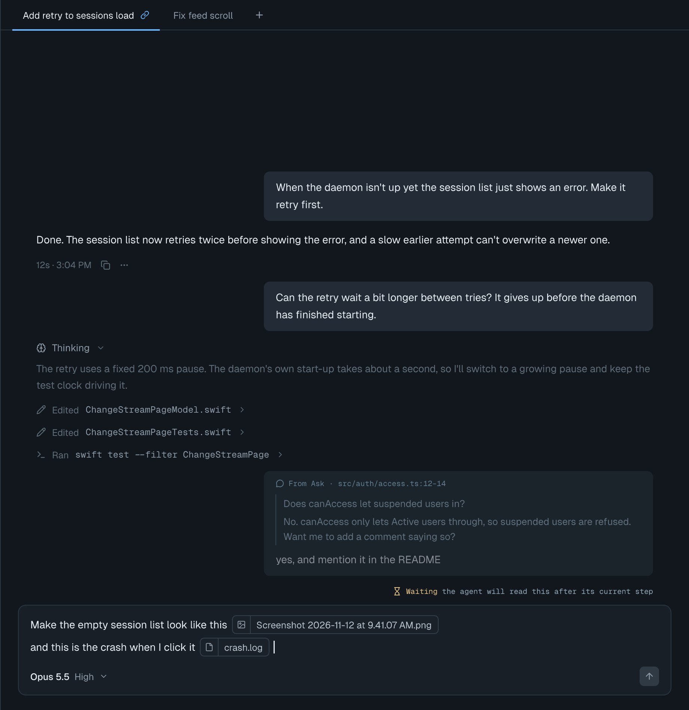
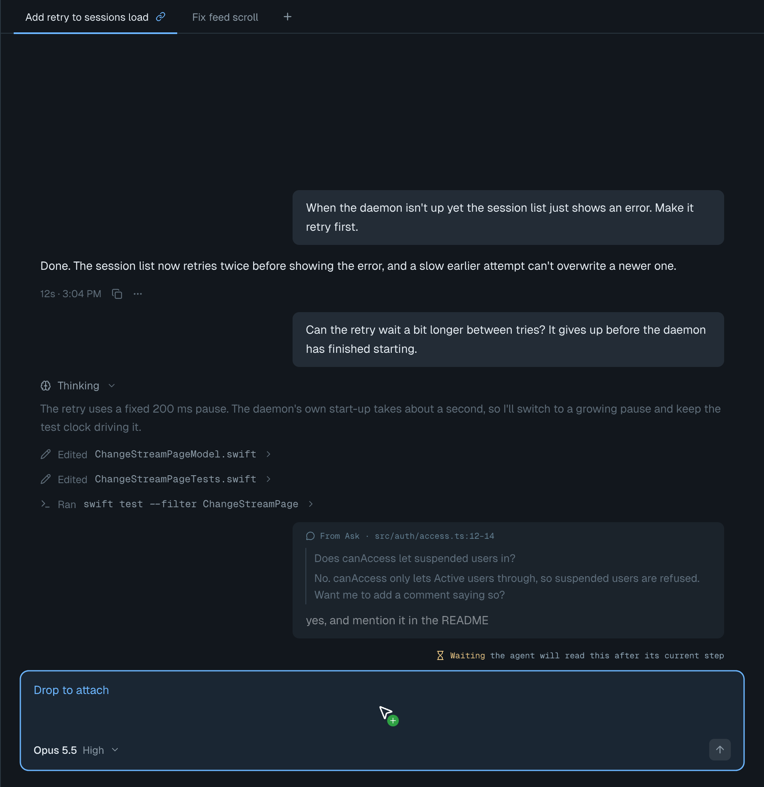
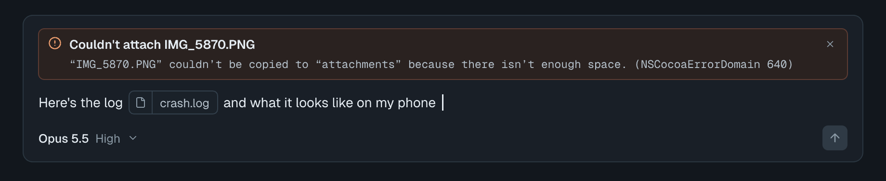
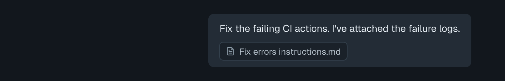

# Chat attachments — Screens

Pen file: `design/slipstream.pen`, zone "16 · Chat attachments".

## Navigation map
| Screen | Surface | Address | Reached from |
|---|---|---|---|
| Message box | client | `n/a (native)`, bottom of the chat pane in the main window | Always visible with a chat tab open |
| Chat message | client | `n/a (native)`, a user bubble in the chat transcript | Sending a message from the message box |

## Message box
- **Status:** Changed
- **Surface:** client
- **Address:** `n/a (native)`, the message box at the bottom of the chat pane (`ChatPageView.messageBox`)
- **Access:** the local user of the app
- **Navigated to from:**
  - Main window → any chat tab
- **Navigates to:**
  - Send (or Return) → the message appears as a Chat message (below)
- **Changed from today:** the draft can hold attachment tokens inline with the text, and the box
  accepts drops and image/file pastes. Today it is a plain text field with no attachments.
  - A token is two cells, kind icon | file name (image icon for images, file icon otherwise),
    inserted at the caret. It flows with the text and is deleted by backspacing over it; it has no ×.
  - While a drag of files or an image is over the box, the box gets the accent outline, a tinted
    fill, and the placeholder line reads "Drop to attach". The green + by the pointer is the
    system's copy-drop cursor, not drawn by the app.
    Dragging plain text over the box looks and behaves as it does today.
  - A long file name truncates in the middle; hovering a token shows its full path.
  - A failed attachment shows its full error above the draft, with an × to dismiss it. The rest of
    the draft, including other tokens, is kept.

| State | When it shows | Node | Mockup |
|---|---|---|---|
| With attachments | A screenshot and a log were dropped/pasted mid-sentence | `y7HVvN` |  |
| Drop target | Files or an image are being dragged over the message box | `WZyfo` |  |
| Attach failed | A dropped file couldn't be copied (or a pasted image couldn't be saved) | `Hvvd6` |  |

## Chat message
- **Status:** Changed
- **Surface:** client
- **Address:** `n/a (native)`, a user bubble in the chat transcript (`ChatPageView`)
- **Access:** the local user of the app
- **Navigated to from:**
  - Message box → Send (or Return)
  - A PR status bar button that hands work to the agent (its message carries an attachment)
  - Reopening a tab: messages reload from the agent's transcript and keep their tokens
- **Navigates to:**
  - A token → opens the file in its default app; a missing file shows today's "Couldn't open the
    file" alert naming the path
- **Changed from today:** every well-formed `@⟦name⟧(path)` marker anywhere in a user message
  renders as an inline two-cell token where it sits in the text, instead of only one marker at the
  very end rendering as a one-cell chip after the text. A message can be tokens only. PR status bar
  messages render the same way.
  

| State | When it shows | Node | Mockup |
|---|---|---|---|
| With attachments | Text with a screenshot and a log placed mid-sentence | `t6JCze` |  |
| Attachment only | A message sent with an image and no text | `u79AU6` |  |
