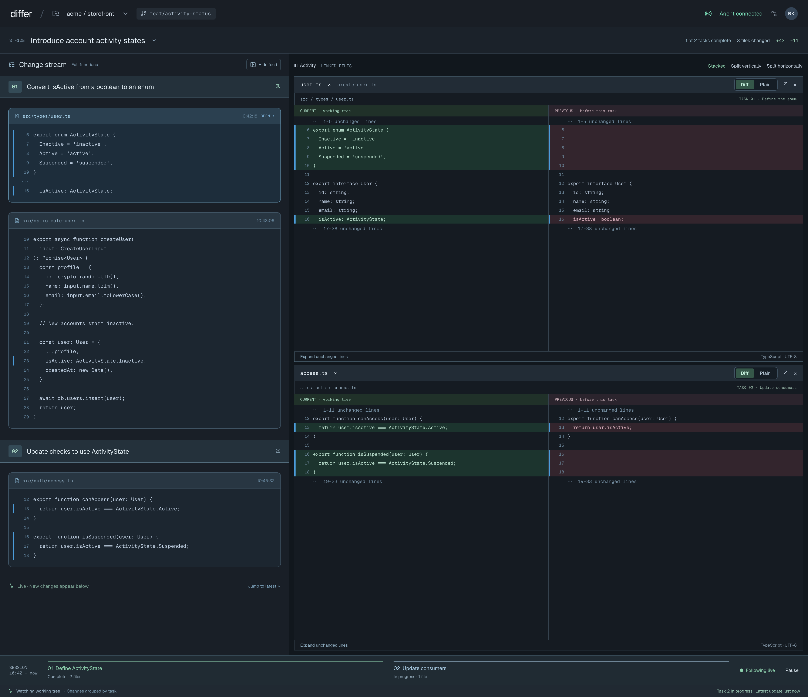
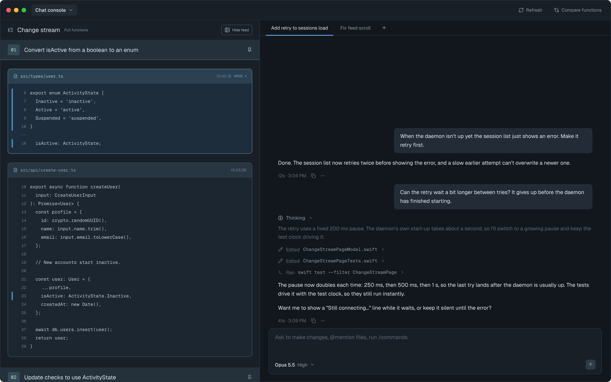
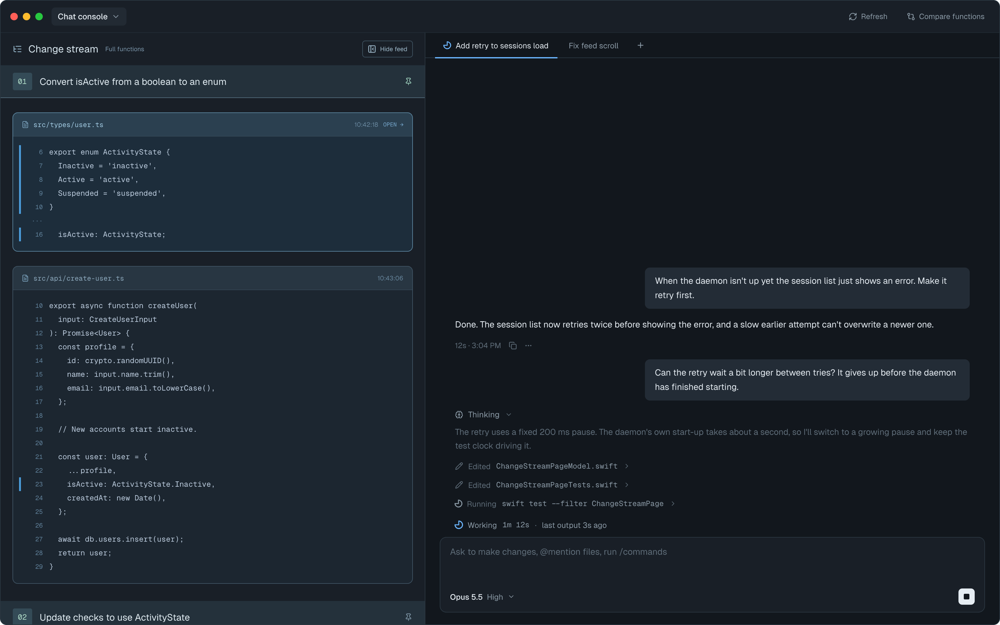
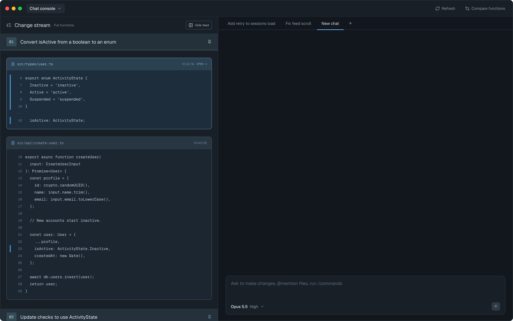
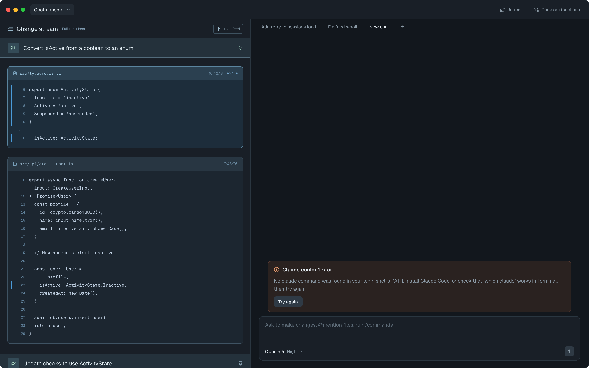
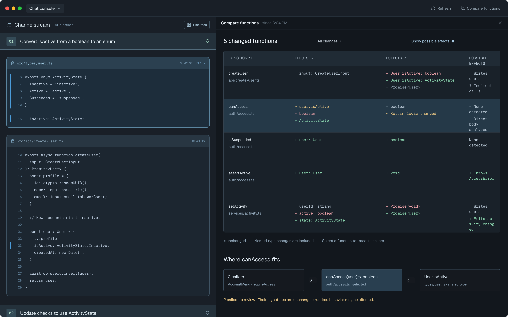
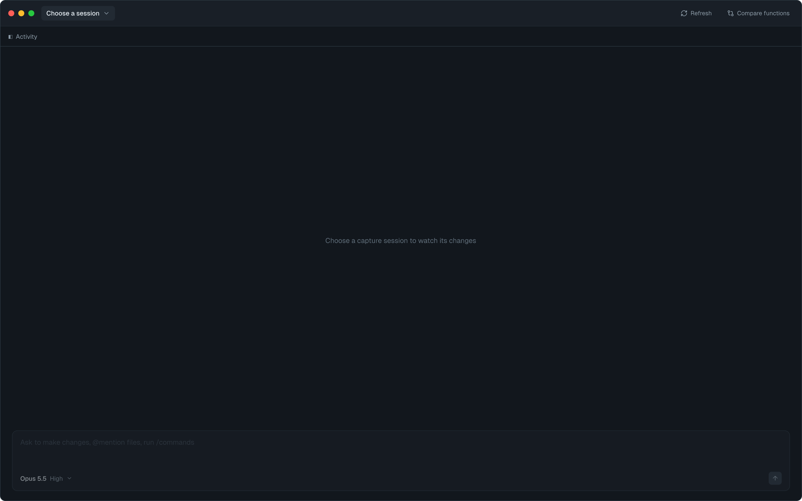
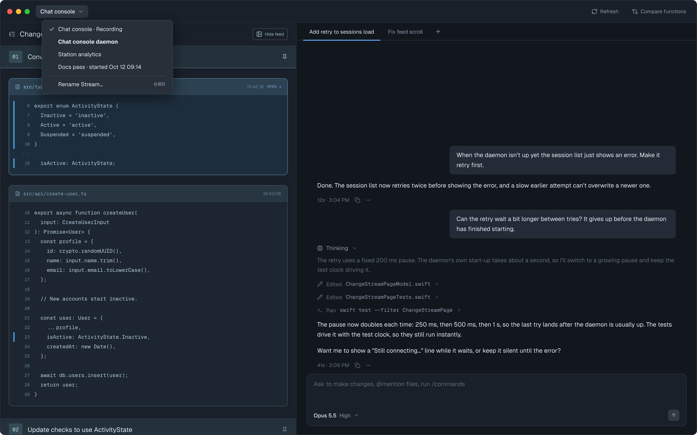
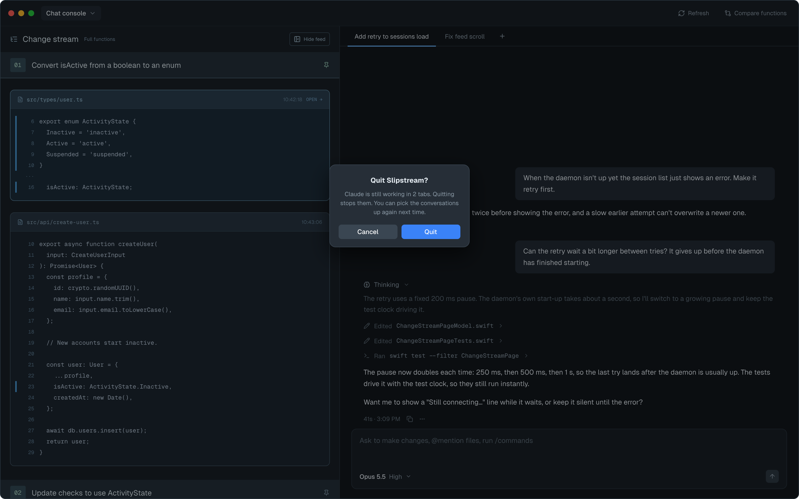

# Chat console — Screens

Pen file: `design/slipstream.pen`, zone 11 ("11 · Chat console — …" frames).

The left-hand change stream column is unchanged by this feature; the mockups reuse an older
feed drawing for it. Today's app is the reference for that column
(). The chat copies
Conductor's middle panel ([reference](exports/existing/conductor-reference.png)) in the app's
dark colours.

## Navigation map
| Screen | Surface | Address | Reached from |
|---|---|---|---|
| Main window | client | `n/a (native)`, the app's only window | App launch |
| Stream picker | client | `n/a (native)`, toolbar menu in the main window | Main window toolbar → picker title |
| Quit alert | client | `n/a (native)`, app-modal alert | ⌘Q / Slipstream → Quit while an agent is mid-turn |

## Main window
- **Status:** Changed
- **Surface:** client
- **Address:** `n/a (native)`, the single `WindowGroup` window
- **Access:** the local user of the app
- **Navigated to from:**
  - App launch
- **Navigates to:**
  - Toolbar picker title → Stream picker
  - Toolbar "Compare functions" → the comparison opens over the chat area; its ✕ returns to
    the chat
  - Tab strip "+" → a new empty tab in the current workspace
  - Clicking a tab → shows that tab's conversation
  - Hovering a tab shows ✕; ✕ or ⌘W closes it. Closing a working tab stops its agent
    without asking (Claude's call); the conversation stays in Claude's own transcript files
  - ⌘Q while an agent is mid-turn → Quit alert
- **Changed from today:** the right-hand file viewer (and its "Open a change to see its file
  here" placeholder) is replaced by the chat: a tab strip, the transcript, and the message
  box. "Compare functions" now covers the chat area instead of the file viewer. The change
  stream column on the left and "Hide feed" are unchanged; with the feed hidden, the chat
  fills the window, and the "◧  Activity" button that brings the feed back (in the file
  viewer's toolbar today) sits at the left end of the chat's tab strip. Current screen: 
- **Chat anatomy** (all states):
  - Tab strip: one tab per conversation in this workspace, then "+". The current tab is
    underlined. A working tab shows a small spinner before its title; a waiting tab's title
    is bold. A new tab is titled "New chat" until Claude names the conversation.
  - Transcript, newest at the bottom: your messages in grey right-aligned bubbles; replies
    as plain text; "Thinking" as a dim block with a collapse chevron; each tool call as a
    muted one-liner ("Edited `File.swift` ›", "Ran `swift test …` ›") that expands; a footer
    after each finished turn with duration · time, copy and "…".
  - Message box: placeholder "Ask to make changes, @mention files, run /commands" (sent as
    plain text; see spec open question); model
    and effort picker bottom-left ("Opus 5.5 High ⌄"); send bottom-right, which becomes a
    Stop square while the agent works. The model/effort picker is a standard menu (Claude's
    models; effort Low / Medium / High / Extra high / Max, the CLI's `--effort` levels). It is disabled while the agent works; a change
    applies from the next message you send (Claude's call).
  - Tool one-liners change tense with their status: "Running `…`" with a spinner, then
    "Ran `…`", or "Ran `…` · failed". A stopped turn's footer reads "Stopped · 41s · 3:09 PM".
  - A workspace always has at least one tab; closing its last tab leaves a fresh "New chat".
    Closing the current tab selects its left neighbour, else its right.

| State | When it shows | Node | Mockup |
|---|---|---|---|
| Conversation | A tab whose agent is idle; also how a resumed tab looks after relaunch (earlier messages loaded from the agent's transcript file) | `ZZ6wC` |  |
| Agent working | A turn is in progress: tab spinner, the running tool line with its own spinner, Stop instead of send, and the live line "Working 1m 12s · last output 3s ago" (both clocks tick every second, no threshold) | `ArCPg` |  |
| New tab | "+" pressed: "New chat" tab, empty transcript | `z6sLAG` |  |
| Waiting tab | Another tab in this workspace finished its turn and you haven't messaged it since: its title is bold | `fj7dp` |  |
| Agent can't start | `claude` isn't on the login shell's PATH, is older than 2.1.293, its transcript file can't be read, or the process exited mid-turn: inline error (with the last lines Claude printed, when there are any) and "Try again", which reconnects and reloads but never resends | `YgbsD` |  |
| Tab hover | Pointer over a tab: subtle highlight and ✕ | `H4reh` |  |
| Compare functions open | "Compare functions" pressed: the comparison covers the chat; ✕ returns to it; agents keep running | `B3gWs` |  |
| No workspace | No stream selected, the stream's folder isn't known yet, or the daemon isn't running: no tabs, one grey line (the feed's own text, e.g. "Choose a capture session to watch its changes", or "Finding this stream's folder…" while a selected stream's folder isn't known yet), message box disabled. Shown with the feed hidden | `c22vG8` |  |

## Stream picker
- **Status:** Changed
- **Surface:** client
- **Address:** `n/a (native)`, the `Menu` on the main window's toolbar
- **Access:** the local user of the app
- **Navigated to from:**
  - Main window → click the picker title in the toolbar
- **Navigates to:**
  - A stream row → switches both the change stream and the chat to that stream's folder
  - "Rename Stream…" (⇧⌘R) → Rename sheet (from the stream-names design, unchanged)
- **Changed from today:** labels follow the stream-names design. New: a stream is bold when
  any chat tab in its folder is waiting, including the stream you're on. It stays bold
  until you message that tab (or close it), across relaunches; selecting the tab doesn't
  clear it. Nothing else marks running agents in the menu.

| State | When it shows | Node | Mockup |
|---|---|---|---|
| Menu open | Picker opened while another workspace has a waiting tab ("Chat console daemon", bold) | `TYme4` |  |

## Quit alert
- **Status:** New
- **Surface:** client
- **Address:** `n/a (native)`, app-modal alert over the main window
- **Access:** the local user of the app
- **Navigated to from:**
  - Main window → ⌘Q, Slipstream → Quit, or closing the window, only while at least one
    agent is mid-turn
    (with every agent idle the app quits straight away)
- **Navigates to:**
  - Quit → stops every agent (waiting for them to exit) and quits
  - Cancel (or Esc) → back to the main window, nothing stopped

| State | When it shows | Node | Mockup |
|---|---|---|---|
| Agents working | "Claude is still working in 2 tabs. Quitting stops them. You can pick the conversations up again next time." | `AL3b9` |  |
