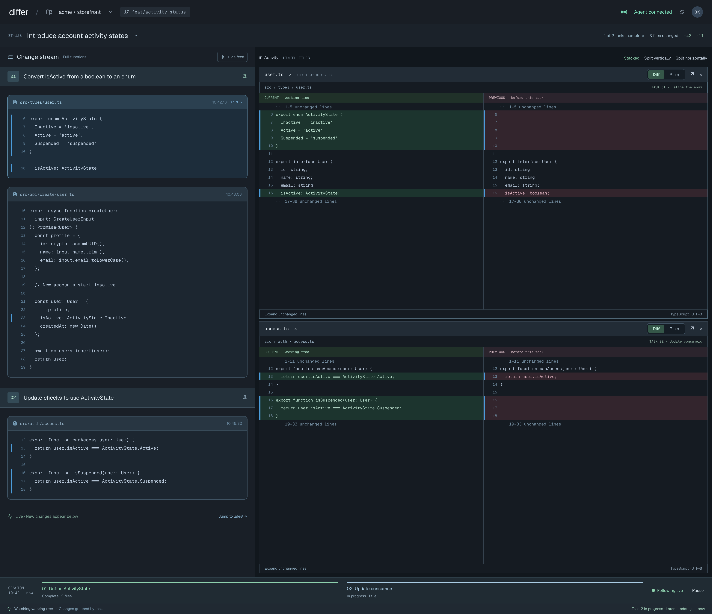

# Chat console

Run the agent chat inside the Slipstream window, next to the change stream, so one workspace
picker switches both. Source brief: [brief.md](./brief.md) (written from the daemon workspace,
2026-10-18). Daemon-side design: `docs/chat-console/DESIGN.md` on daemon PR #76.

## Base commits

| Repo | Branch | SHA |
|---|---|---|
| Client `playola-radio/slipstream-client-swift` | `develop` | `317788b` |
| Daemon `briankeane/slipstream` | `origin/develop` | `312aa42` (chat-console design on PR #76, `ec6e2a1`) |

## Target surfaces

- `client`: the macOS app (`SlipstreamViewer`) and `SlipstreamCore`.
- Daemon: none for v0.1.

## Why

Brian works in two windows that he always switches together: pick a workspace in Conductor,
pick the same one in Slipstream, read the stream, go back to Conductor to give the agent its
next instruction. His eyes are on both all the time (Brian, 2026-10-18). Conductor's local
chats can't be driven from outside, so the client runs the chat agent itself. That amends the
"Slipstream does not launch agents" rule (Brian, 2026-10-18; daemon Change 1).

## Scope (v0.1, agreed 2026-10-18)

- **One window: stream left, chat right.** The change stream column stays where it is; the
  chat takes over the right-hand area that is the file viewer today (Brian, 2026-10-18). The
  file viewer's placeholder goes away. "Compare functions" opens over the chat area and its
  close button returns to the chat (Claude's call); agents keep running underneath. "Hide
  feed" still hides the stream, giving the chat the whole window. One workspace picker in
  the window header drives both. There is no left-hand workspace list (Brian).
- **A workspace is a stream's folder.** Its root comes from the stream's
  `slipstream.session.started.v1` event. Tabs belong to the folder, so two streams of the same
  folder show the same tabs (Claude's call).
- **The chat half copies Conductor's center panel** as closely as possible (Brian; reference
  [conductor-reference.png](./exports/existing/conductor-reference.png), middle panel):
  - a tab strip with a "+" to start a new tab; each tab titled like Conductor's
  - your messages in grey right-aligned bubbles; the agent's replies as plain text
  - thinking as a dim, collapsible section; tool calls as muted one-liners that expand
    (Brian reads replies, sometimes thinking, rarely tool detail)
  - a per-turn footer with duration, time, copy and "…". In v0.1 the "…" is shown but has no
    items (disabled); Fork goes in it later (Brian, 2026-10-18)
  - the message box with placeholder text, the agent/model/effort picker bottom-left, and
    send (or Stop while the agent works) bottom-right
- **Agents.** Claude only for v0.1. The picker is built so Codex slots in next (Brian).
  Each tab has its own picker.
- **Live conversation.** Send messages; the agent's replies, thinking and tool calls appear as
  they arrive; Stop interrupts the current turn.
- **Working vs hung.** While a turn runs, the bottom of the transcript shows an animated
  spinner and "Working 1m 12s · last output 3s ago": a timer counting up each second for the
  turn, and how long since the agent last sent anything. Both always show, in plain grey,
  with no cut-off or warning colour; Brian judges a long quiet stretch himself (Brian,
  2026-10-18). The still-running tool line ("Running `swift test …`") shows what a quiet
  stretch is waiting on.
- **Same behavior as Conductor sessions.** Permissions bypassed, Brian's user/project/local
  settings, skills and plugins loaded. The exact invocation is in "Existing contracts".
- **Agents keep running when you switch workspace.** Switching only changes what you see.
- **Waiting marker.** A tab becomes *waiting* when its agent finishes a turn (or is
  stopped) while that tab isn't on screen. A waiting tab's title is bold; a stream whose
  folder has any waiting tab is bold in the picker, including the stream you're on. It stays
  bold until you send that tab a message, across relaunches; closing the tab also clears it
  (Brian, 2026-10-18). Selecting a waiting tab does not clear it. A turn that finishes while
  its tab is on screen doesn't mark it: you saw it (Claude's call, matching the approved
  mockups, where the current idle tab isn't bold). *On screen* means, at the moment the turn
  ends: Slipstream is the active app, the tab is the current tab of the current workspace,
  and Compare functions isn't covering the chat (Claude's call). A working tab
  shows a small spinner, like Conductor's. Nothing else marks running agents in the picker
  (Claude's call, to keep the menu clean).
- **Resume.** Quitting and reopening the app brings back every open tab; each continues
  the same conversation and shows its earlier messages. Closing a tab is final inside
  Slipstream (no reopen in v0.1); the conversation stays in Claude's files, where
  `claude --resume <id>` can still reach it (Claude's call).
- **Quitting** stops every agent. If any agent is mid-turn, the app warns first (Claude's
  call). Closing the window quits the app, through the same warning (Claude's call).

- **Tabs.** "+" opens "New chat"; Claude's own title for the conversation replaces it once
  one exists. ✕ on hover or ⌘W closes a tab; closing a working tab stops its agent without
  asking (Claude's call). The conversation itself stays in Claude's transcript files. A
  workspace always has at least one tab: one with none (first visit, or its last tab
  closed) gets a fresh "New chat" (Claude's call). Closing the current tab selects the tab
  to its left, else its right.
- **Model and effort.** Per tab; a new tab starts with the choice of the tab you were on (Opus 5.5 · High when there is none). Disabled while the
  agent works; a change applies from your next message (Claude's call).
- **Picker labels** are the stream-names design's labels (merged as design in #27). If that
  feature hasn't shipped when this one is built, today's labels stay.

## Non-goals (v0.1)

- Conductor's extras: question pop-ups (`AskUserQuestion` stays disallowed), diff comments,
  checkpoints, PR buttons, the left-hand workspace list, the right-hand files/terminal panel.
- Importing old Conductor conversations.
- Codex (the next slice).
- Ask-at-a-line answered from a forked conversation. That gets its own design once daemon
  PR #76 (`record_question_exchange`) lands. The existing inline thread UI is unchanged.
- Any daemon change.

## Anti-goals

- The chat must never become a second capture source: it writes no file-change events and
  talks to the daemon only as it does today.
- Don't overlay Conductor, read Conductor's private database, or reuse Conductor's agent
  binaries or flags (`--session-mirror`, `--plugin-dir`, `--chrome`).
- Interface bloat: nothing on screen that Conductor's center panel doesn't already have,
  unless this spec names it.

## Open questions

- Markdown rendering approach (no markdown dependency exists yet). Builder's call, to be
  settled in the plan.
- Whether `/commands` and `@file` mentions typed in the message box are expanded by the CLI
  in this mode. They are sent as plain text either way; the plan's first task probes it, and
  if they don't work the placeholder drops those words.
- Codex invocation and fork support (next slice).

## Existing contracts

### Claude Code CLI (external; observed with 2.1.293 and Conductor's 2.1.300)

One long-running process per tab, `cwd` = the stream's folder, the user's own `claude` resolved
through the login shell:

```
claude --print --output-format stream-json --verbose --input-format stream-json \
  --thinking=adaptive --thinking-display=summarized \
  --effort=<low|medium|high|xhigh|max> --model=<model> --max-turns=1000 \
  --permission-prompt-tool=stdio --permission-mode=bypassPermissions \
  --disallowedTools=AskUserQuestion --setting-sources=user,project,local \
  (--session-id=<new uuid> | --resume=<uuid>)
```

`--print` is explicit because the CLI documents both stream formats as print-mode only
(the probe ran from the SDK entrypoint). Conductor's `--session-mirror`, `--plugin-dir` and
`--chrome` are dropped; Chrome is simply not enabled (no `--no-chrome` either). `--resume` keeps the
same session id (probe: `init` and `result` both report the original id), so a tab needs one
id for its whole life.

**stdin** (one JSON object per line):
- Send a message: `{"type":"user","message":{"role":"user","content":[{"type":"text","text":"…"}]}}`
- Stop: `{"type":"control_request","request_id":"int-1","request":{"subtype":"interrupt"}}`
  → `control_response` success, then a `user` line "[Request interrupted by user for tool
  use]", a `result`, and `session_state_changed` `idle` (verified).
- Control requests that arrive on stdout must be answered so the agent never hangs
  (brief). With `bypassPermissions` none arrived in the probes; if one does, it is answered
  in the SDK's envelope: `can_use_tool` →
  `{"type":"control_response","response":{"subtype":"success","request_id":"<id>","response":{"behavior":"allow","updatedInput":<the request's input>}}}`;
  any other subtype →
  `{"type":"control_response","response":{"subtype":"error","request_id":"<id>","error":"unsupported"}}`.
- Interrupt acknowledgement (verified):
  `{"type":"control_response","response":{"subtype":"success","request_id":"int-1","response":{"still_queued":[]}}}`.

**stdout** (one JSON object per line). What v0.1 reads:

| Line | Used for |
|---|---|
| `system`/`init` (`session_id`, `model`, `cwd`) | Agent started |
| `system`/`session_state_changed` `state: "running" \| "idle"` | Working spinner, Stop, timer, waiting marker |
| `assistant` → `message.content[]` blocks `text`, `thinking`, `tool_use` (`name`, `input`) | Replies, thinking, tool one-liners |
| `user` → `message.content[]` `tool_result` (`tool_use_id`, `content`) | Expanded tool detail |
| `result` (`subtype`, `duration_ms`, `is_error`) | Turn footer; error text if the turn failed |
| any line | Resets "last output" |

Ignored: `hook_*`, `commands_changed`, `thinking_tokens`, `task_*`, `rate_limit_event`.
Text arrives one whole block at a time (no partial deltas without
`--include-partial-messages`, which v0.1 doesn't use).

### Claude transcript file (external; for resumed tabs and tab titles)

`--resume` doesn't replay history, so the client reads Claude's own file:
`~/.claude/projects/<encoded cwd>/<session-id>.jsonl`. The encoding of the folder (observed:
`/private/tmp/ccprobe` → `-private-tmp-ccprobe`) is Claude's, so the client finds the file by
session id (`~/.claude/projects/*/<session-id>.jsonl`) rather than re-deriving it. Lines used:
`user` and `assistant` (same `message` shape as stdout, plus `uuid`, `timestamp` and, on
the user's own prompts, `promptId`) and `ai-title` (`aiTitle`, the conversation's title,
used for the tab). The file has no turn duration or `result` line (verified on the probe
transcript), so history footers are built from timestamps (see "Runtime design"). Everything else (`attachment`,
`queue-operation`, `last-prompt`, `atis-latch`, `cost-state`, `mode`, `system`) is skipped;
`isSidechain: true` lines (subagents) are skipped.

### Client today (base `317788b`)

- `SessionOption` (`SlipstreamViewer/Models/FeedContent.swift:5`): `id`, `label`,
  `agentConnection`, `readinessSeq`. No folder.
- The folder is `SessionStarted.root` (`Sources/SlipstreamCore/Events.swift:23`), fetched per
  stream by `daemon.sessionStart` in `loadSessions`
  (`ChangeStreamPageModel.swift:586-600`), used only to build the label, then dropped.
- The selected stream is `ChangeStreamPageModel.selectedSession`, not persisted.
- Local persistence pattern: `SavedQuestionsClient` (`SlipstreamViewer/Dependencies/`), JSON in
  `UserDefaults` behind an actor and a dependency client; swift-sharing `@Shared` keys
  (`FontSize.swift`).
- No process spawning, login-shell PATH lookup or markdown rendering exists yet. The app is
  not sandboxed.
- Current screen: 

### Daemon

None used beyond today's. v0.1 calls no new daemon verb or endpoint.

## Runtime design

Settled in answer to the adversarial review (all Claude's calls unless marked). These are the
behaviours the plan must implement and test; type names are the plan's to finalise.

### Ownership and lifetime

- **One owner for all chat work: `ChatPageModel`** (`@MainActor @Observable`). The app creates it
  once (like `FontSizeModel`) and hands it to the page; it outlives stream switches. It holds
  every tab's runtime keyed by tab id, independent of which stream is selected.
- **`ChangeStreamPageModel` stays authoritative for stream selection.** When the selected
  stream or its root changes, it tells `ChatPageModel` the current folder (`nil` when there is
  none). `ChatPageModel` only changes what is shown; nothing it runs is cancelled by a switch.
- **One window.** The app's `WindowGroup` becomes a single `Window`, so there is exactly one
  page model and one `ChatPageModel`. A second copy of the app (only possible with `open -n`)
  is not guarded against in v0.1 (accepted, see review #2).
- **Generation (plan §2.8).** Each tab runtime has one generation, bumped on every start,
  shutdown and history load. Every callback — line, exit, error, cleanup, history result —
  checks it before it publishes, so a stopped process or a superseded load can't write into
  a tab.
- **Effects behind clients:** `AgentProcessClient` (launch, write a line, signal, exit),
  `TranscriptClient` (find and read a session's file), the records (`@Shared(.chatTabs)`, file storage),
  `AgentEnvironmentClient` (login-shell environment and `claude` lookup) and the continuous
  clock. Model tests never spawn a process or touch `~/.claude`.

### Launch

- **Environment, once per app run:** run the user's `$SHELL -ilc` printing a marker then
  `env -0`, with a 10 s timeout; parse only after the marker (shell start-up chatter is
  ignored). Find `claude` on that `PATH`. Run it directly (argument array, no shell) with
  that environment and `cwd` = the folder. Check `claude --version` once; older than 2.1.293
  is a can't-start error naming the version found.
- **Config directory:** `CLAUDE_CONFIG_DIR` from that environment, else `~/.claude`. The
  same directory is used to find transcript files.
- **Lazy start:** a tab's process starts when you send its first message after launch (or
  after a model/effort change, or Try again), not when the tab appears. It then stays
  running while idle so the next message is immediate.
- **New vs resume:** look up `<config>/projects/*/<id>.jsonl`. Found → `--resume=<id>`.
  Not found → `--session-id=<id>` (a tab that never sent anything; or a conversation whose
  file was removed, which honestly is gone — accepted, review #9). Found but unreadable → an
  error in the tab, nothing launched; never treated as missing.
- **No startup timeout** (simplicity gate): a launch that hangs shows the ticking working
  line, like any quiet stretch; Stop resolves it.

### Turns

- A turn runs from Send to exactly one ending: **completed** (`result`, not error),
  **failed** (`result` with `is_error`, process exit before `result`), or **stopped** (Stop pressed, then `result`). The ending is
  recorded once; later lines for the same turn (`session_state_changed idle` after
  `result`) change nothing. The footer, waiting marker and title refresh all hang off that
  single ending.
- **Send:** the user bubble is added locally (no `--replay-user-messages`), the line is
  written to stdin, and the waiting flag is cleared once the write succeeds. A failed write
  leaves the text in the message box and the flag as it was.
- **Stop:** writes the interrupt request and waits up to 10 s for the turn's `result`. If
  it doesn't come, the process is shut down (below) and the turn
  ends as stopped; the next message resumes.
- **Process exit mid-turn:** the turn fails with "Claude stopped unexpectedly" plus the last
  stderr lines; the tab shows the can't-start/failed state with **Try again**. Try again
  starts a fresh `--resume` process and reloads history from the file. **Nothing is ever
  resent automatically**. If Claude crashed before saving your last message, retype it (rare; simplicity gate).
- **Model/effort change:** stored at once as the tab's requested choice. If the tab's process
  is running (idle — the picker is disabled while working), it is shut down; the next Send
  starts a new `--resume` process with the new flags.

### Shutdown

- Each process starts in its own process group. **Shutdown:** close stdin, send SIGTERM to
  the group, wait 3 s, then SIGKILL the group and reap. Tools the agent ran in that group
  stop with it; anything that deliberately detached itself is not chased (accepted).
- **Close tab:** the record is deleted at once (the tab disappears); the runtime stays owned
  by `ChatPageModel` until shutdown finishes, and its late callbacks are dropped by generation.
- **Quit:** with no turn running, every process is shut down and the app quits. With turns
  running, the Quit alert shows; **Quit** shuts all down and the app waits for that
  (`terminateLater`) before exiting; **Cancel** touches nothing.
- **App crash:** the agents lose stdin and exit on their own after their current turn; an
  agent can be mid-turn when the app relaunches, and resuming it then would give two writers
  (accepted for v0.1, review #6).

### Transcript (live and history)

- **Framing (`SlipstreamCore`):** stdout bytes split on `\n`, a trailing `\r` dropped, UTF-8
  decoded per complete line. Cap 1 MiB: an over-long line is discarded through its newline
  and becomes a gap. An incomplete final line at exit is dropped.
- **Unknown line types are ignored.** A supported line that doesn't decode becomes a gap: an
  error row "Part of this conversation couldn't be shown" (reported). A control request that
  doesn't decode is a gap too; it goes unanswered and the turn keeps working until Stop.
- **stderr** is drained concurrently into a 4 KB ring, used only for error text.
- **"Last output"** = the time of the last complete stdout line.
- **History** is read when a tab is first shown after launch, and on Try again, and only
  while the tab has no live process — so live lines and history never overlap and nothing is
  shown twice. Turns are split at user lines that carry `promptId` and text (not
  `tool_result`). A history footer's time is the turn's last line timestamp; its duration is
  last minus first timestamp (wall clock). A turn whose user line is "[Request interrupted
  by user…]" ends as stopped; that line itself isn't shown as a bubble (live or history).
- **Titles** are read from the file's last `ai-title` when history loads and again after
  every turn ends.
- **Copy** in a footer copies that turn's reply text. Message-box drafts are kept per tab in
  memory.

### Records

- One array of records in `@Shared(.chatTabs)` (swift-sharing `fileStorage`,
  `<Application Support>/<bundle id>/chatTabs.json`), written only by `ChatPageModel` on the
  main actor, so there are no concurrent writers.
- If the file can't be decoded, the app starts with no tabs and the next write replaces it.
  The conversations are untouched in Claude's files and still reachable with
  `claude --resume <id>` (simplicity gate; reverses review #12, a Claude's call).

### Workspaces

- The chat's workspace is the selected stream's `root`, normalised once on arrival
  (standardised, symlinks resolved). Streams sharing a folder share tabs and the same running
  agents (runtimes are per tab, so never duplicated).
- `root` is carried across stream-list refreshes like `agentConnection` is today, and kept on
  `selectedSession` the same way its label is, so a refresh or a failed start-record fetch
  never hides an open workspace.
- **No workspace** (no stream selected, folder not known yet, or the daemon unavailable):
  the chat area shows no tabs, a disabled message box and one grey line: the feed's text when no stream is selected, or "Finding this stream's
  folder…" while the selected stream's folder isn't known yet, so it stays clear with the feed hidden (new state, see screens.md).
- Tabs whose folder no stream reports are hidden but keep running to the end of their turn;
  they count in the Quit alert and come back when a stream with that folder does.

## Acceptance criteria

Each is a model or `SlipstreamCore` test unless marked.

1. Switching workspace A → B → A leaves A's running turn running and its transcript intact;
   a completion that arrives while B is shown marks A's tab waiting and A bold.
2. A process stopped (close, Try again, model change) can't publish: late lines, exit,
   errors and cleanup from the old generation change nothing.
3. A history load superseded by another (or by a live start) is discarded.
4. Each turn ends once: `result` followed by more lines produces one footer and at most one
   waiting change; exit before `result` produces one failure; Stop with no `result` in 10 s
   shuts down and ends the turn as stopped.
5. Try again never resends.
6. A model/effort change on an idle tab restarts with `--resume` and the new flags on the
   next Send.
7. Waiting: set only when the turn ends off-screen (app inactive, other tab, other
   workspace, or Compare open); not cleared by selecting; cleared by a successful send or
   by closing; survives relaunch; a failed send leaves it set.
8. Two streams with the same folder show the same tabs and one runtime per tab.
9. Records: tabs, choices and waiting flags survive relaunch (`@Shared(.chatTabs)`).
10. Framing: split chunks, CRLF, an over-long line (gap, next line fine), unknown types
    ignored, malformed supported line or control request → gap row.
11. Transcript lookup: found / not found / unreadable choose resume / new / error.
12. Quit with turns running shows the alert (Cancel is checked manually, #15); Quit shuts every
    process down before the app exits. Closing a working tab shuts its process down.
13. No workspace: no selection shows the feed's text; a selected stream with no folder yet
    shows "Finding this stream's folder…".
14. The existing stream selection, comparison and inline-question suites still pass
    (touched-area rule).
15. Manual (disposable daemon, `SLIPSTREAM_STORE`): send, Stop, switch away during a turn,
    relaunch and resume, model change, close a working tab, quit with a turn running.

## Adversarial review (Codex `gpt-6-astra`, 2026-10-18)

Run read-only against base `317788b` with spec.md, models.md and screens.md embedded.
17 findings; none left blocking.

| # | Finding | Severity | Disposition |
|---|---|---|---|
| 1 | Chat has no owner or lifetime | Blocking | **Resolved:** "Ownership and lifetime" (`ChatPageModel`, generations, effect clients) |
| 2 | Multiple windows/instances could double-drive a conversation | Blocking | **Resolved** for windows (single `Window`). **Accepted** for a second app copy: only reachable with `open -n`; guarding needs a lock that v0.1 doesn't justify |
| 3 | CLI control contract incomplete; `--print` missing | Blocking | **Resolved:** explicit `--print`; response envelopes, interrupt ack, unsupported subtypes, broken pipe and timeouts specified |
| 4 | Model/effort can't change in a running process | Blocking | **Resolved:** idle restart with `--resume`; requested vs effective choice separated |
| 5 | Turn completion, crash and retry undefined | Blocking | **Resolved:** "Turns" (one ending per turn, timeouts, Try again never resends) |
| 6 | Quit/close don't say how agents stop | Blocking | **Resolved:** process-group shutdown, runtime kept until reaped, `terminateLater`, window close = quit. **Accepted:** detached tools and post-crash orphans |
| 7 | History can't produce footers from the file | Blocking | **Resolved:** verified the file has no duration/`result`; footers from timestamps, turns split on `promptId` |
| 8 | Live/history/title reconciliation | Should-fix | **Resolved:** history only loads with no live process; local user bubble; title re-read after each turn |
| 9 | File existence isn't a resume decision | Should-fix | **Resolved** for unreadable (error, never "missing"). **Accepted:** a missing file starts fresh under the same id — no "established" flag stored; a removed conversation is genuinely gone |
| 10 | `root` vs duplicated selection state | Should-fix | **Resolved:** carried like `agentConnection`, mirrored to `selectedSession`, normalised paths. **Accepted:** loading and failed both read "folder not known yet"; every refresh retries |
| 11 | Waiting rule conflicts; "on screen" undefined | Should-fix | **Resolved:** one rule (screens.md's "isn't the tab you're looking at" removed), on-screen defined, clear on successful send |
| 12 | Bad data wipes all tabs | Should-fix | **Resolved:** per-record decode, raw backup, per-record mutations. No format version (nothing to migrate from; simplicity) |
| 13 | Reopen promise; disappeared streams; empty states | Should-fix | **Resolved:** no reopen in v0.1 (spec narrowed); hidden tabs keep running and count at quit; new "No workspace" state; selection after close; a workspace always has a tab |
| 14 | Parser tolerance hides gaps or hangs | Should-fix | **Resolved:** "Transcript" framing rules, gap row, control failure fails the turn, stderr ring, "last output" defined |
| 15 | Launch environment and compatibility | Should-fix | **Resolved:** marker-delimited login-shell env with timeout, direct exec, config dir, version floor, Chrome not enabled |
| 16 | Tool state and composer promises | Should-fix | **Resolved:** tool status running/done/failed/stopped, `tool_result` content rule, Copy and drafts defined. `/commands` and `@mentions`: plain text passthrough, probed in the plan's first task (open question) |
| 17 | Keep Codex/fork at the boundary | Minor | **Accepted:** Claude decoding stays in one adapter; records gain a provider only when Codex arrives (missing = `claude`) |

## Simplicity gate (Codex `gpt-6-astra` + Claude Opus, 2026-10-18)

Both read-only, grounded in the code at `317788b`, asked whether the whole feature and each
piece could be smaller. Neither found a simpler whole approach. Each rejected one: Codex
reusing the daemon question path, the event follower or the existing line buffers; Opus one
process per message, which would lose hooks, MCP warm-up and the interrupt marker. One wave
of cuts was applied; none reverses one of Brian's decisions.

| # | Cut | Raised by | Disposition |
|---|---|---|---|
| 1 | Drop `session_state_changed` as a turn signal; a turn's single ending consumes one active-turn value | both | **Adopted** |
| 2 | Drop the ineffective quit-Cancel model test | both | **Adopted**; Cancel stays in manual QA #15 |
| 3 | Fold the folder/records PR into the chat-model PR (5 → 4 PRs) | Opus | **Adopted** |
| 4 | Merge chat model and chat screen PRs | Codex | **Rejected**: one PR of Tasks 7–14 is too large to review well; the wiring tests in Task 13 cover the boundary |
| 5 | Drop the interrupt acknowledgement wait; Stop waits only for `result` (10 s) | Opus | **Adopted** |
| 6 | Drop the 30 s startup timeout and the `init` line | Opus | **Adopted** (Claude's call): matches the no-threshold working line; can't-start keeps its other triggers |
| 7 | Replace `ChatTabsClient` actor, per-record decode, raw backup and duplicate handling with `@Shared(.fileStorage)` owned by the main-actor model | Opus | **Adopted**; reverses review #12 (Claude's call). A corrupt file loses the tab list only |
| 8 | Drop the `claude --version` check | Opus | **Rejected**: an old CLI may accept the flags and still differ in its stream format, so the floor guards more than flag errors. Codex's narrower cut (don't return the version) **adopted** |
| 9 | Drop "a missing message returns to the box" after Try again | Opus | **Adopted**: only a crash between write and save loses it |
| 10 | Failure text in one place (`errorText`); `TurnEnding.failed` has no payload; `TranscriptItem.error` becomes `gap` | Opus | **Adopted** |
| 11 | One generation per tab instead of process + history | Opus | **Adopted** |
| 12 | Fold `controlGap` into `gap` (unanswerable request → Stop) | Opus | **Adopted** |
| 13 | Drop the "truncated at end" report | Opus | **Adopted** |
| 14 | Drop `twoStreamsSameFolderShareTabs` and two of acceptance #13's three cases | Opus | **Adopted** |
| 15 | Bug: with a stream selected but its folder unknown, `emptyStateText` gives nil or "Waiting for changes…" | Opus | **Resolved**: `chatEmptyText` with "Finding this stream's folder…" (Claude's call) |
| 16 | Footer stores no copy of the reply text; Copy collects the turn's reply rows | Codex | **Adopted** |
| 17 | `ChatTabModel.id` computed from `record.id`; display flags and lists computed, never stored | Codex | **Adopted** |
| 18 | `ClaudeInvocation.reply` takes the request fields and returns non-optional `Data` | Codex | **Adopted** |

## Design deliverables
- Screens: [screens.md](./screens.md)
- Endpoints: none — v0.1 calls no new or changed daemon endpoint; the Claude CLI and transcript
  formats it depends on are external contracts, recorded in "Existing contracts"
- Models: [models.md](./models.md)

## Approvals

| Date | What | Revision |
|---|---|---|
| 2026-10-18 | Scope playback ("All looks good!") and the waiting-marker rule | spec.md scope above |
| 2026-10-18 | Layout: stream left, chat takes over the file viewer area | spec.md scope above |
| 2026-10-18 | All state frames: agent working, new tab, waiting tab, picker open, can't start, quit warning, compare functions open ("it's all perfect"); Resumed dropped as a duplicate of Conversation | zone 11 |
| 2026-10-18 | Working line: live turn timer plus "last output Ns ago", always shown, no threshold ("great") | frame `ArCPg` |
| 2026-10-18 | Main window, conversation state (frame `ZZ6wC`), and its state list: conversation, agent working, new tab, resumed, waiting tab, picker open, can't start, quit warning, compare functions open ("perrrfect") | `design/slipstream.pen` zone 11 |
| 2026-10-18 | No workspace state (added after the adversarial review, review #13) and Tab hover ("looks good") | frames `c22vG8`, `H4reh` |
| 2026-10-18 | models.md, endpoints "none", the gap calls (waiting rule seen-on-screen, tab close, model/effort, picker labels); keep "…" for a later Fork | models.md, spec.md |
