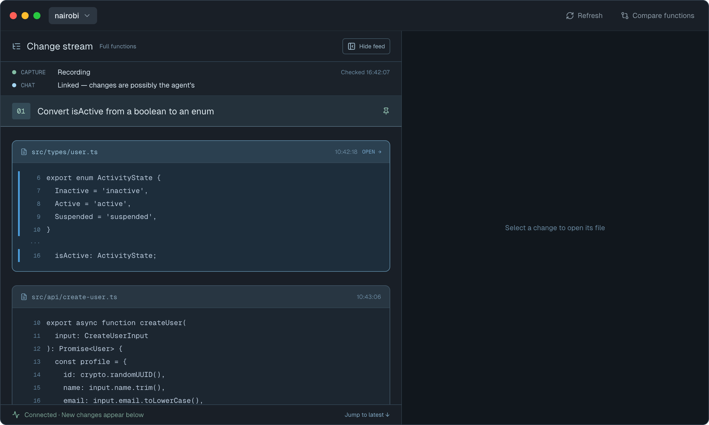
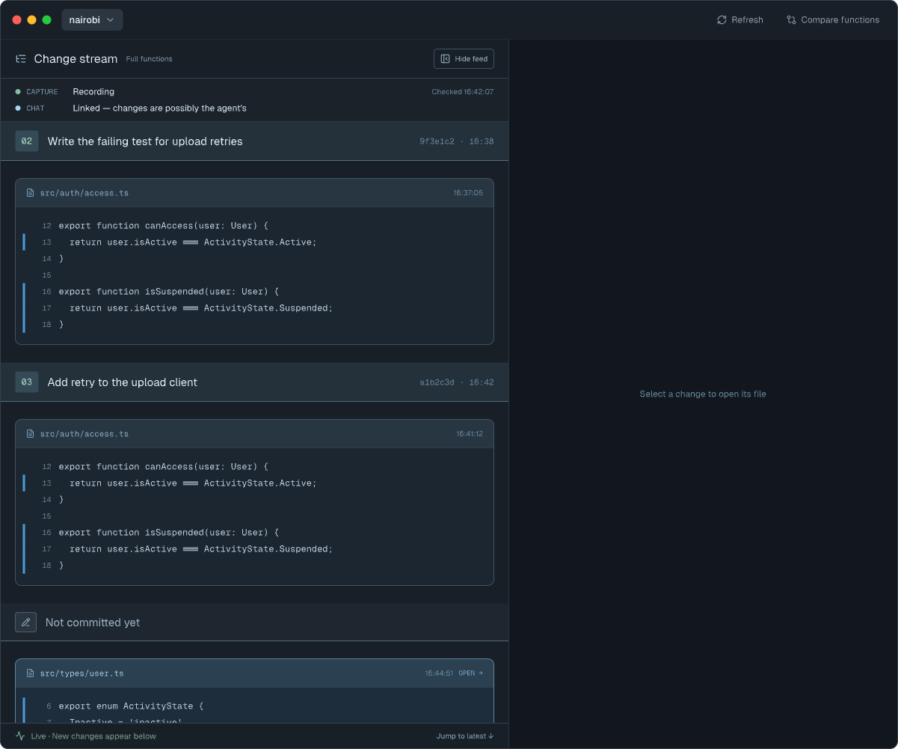
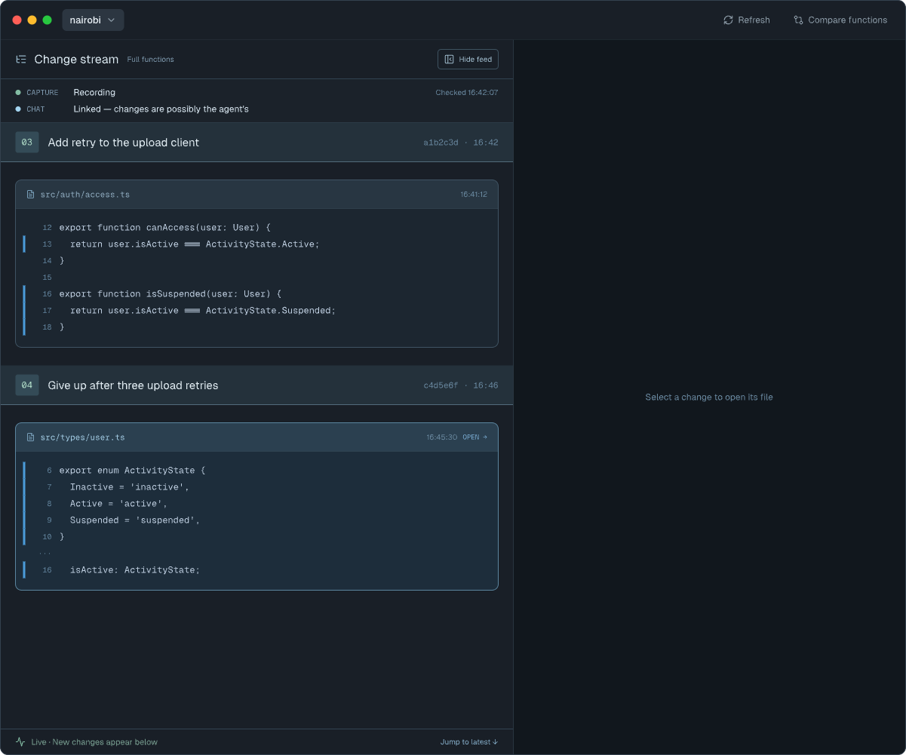
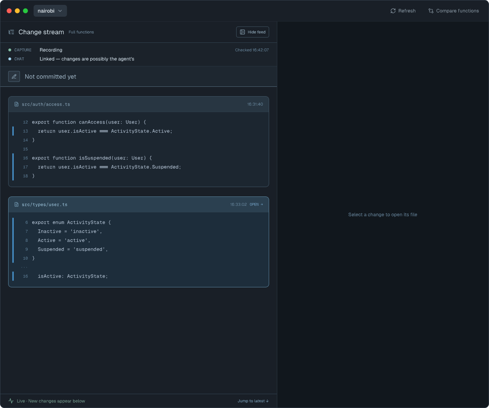
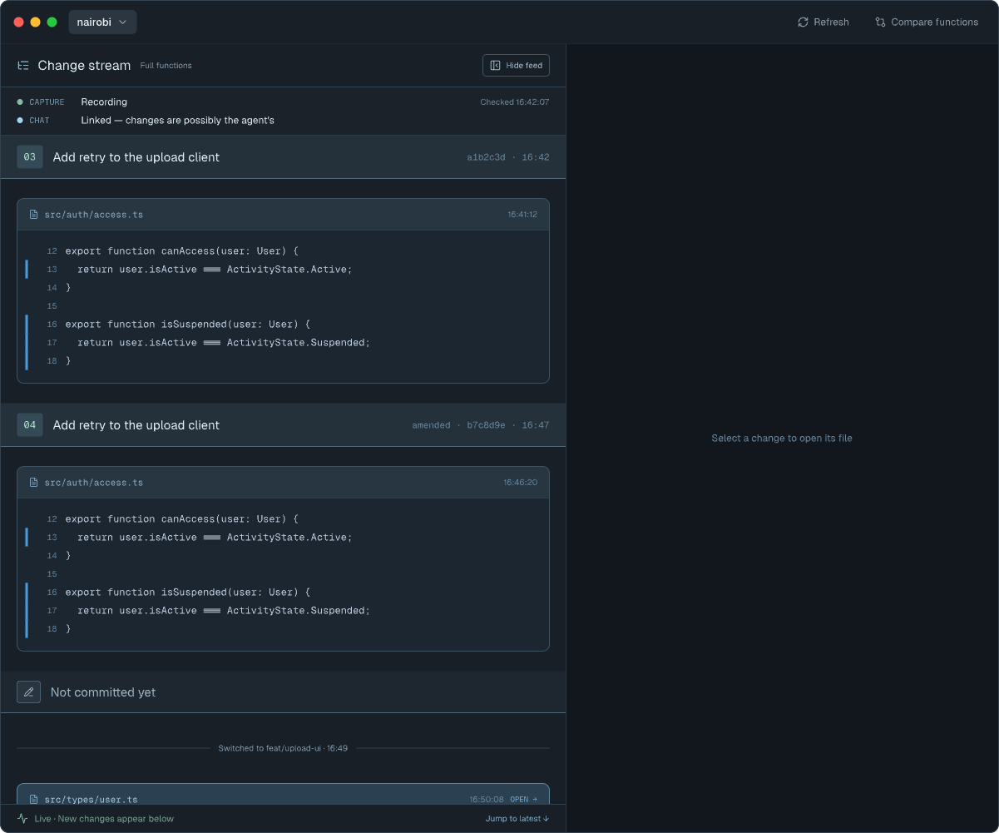
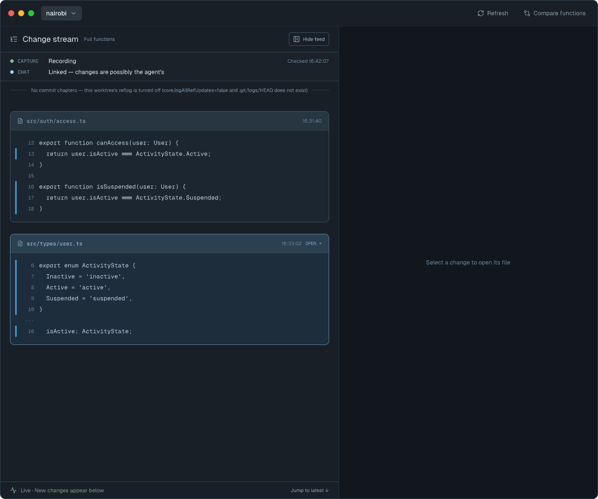

# Commit chapters — Screens

Pen file: `design/slipstream.pen`, zone "Zone · Commit chapters" (`dcPGn`). Components: chapter
heading `gPla3`, open chapter heading `VSPW0`, stream marker `HG5yk`.

## Navigation map
| Screen | Surface | Address | Reached from |
|---|---|---|---|
| Change stream | client | n/a (native) — the feed column of the main window | Selecting a workspace in the sidebar (unchanged) |

## Change stream
- **Status:** Changed
- **Surface:** client
- **Address:** n/a (native) — the "Change stream" column on the right of the main window
- **Access:** anyone using the app
- **Navigated to from:**
  - Sidebar → click a workspace row (unchanged)
  - "Hide feed" toggled back on (unchanged)
- **Navigates to:**
  - Click a change card → the file opens in the left pane (unchanged)
  - "Jump to latest ↓" → scrolls to the newest change (unchanged)
- **Changed from today:**
  - The feed is split into **chapters, one per git commit**. A chapter heading shows the
    chapter number (`01`, `02`, … per session), the commit subject, and a detail line
    `<short sha> · <HH:mm>`. An amend opens a new chapter whose detail reads
    `amended · <short sha> · <HH:mm>`.
  - Changes that haven't been committed yet sit under an **open chapter** at the bottom: a pencil
    icon badge and the title "Not committed yet". The open chapter's heading shows only while it
    holds something (a change card or a divider line), so right after a commit the newest commit
    chapter is last. It never shows when the recorder hasn't said chapters are running (an older
    daemon, or chapters unavailable).
  - A chapter whose commit captured no changes still shows its heading, with nothing under it.
  - Headings pin to the top while you scroll through their chapter, as task headings do today.
  - Branch moves that aren't commits (checkout, reset, fast-forward pull or merge, finished or
    abandoned rebase, unrecognised HEAD moves) are **thin divider lines**, not chapters.
  - When the worktree's git history log can't be read, one divider line says chapters are
    unavailable and why; changes keep streaming.
  - When chapters were running, the "Capture restarting" divider adds that commits made while
    the recorder was stopped don't get chapters.
  - **Every stream divider is drawn as a thin line with centred text** (`HG5yk`), including
    today's "Capture restarting", gap and "Unsupported event" markers, which are plain text
    today. Long divider text wraps; it is never cut off.
  - **Task headings are gone.** `slipstream_begin_task` still records a task, but the stream no
    longer draws a heading for it.

  

| State | When it shows | Node | Mockup |
|---|---|---|---|
| Chapters | Commits exist and there are uncommitted changes since the last one | `A3nxO` |  |
| Just committed | A commit just arrived and nothing has changed since; the open chapter heading is hidden | `EiNBf` |  |
| No commits yet | No commit has been seen this session; every change is in the open chapter | `NhNk1` |  |
| Branch moves | An amend chapter, then a branch switch divider, then the open chapter | `ybVL3` |  |
| Chapters unavailable | The daemon reported it can't read the worktree's git history log | `epuHV` |  |

### Copy

| Where | Text |
|---|---|
| Commit chapter title | the commit subject; `Commit <short sha>` when the subject is empty or unreadable |
| Commit chapter detail | `<short sha> · <HH:mm>` |
| Amend chapter detail | `amended · <short sha> · <HH:mm>` |
| Open chapter title | `Not committed yet` |
| Checkout divider | `Switched to <target> · <HH:mm>`, where `<target>` is what Git wrote (a branch name or a commit); without a target: `Switched to <short sha> · <HH:mm>` |
| Reset divider | `Reset to <short sha> · <HH:mm>` |
| Fast-forward divider | `Fast-forwarded to <short sha> · <HH:mm>` |
| Rebase finished divider | `Rebase finished · now at <short sha> · <HH:mm>` |
| Rebase abandoned divider | `Rebase abandoned · back at <short sha> · <HH:mm>` |
| Other HEAD move divider | `HEAD moved to <short sha> · <HH:mm>` |
| Chapters unavailable divider | `No commit chapters — <detail>`, e.g. `No commit chapters — this worktree's reflog is turned off (core.logAllRefUpdates=false and .git/logs/HEAD does not exist)`. The daemon writes `detail` as a full sentence (wording per cause in [models.md](./models.md)) |
| Empty or absent detail | `No commit chapters` |
| Restart divider, chapters were running | `Capture restarting — commits made while it was stopped don't get chapters` |
| Restart divider, otherwise | `Capture restarting` (unchanged) |

`<short sha>` is the first 7 characters. `<HH:mm>` is the `head_observed` event's `observed_at_ms` in the
viewer's time zone (the app's injected time zone, as card times use), formatted `HH:mm` — cards
keep `HH:mm:ss`.
