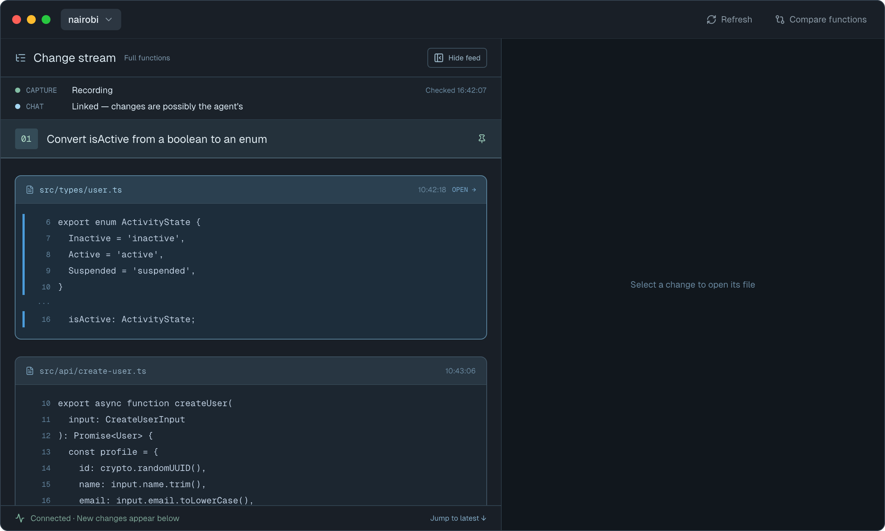

# Commit chapters

Split the change stream into chapters, one per git commit, so the feed reads like a story:
each chapter is titled with the commit's subject and holds the changes made before that commit;
the open bottom chapter, "Not committed yet", holds changes since the last one.

## Base commits

| Repo | Branch | SHA |
|---|---|---|
| Client `playola-radio/slipstream-client-swift` | `develop` | `84d31da` |
| Daemon `playola-radio/slipstream` (owns the wire contract) | `origin/develop` | `56e171a` |

## Target surfaces

- Daemon: capture session (`src/session.ts`), a new reflog reader,
  `src/public-events.ts`, `schemas/`, docs.
- `client`: `SlipstreamCore` event decoding and the Change stream page (`SlipstreamViewer`).

## The problem

From Brian, 2026-11-11: "Why is the stream on the right side not divided into sections based on
what the llm is doing?" Sections today come only from `slipstream.task.started.v1`, which needs
the agent to call `slipstream_begin_task`, and agents rarely do. Brian rejected per-prompt
headings and to-do-list headings: "I want it to look like a story. Maybe one per git commit?"

## Brainstorming waiver

Brian skipped the design-feature brainstorming questions ("yeah skip this. I know what I want.").
Scope below comes from the chat that preceded the skill, not from a structured interview. Phase 3
was a single layout direction for the same reason.

## Existing contracts

Only what this feature touches. Current screen:

**Client** (`e2ea25c`):

| Type | Fields | Notes |
|---|---|---|
| `FeedSection` (`Models/FeedContent.swift`) | `id: Seq`, `heading: TaskHeading?`, `items: IdentifiedArrayOf<FeedItem>` | Created lazily by `append`; `.zero` first |
| `TaskHeading` | `number: String`, `title: String` | Number is a per-fold `%02d` counter |
| `TaskStarted` (`SlipstreamCore/Events.swift`) | `title: String` | Decoded from `task.started` `{task_id, title}` |

`ChangeStreamPageModel.apply`: `.taskStarted` appends a headed section; `.sessionResumed` appends
an unheaded section plus a "Capture restarting" marker; `.unsupported(type)` appends an
"Unsupported event: <type>" marker. Card times are `HH:mm:ss` in the injected time zone. One
global heading height drives the sticky file-header offset; `cardFrames` stores whole
`FeedSection` copies.

**Daemon** (`56e171a`): events are CloudEvents in `events.jsonl`, ordered only by `seq`, each
with a self-contained schema in `schemas/` (`slipstream.task.started.v1.json`,
`slipstream.capture.scope.v1.json`, …). File observations pass through a shared buffer and
`classifyLoop` in `src/session.ts` `onObservation`, then the engine (`src/engine.ts`) processes
paths concurrently, so `file.changed` can already be out of `observed_at_ms` order. The `.git`
directory is excluded from the file watch. No route changes are involved; events are read from
`GET /v1/sessions/:sessionId/events`.

## Scope

1. **One chapter per commit.** A commit closes the open chapter: it gets a number (`01`, `02`, …
   per session), the commit subject as title, and `<short sha> · <HH:mm>`.
2. **Open chapter.** Changes after the last commit sit under "Not committed yet". Its heading
   shows only while it holds something.
3. **Chapters are observation windows, not commit contents.** A chapter holds the changes the
   daemon observed between two commit notifications. It does not claim those changes are in the
   commit, and "Not committed yet" does not claim they are absent from Git. Changes are never
   reordered, moved between chapters or duplicated.
4. **Amend** opens a new chapter marked `amended`.
5. **Other HEAD moves** (checkout/switch, reset, fast-forward merge or pull, rebase finished or
   abandoned, anything unrecognised) are divider lines.
6. **Chapters unavailable** (reflog turned off, unsupported ref format, unreadable, or its watch
   failed) is one divider line with the full explanation; changes keep streaming.
7. **Restart disclosure.** When chapters were running, the "Capture restarting" divider says
   commits made while stopped don't get chapters.
8. **Task headings are removed** from the stream.

## Non-goals

- Rebuilding chapters for commits made while the daemon wasn't running (no durable reflog
  cursor).
- Chapters from history before the capture started.
- Showing which files a commit contains, or diffing a commit.
- Placing boundaries by Git's commit timestamp, or sorting file changes by time.
- Knowing whether a checkout left HEAD on a branch or detached.
- The `reftable` ref format (detected and disclosed, not supported).
- Stash, tags, or other refs' reflogs.
- Filesystem-policy (non-git) captures: no chapters and no divider.
- Removing `slipstream_begin_task` or `slipstream.task.started.v1` from the daemon.
- Enabling Git's reflog for the user.

## Decisions

**D1 — Detect commits from the worktree's HEAD reflog.** At each activation the daemon resolves
`git rev-parse --path-format=absolute --git-path logs/HEAD` (correct for linked worktrees, whose
log lives under the common dir) and `git rev-parse --absolute-git-dir`, and checks the ref format
and reflog setting (reasons in [models.md](./models.md)). It watches the per-worktree git dir —
which always exists, unlike `logs/` in a repository with no commits — with a second
`Platform.watch` subscription and ignores every notification except `logPath`. The existing
`.git` exclusion on the file watch stays. Each notification is a wakeup, never "one commit". Git
runs only at activation (the probe), never per file observation or per commit: the commit
subject comes from the reflog message ([models.md](./models.md)).

**D2 — Boundaries are placed by the daemon, in `seq` order (reverses the first agreement).**
Brian first agreed the app would place each boundary by comparing timestamps. Codex showed this
can't work: the daemon already emits `file.changed` out of timestamp order (observations wait for
`git check-ignore` classification in `classifyLoop`, and the engine processes paths
concurrently), so a time cut would split neighbouring cards or reorder them. Brian approved the
replacement 2026-11-11. The mechanism:

- **Barriers ride the existing queue.** The capture session's `buffer` and its one serial
  worker, `classifyLoop` (`src/session.ts`), already hold git-policy observations in callback
  order. A barrier becomes a second kind of entry in that same buffer; no new queue or scheduler
  is built.
- **Barrier creation is synchronous** in the metadata watch callback: `observed_at_ms =
  Date.now()` and `extent = statSync(logPath).size` (the bytes this notification covers). A
  failed `statSync` queues a barrier that reads to end of file. A duplicate notification queues a
  barrier whose read is empty (`extent` ≤ the reader's offset), so it adds no events.
- **The worker** takes the observations at the head of the buffer up to the next barrier (not
  `splice(0)`), classifies and forwards them to the engine exactly as today, and repeats. At a
  barrier it: awaits `engine.drain()` (nothing after the barrier has been forwarded, so no
  coalescing crosses it); reads the reflog to `extent`; classifies records (subject included);
  appends the `head_observed` events in reflog order; then moves on. Callbacks that fire
  meanwhile only enqueue. A barrier waits only for entries ahead of it, so continuous activity
  can't starve it.
- **Records written after the callback** are read by the barrier their own notification creates;
  a record whose notification is lost is read by the next barrier (late, still in order).
- **Recovery and stop reuse the loop's existing fencing.** The loop runs only while capture is
  live and re-checks `live` after every await. A barrier that finds capture not live goes back to
  the head of the buffer, carrying any moves it already read, and is finished once storage
  recovery makes capture live again; the existing storage gap event discloses the outage. No
  generation counter, re-baseline or re-announce is added: each activation already builds a new
  reader, and the client resets chapter state only on resume. Stop closes the metadata
  subscription next to the file subscription, before it waits for the classifier loop, so every
  accepted barrier is appended before the stop record and none after.
- **Engine failures** stay as today: a processing error is surfaced by the engine/log, and the
  boundary is still appended after the drain.

**What it guarantees:** a `file.changed` produced from an observation admitted before a barrier
has lower `seq` than that barrier's `head_observed` events; one admitted after has higher `seq`.
It does **not** guarantee Git's order: the file watch and the metadata watch are separate
subscriptions, a pre-barrier read can capture bytes written just after the commit, and not every
write produces a card. `observed_at_ms` is display only.

**D3 — One event type for HEAD moves, classified by the daemon.**
`slipstream.git.head_observed.v1` carries a `kind`; the daemon maps reflog actions (table in
[models.md](./models.md)), skipping intermediate rebase steps and no-op resets. Checkout carries
the reflog's `target` text as written, without claiming branch attachment. Raw messages and the
previous SHA are not on the wire.

**D4 — Amend is a new chapter.** Renaming the previous chapter would erase when its changes
happened. The new chapter's detail starts `amended ·`. (Brian's carried-in lean was "amend renames
last chapter"; Codex recommended a new chapter; Brian approved 2026-11-11.)

**D5 — Availability is stated once per activation.** `slipstream.git.chapters.v1` says `active` or
`unavailable` (with a full explanatory sentence) when setup finishes, and `unavailable` again if
detection stops mid-activation. Old daemons never send it, which is how the app knows not to
promise chapters.

**D6 — No offline reconstruction.** Resume re-baselines the reader; commits made while capture
was stopped make no chapters. Storage recovery is not a stop: barriers queued during it are read
afterwards (D2).

**D7 — Client fold.** In `ChangeStreamPageModel`:

- **Chapters on/off** is one flag, `chaptersActive`, false at the start of a fold.
  `git.chapters active` sets it; `unavailable` clears it and appends a divider. `sessionResumed`
  → its marker gets the "commits made while it was stopped don't get chapters" suffix iff the
  flag was set, then clears it until the next `git.chapters`. Switching session resets the fold
  as today.
- **Sections stay lazy**: `sections` is empty until the first item or commit, so the existing
  "Waiting for changes" state is unchanged. The first section has id `.zero` and is `.open`.
- **Commit/amend** turns the last section (creating it if none) into `.commit(number:title:
  detail:)` **keeping its id**, then appends a new `.open` section whose id is the event's `seq`.
  Its number is `sections.count` at the moment it closes (only commits create sections after the
  first), so no counter is kept. Repeated commits with nothing between produce consecutive empty
  commit chapters. No item ever moves.
- **Dividers** (other `head_observed` kinds, `git.chapters unavailable`, restart, gaps) append to
  the current section. `.sessionResumed` no longer starts a section.
- **Open heading visible** iff `chaptersActive` and its section has at least one item
  (file card or divider). One model predicate; the view only binds it. Commit headings are always
  visible.
- **Geometry:** both heading kinds have the same fixed height (one-line title, truncated; detail
  on the same row), so the existing single `taskHeadingHeight` stays valid. Sticky offsets are
  computed from current visibility. `cardFrames` stores the section id, not a copy of the
  section. A commit keeps the pinned section's id and its heading stays visible, so pins need no
  new cleanup; a stale pin on a hidden open heading draws nothing and `headingMoved` clears it
  when the heading reappears.
- **Times** are `HH:mm` in the viewer's time zone (the existing injected time zone), not the
  cards' `HH:mm:ss`.
- Card ids, selection, Ask `change_seq` references, content caches and generation checks are
  untouched.

**D8 — Empty chapters stay.** A commit chapter with no captured changes still shows its heading.
Only the open chapter hides while empty.

**D9 — Task events stop drawing.** `slipstream.task.started.v1` becomes a rowless type in the
client; `TaskHeading` and `TaskStarted` are deleted. The daemon keeps emitting it.

## Acceptance criteria

Daemon (fixtures recorded from real Git runs; schema tests include negative cases):
1. A commit in a watched main checkout and in a linked worktree appends one `head_observed`
   `commit` with the full SHA and the subject taken from the reflog (non-ASCII intact).
2. Barrier ordering, with a fake watcher and controllable classifier/engine/reader: for callbacks
   `obs A → barrier 1 → obs B → barrier 2 → obs C`, the log is `A…, head(1), B…, head(2), C…`,
   including when B and C arrive while classification, drain and the reflog read are each held,
   and a barrier during baseline waits behind the held observations. Tests never assert that
   every write yields a card.
3. Duplicate notifications produce no extra events; one notification covering two commits
   produces two events in reflog order.
4. Classification fixtures: `commit`, `commit (initial)`, `commit (merge)`, cherry-pick, revert,
   `--amend`, `checkout`/`switch` (branch and `--detach`), `reset --hard <other>` (and a no-op
   reset → nothing), `merge --ff`, `pull` fast-forward, non-ff merge, `rebase` and `rebase -i`
   (including `--rebase-merges` and a conflict-continue) → exactly one `rebase`, abort → one
   `rebase_abort`, an unknown action → `other`. Non-ff merge subject is `Merge <branch>`.
   `parseReflogRecord` accepts a 64-hex (SHA-256) record.
5. Activation on a repository with history emits `git.chapters active` and no `head_observed`;
   neither does resume for commits made while stopped.
6. A repository with no commits and no `logs/` directory → `active`, and the first commit is
   detected.
7. Missing log + `core.logAllRefUpdates=false` → `unavailable` with the reflog-off sentence;
   existing log + `false` → `active` and commits detected; `reftable` → the unsupported-format
   sentence; a watch that fails to start → the watch-failed sentence with the error text. File
   capture continues in each case.
8. Reader: a record split mid-UTF-8 across reads decodes intact; a malformed complete record is
   skipped; a rewrite that keeps the last seen record continues; one that drops it →
   `unavailable` with the rewritten sentence.
9. A barrier whose read finishes while storage recovery has capture not live is appended once,
   after the log reopens; stop with a barrier in flight appends it before the stop record and
   nothing after.
10. Schemas accept the examples in [models.md](./models.md) and an unknown `kind`/`state`;
    reject a short SHA, a numeric `subject` and a missing `kind`. Recovery accepts logs
    containing both types.

Client (model tests, `ChangeStreamPageModel`):
11. Changes → commit → changes: two sections; the first is `.commit` with id `.zero`, number `01`,
    the subject and `<short sha> · <HH:mm>`; the second is `.open` with the commit's `seq` as id;
    no card changed section.
12. A commit as the first event creates a commit section and leaves no "Waiting for changes";
    two commits in a row give two empty commit chapters.
13. Amend → new chapter whose detail starts `amended ·`; a missing subject → `Commit <short sha>`.
14. Each divider kind produces its copy from [screens.md](./screens.md) in the current section;
    an unknown kind uses the `other` copy.
15. Open heading: hidden while empty, before any `git.chapters`, and after `unavailable`; shown for
    a marker-only open section once `active`.
16. Resume after `active` appends the suffixed restart text; resume with chapters off
    appends plain "Capture restarting"; neither starts a section; a later `active` re-shows the
    open heading.
17. `task.started` produces no heading and no row.
18. Pinning: a chapter heading pins only while at the top (existing test, renamed); the file
    header offset matches for open and commit headings, and is 0 under a hidden heading.

## Open questions

None.

## Adversarial review (Phase 5)

Codex (gpt-6-astra, read-only, grounded in client `e2ea25c` and daemon `56e171a`), 2026-11-11.
Dispositions:

| # | Finding | Severity | Disposition |
|---|---|---|---|
| 1 | "Edits before/after `git commit`" can't be guaranteed; reads can span the boundary | Blocking | **Resolved.** D2 "What it guarantees" and AC 2 state observation-admission order only |
| 2 | A hold flag plus `drain()` can't order batches | Blocking | **Resolved.** D2 ordered admission queue with one worker |
| 3 | Reflog reads aren't tied to barriers | Blocking | **Resolved.** Synchronous `statSync` extent per barrier; duplicate callbacks skipped; AC 3 |
| 4 | No protocol for storage recovery and teardown | Blocking | **Resolved.** Generation fence, recovery re-baselines and re-announces, stop semantics, subprocess kill; AC 9 |
| 5 | `logs/` may not exist in a repository with no commits | Blocking | **Resolved.** Watch the per-worktree git dir and filter (D1); AC 6 |
| 6 | `core.logAllRefUpdates=false` doesn't stop an existing log | Should-fix | **Resolved.** `reflog-disabled` only when the log is missing too; AC 7 |
| 7 | `reftable` repositories have no `logs/HEAD` | Should-fix | **Resolved.** `unsupported-ref-format`; support deferred (non-goal) |
| 8 | Reader continuity and partial lines underspecified | Should-fix | **Resolved.** Identity, byte tail, `lastRecord` re-find, baseline mid-line, malformed records; truncate-and-regrow limitation accepted |
| 9 | The checkout message can't say branch vs detached | Blocking | **Resolved.** `branch` replaced by descriptive `target`; copy "Switched to <target>" |
| 10 | Rebase table misses `rebase (reset)`; prefixes are conventions | Should-fix | **Resolved.** Any non-terminal `rebase` step is skipped; fixtures from real Git runs; quit/crash produce nothing |
| 11 | Proposed schemas exceed the validator | Blocking | **Resolved.** Optional fields absent (never null); no conditional `oneOf`; negative schema tests (AC 10) |
| 12 | Closed enums break recovery of future values | Should-fix | **Resolved.** `kind`/`state`/`reason` are plain strings in schemas; consumers fall back |
| 13 | No client availability state machine; scope isn't a capability signal | Should-fix | **Resolved.** New `git.chapters.v1` per activation (D5) and the D7 state machine; dropped the `capture.scope` decoding change |
| 14 | Visibility rule inconsistent; eager `.zero` breaks the waiting state | Should-fix | **Resolved.** Any item counts; sections stay lazy; empty-commit cases in AC 12 |
| 15 | Global heading height and stale pinned state | Should-fix | **Resolved.** Equal fixed heading geometry, unpin on hide, `cardFrames` keeps ids; AC 18 |
| 16 | `HH:mm:ss` vs `HH:mm`; envelope `subject` claim wrong | Nit | **Resolved.** D7 times; models.md registration note |

Also from the review: new events register in `src/public-events.ts` like `capture.scope.v1`, not
`EVENT_TYPES` (its comment marks that list as feeding the frozen display fold).

No blocking findings remain. Finding 4's generation fence, recovery re-baseline/re-announce and
subprocess kill were later removed by the simplicity gate (below): the existing classifier loop
already provides that fencing.

## Simplicity gate (Phase 7)

Codex (gpt-6-astra, read-only) and a Claude Opus subagent, in parallel, each grounded in client
`e2ea25c` and daemon `56e171a`, 2026-11-11. Both kept the core design: daemon barriers ordered by
`seq`, a byte-offset reflog reader, in-place section retitling. Dispositions (C = Codex, O =
Opus):

| # | Cut | From | Disposition |
|---|---|---|---|
| 1 | Barriers as entries in the existing `buffer`/`classifyLoop`; drop the generation fence, recovery re-baseline, re-announce and subprocess kill (old Task A5) | O (C agreed on reusing the loop, wanted to keep the fence) | **Adopted.** Checked against `session.ts`: the loop runs only while live, re-checks `live` after awaits, and stop waits for it. A barrier interrupted by recovery goes back to the buffer with its read moves (D2). Brian approved 2026-11-11 |
| 2 | Subject from the reflog message; delete `commitSubject` / `git log` | O (C objected: merges) | **Adopted.** Non-ff merges are titled `Merge <branch>` from the action; whitespace collapse accepted. Brian approved 2026-11-11 |
| 3 | `git.chapters` carries `detail` only; delete `reason`, its codes and the client reason table | O (C kept reasons) | **Adopted.** On-screen wording is unchanged; the daemon now writes each sentence (models.md) |
| 4 | Client availability enum → `chaptersActive: Bool` | C, O | **Adopted** (D7) |
| 5 | Delete `chapterCount`; number = `sections.count` on close | C | **Adopted** (D7) |
| 6 | Delete `git.chapters.data.observed_at_ms` | C, O | **Adopted** (models.md) |
| 7 | Delete `ReflogReader.claimedThrough()` and the enqueue-time duplicate check | C (move to session), O (delete) | **Adopted, deleted.** The serial worker reads `[offset, extent)` in order; a duplicate reads nothing |
| 8 | No bespoke recovery-registration work | C, O | **Adopted.** `PUBLIC_EVENT_TYPES` + `loadAllSchemas()` cover it; `recoversALogContainingGitEvents` kept as AC 10's check (C) over O's suggestion to drop it |
| 9 | Delete the unpin-on-hide rule and `aHiddenOpenHeadingIsUnpinned` | C (replace scenario), O (delete) | **Adopted, deleted.** The test's transition can't happen under D7; a stale pin is invisible and `headingMoved` clears it |
| 10 | One compiling client commit across B1–B4 | C | **Adopted** (plan) |
| 11 | Delete the baseline mid-line discard rule | O | **Adopted.** The malformed-record rule skips the fragment |
| 12 | Delete the `probeChapters` dependency injection | O | **Adopted.** Tests use real temp repos and the fake platform |
| 13 | Trim tests: envelope-`time` negative, starvation and pending-read ordering duplicates, separate full-detail test, `--rebase-merges` fixture, real SHA-256 repo | O | **Adopted.** Each is covered by a kept test (plan Review Focus updated) |
| 14 | Poll the reflog size instead of a second watch | O (optional) | **Rejected.** Boundaries could land up to one poll interval late |
| 15 | Merge `rebase_abort` into `rebase` | O (optional) | **Rejected.** Changes approved divider copy |

## Design deliverables

- Screens: [screens.md](./screens.md)
- Endpoints: [endpoints.md](./endpoints.md)
- Models: [models.md](./models.md)

## Decisions log

- 2026-11-11: Brian chose one chapter per git commit, titled by the commit subject, with the open
  bottom chapter "Not committed yet" ("I want it to look like a story. Maybe one per git
  commit?").
- 2026-11-11: Brian proposed timestamping the commit event to place it in the stream; agreed then
  as client-side time placement.
- 2026-11-11: Brian skipped brainstorming ("yeah skip this. I know what I want.").
- 2026-11-11: Codex architecture consult (gpt-6-astra, read-only, client `a8fb46b`, daemon
  `56e171a`); adjudicated as D1–D9.
- 2026-11-11: Brian approved the Change stream screen in five states (`A3nxO`, `EiNBf`, `NhNk1`,
  `ybVL3`, `epuHV`, rev 1) and the reversal to daemon-side barriers and `seq` order (D2), with
  Codex's other calls: amend as a new chapter, rebase as one divider, other moves as dividers, task
  headings removed, no offline reconstruction, empty commit chapters kept, empty open chapter
  hidden ("yes").
- 2026-11-11: Rev 2 of `ybVL3` (my call, after approval): the branch-switch divider moved below
  the "Not committed yet" heading, since a divider joins the current (open) section. Flagged to
  Brian.
- 2026-11-11: Phase 5 dispositions (above) applied by me. Two change what Brian approved in
  words, not in pixels: the checkout divider shows the reflog's target as written (it can't tell
  branch from detached), and availability is announced by a new `git.chapters.v1` event.
- 2026-11-11: Copy-only canvas edits (my call): the chapters-unavailable mockup (`epuHV`) and the
  stream marker component's default text now match the final copy in screens.md. screens.md now
  states that every divider uses the line style the mockups show.
- 2026-11-11: Implementation plan written ([implementation-plan.md](./implementation-plan.md)):
  daemon PR first, then client; consumer `orchestrate-feature`.
- 2026-11-11: Branch fast-forwarded from `a8fb46b` to `develop` `e2ea25c` (release 0.4.3; no
  change-stream or design files touched).
- 2026-11-11: Phase 7 simplicity gate (above). Brian accepted every recommendation ("all
  recommendations accepted"), including the reflog-derived subject (non-ff merges titled
  `Merge <branch>`) and rejecting polling and the rebase-abort merge. Visible change from the
  approved design: merge-commit titles only.
- 2026-11-11: Branch fast-forwarded from `e2ea25c` to `develop` `84d31da` (release 0.4.4: the
  sidebar's stable order). It touched `ChangeStreamPageModel.swift` only in sidebar code; the
  feed fold, `sections`, `taskCount` and `cardFrames` the plan names are unchanged.
- 2026-11-11: Phase 8 exports: a PNG and both HTML flavours per state, `design-tokens.json`,
  per-screen JSON, and `components.json` for the three new components. The per-screen JSON
  replaces each unchanged change card with a stub pointing at the html-css export.
