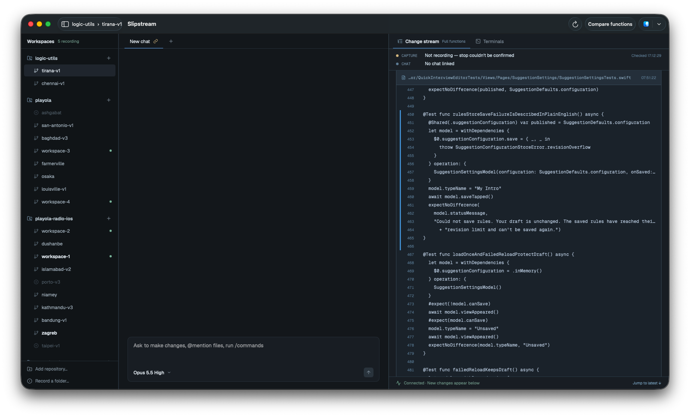
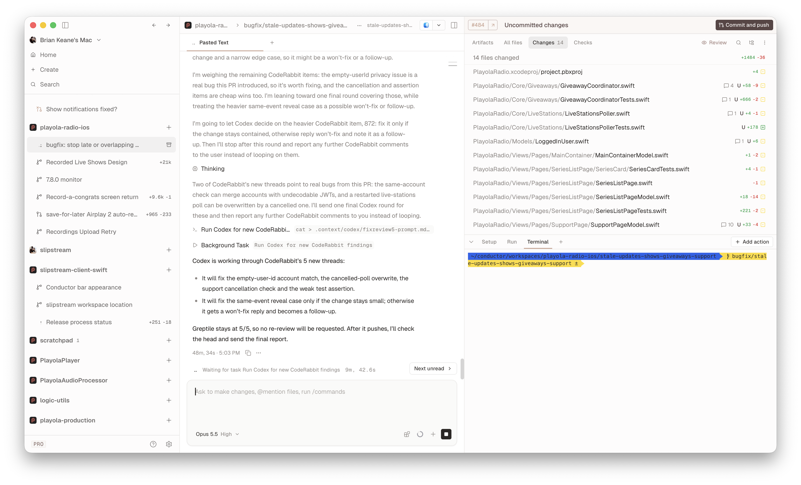
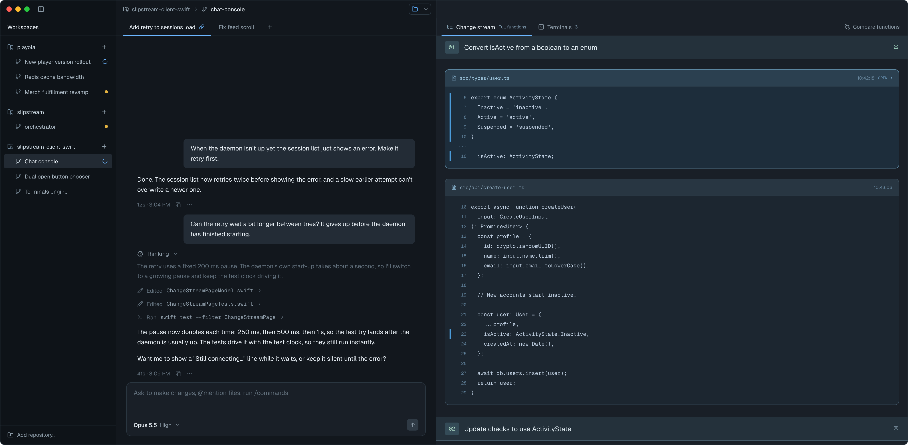
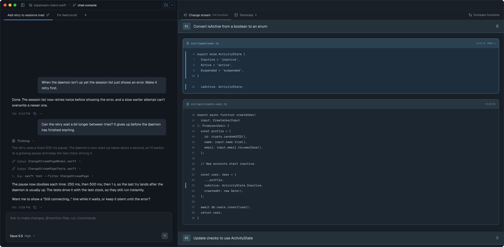
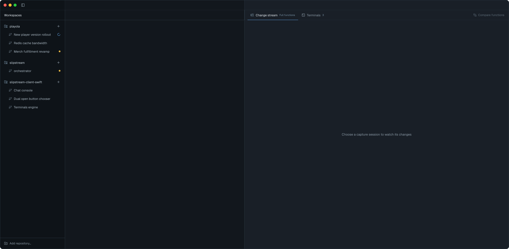
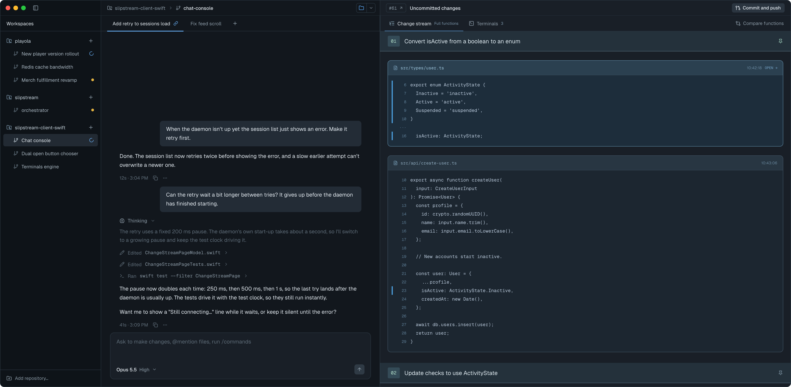

# Conductor top bar — Screens

Pen file: `design/slipstream.pen`. The frames are in zone "15 · Conductor top bar" (title node
`O7OcS`), in a row to the right of the title. Measurements and colours for every header element
are in [`exports/window-header.json`](exports/window-header.json).

## Navigation map
| Screen | Surface | Address | Reached from |
|---|---|---|---|
| Workspace window | client | n/a (native): the one `Window("Slipstream", id: "main")` | Launching the app |

## Workspace window
- **Status:** Changed
- **Surface:** client
- **Address:** n/a (native). The app's only window. This feature changes only its top 40pt and the
  right side's Change stream | Terminals row.
- **Access:** anyone using the app on this Mac
- **Navigated to from:**
  - Launching the app.
- **Navigates to:** it stays on this screen.
  - Sidebar toggle (sidebar header, or the chat header when the sidebar is hidden) → hides or shows
    the sidebar (today's `sidebarToggleTapped()`)
  - Open in, app icon → opens the workspace folder in the remembered app (today's
    `OpenInModel.openTapped()`)
  - Open in, chevron → the list of apps; choosing one opens the folder there and remembers it
    (today's `OpenInModel.appSelected(_:)`)
  - **Compare functions** (right end of the Change stream | Terminals row) → the comparison replaces
    the chat column until closed, as today
  - ⌘R (View menu, "Reload Workspaces") → reloads the workspace list, as the Refresh button did
- **Changed from today:**
  - **The toolbar is gone.** No system toolbar items and no "Slipstream" title. In its place is
    one 40pt header row, split into three parts that line up with the columns below them. Each
    part has its column's background and a 1pt bottom border. The controls are flat: no glass
    capsules.
    - **Sidebar part** (260pt, only when the sidebar is shown): the window buttons, then the
      sidebar toggle icon. While a workspace is being created or archived, a small spinner sits
      right after the toggle (it replaces today's toolbar spinner).
    - **Chat part** (the chat column's width): a breadcrumb on the left, the Open in button on
      the right. The breadcrumb is: repo icon, repo name (muted), `›`, branch icon, workspace name
      (bright, medium weight). The names are the ones today's toolbar title shows. Until the
      workspace's repository is known, the breadcrumb shows the branch icon and workspace name
      only. Open in is 24pt high: the app's icon, a 1pt divider, a chevron, with a 1pt border and
      5pt corners. It shows dimmed and does nothing until the workspace's folder is known.
    - **Right part** (fills the rest): empty. It is kept for the PR actions that come later.
  - **Refresh is gone.** The workspace list now also reloads when the app comes back to the front,
    and ⌘R reloads it on demand. A reload that fails keeps the list and selection already shown;
    the daemon error replaces the list only when no load has ever succeeded. Messages that say
    "Refresh to check again" now say "Press ⌘R to check again".
  - **Compare functions moves** from the toolbar to the right end of the Change stream |
    Terminals row: same icon and label, same muted style as the Terminals switch. When it can't
    be used it is dimmed (`#5C6B77`) and its help text says why. Its label never truncates; when
    the row is narrow, the Change stream subtitle truncates first.
  - The sidebar no longer needs its own hide button. The canvas sidebar component had one; the app
    never did.

  Current screen: 

  Reference: 

| State | When it shows | Node | Mockup |
|---|---|---|---|
| Default | Sidebar shown and a workspace selected | `XIjZj` |  |
| Sidebar hidden | The sidebar toggle was clicked. The sidebar part goes away and the chat part starts at the window's left edge. The window buttons stay where macOS draws them; the chat part leaves room for them, then shows the toggle and the breadcrumb | `SoZho` |  |
| No workspace | No workspace is selected. The breadcrumb and Open in are not shown, Compare functions is dimmed, and the header keeps its height and borders. Below the header, the columns show what they show today with nothing selected (here, the feed's "Choose a capture session" text; the daemon-down and no-sessions messages are unchanged) | `E5HiR4` |  |

### Reference only: PR actions (not built in this feature)

This frame shows where the later PR feature is expected to put its controls, so this feature's
right part is laid out to take them. Nothing in it is implemented here.

| Frame | Node | Mockup |
|---|---|---|
| PR actions preview: PR number chip `#61 ↗`, status "Uncommitted changes", **Commit and push** on the right | `mmNKj` |  |
