# Instant Ask — Screens

Pen file: `design/slipstream.pen` (zone "14 · Instant Ask")

## Navigation map
| Screen | Surface | Address | Reached from |
|---|---|---|---|
| Question thread | client | n/a (native) — the reply panel on a question bar | A question bar in the change stream; sending from the Ask panel |
| Question bar | client | n/a (native) — a bar in the change stream under the asked lines | Sending a question from the Ask panel |
| Chat console | client | n/a (native) — the chat panel of a workspace window | Opening a workspace window |
| Ask panel | client | n/a (native) — the Ask popover on a changed line | Ask on a line in the change stream |

## Question thread
- **Status:** Changed
- **Surface:** client
- **Address:** n/a (native) — the reply panel opened from a question bar in the change stream
- **Access:** anyone using the app on this Mac
- **Navigated to from:**
  - Change stream → a question bar
  - Ask panel → **Send** (the thread opens on the new question)
- **Navigates to:**
  - Close (✕) → back to the change stream, question bar showing the thread's latest label
- **Changed from today:** for questions asked while an app chat tab is linked, the agent answers
  right away (no waiting for its turn to end). When a reply asks for a change, the agent says
  "On it" and the thread shows progress lines (Sent, Picked up, Working) that fold into one Done
  line when the agent reports the change made. Questions to outside chats (Conductor, terminal)
  keep today's thread.
  Current screen: 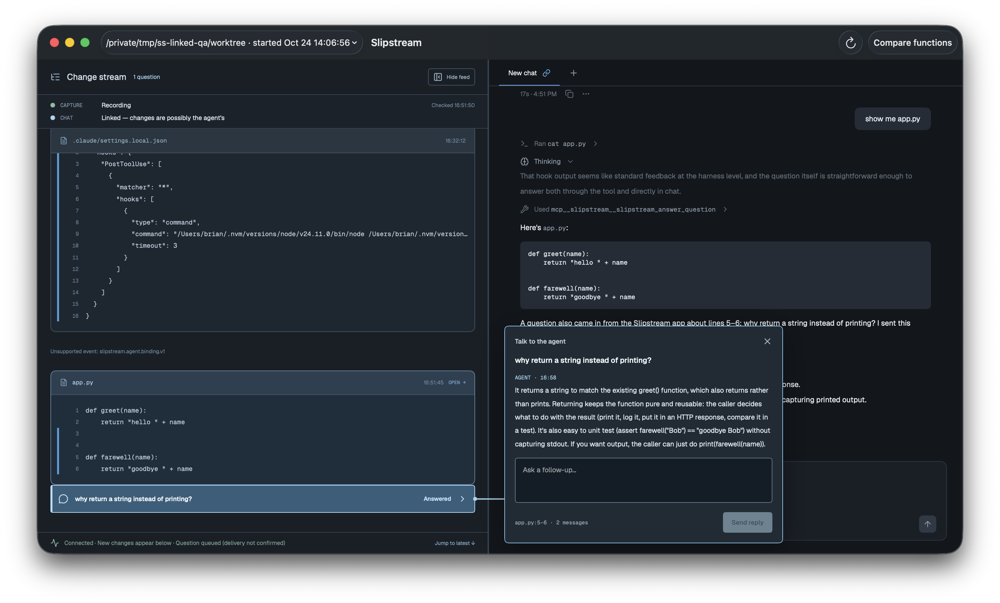

| State | When it shows | Node | Mockup |
|---|---|---|---|
| Answering | The question (or a follow-up) was just sent and the answer hasn't arrived | `OMEHa` | 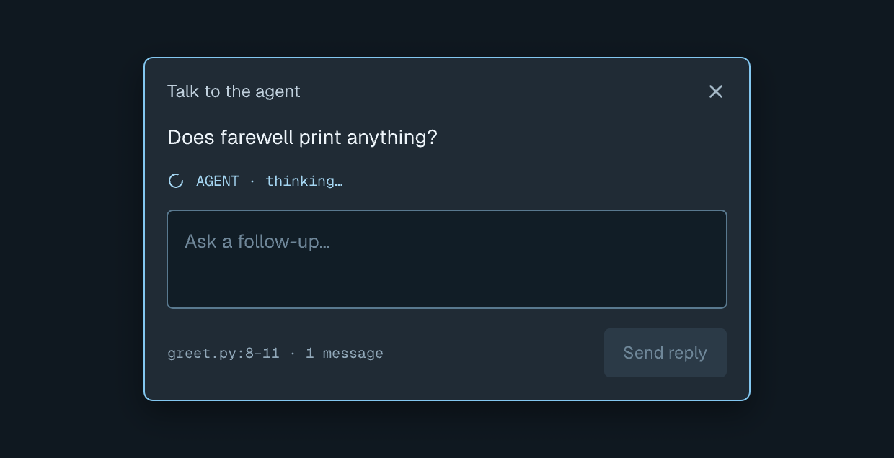 |
| Answered with an offer | The answer arrived; it may end by offering to make a change | `WyEdX` | 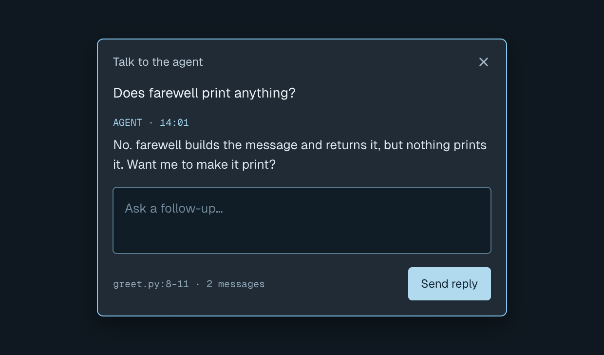 |
| Sent, agent busy | The user asked for a change; it was passed to the chat, which is mid-step | `ZxmpK` | 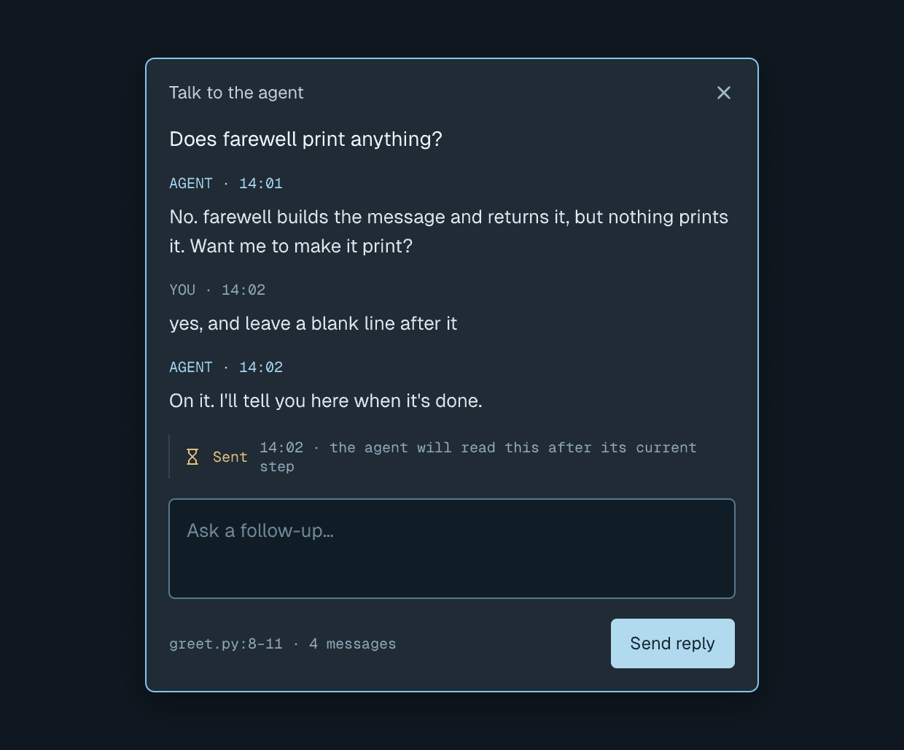 |
| Working | The agent picked up the request and files are changing; one line per changed file | `L15mOx` | 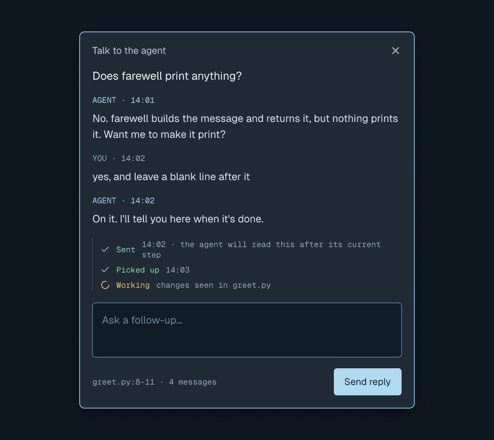 |
| Done | The agent's turn ended with the change made; progress folds to one line, then the agent's report | `M23SOg` | 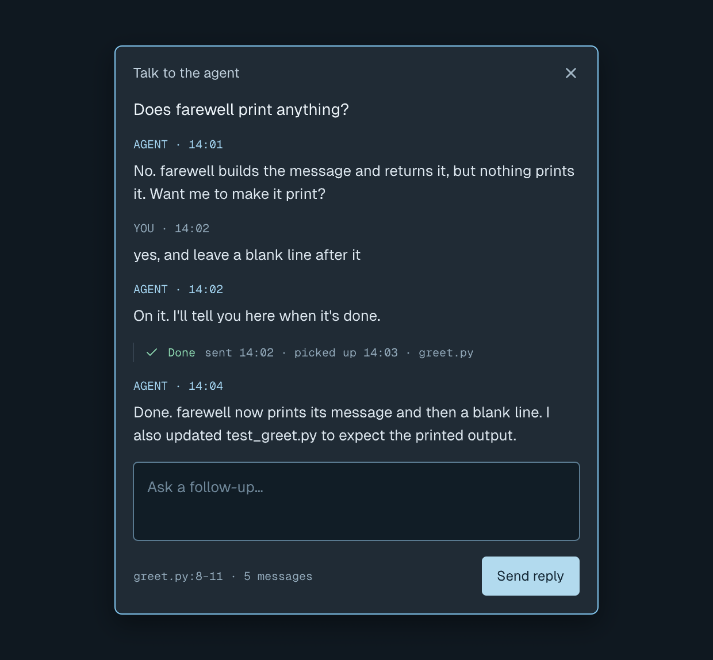 |
| Not done yet | The agent's turn ended without the change; the report says so plainly and the thread checks again at the next turn end | `KtD6e` | 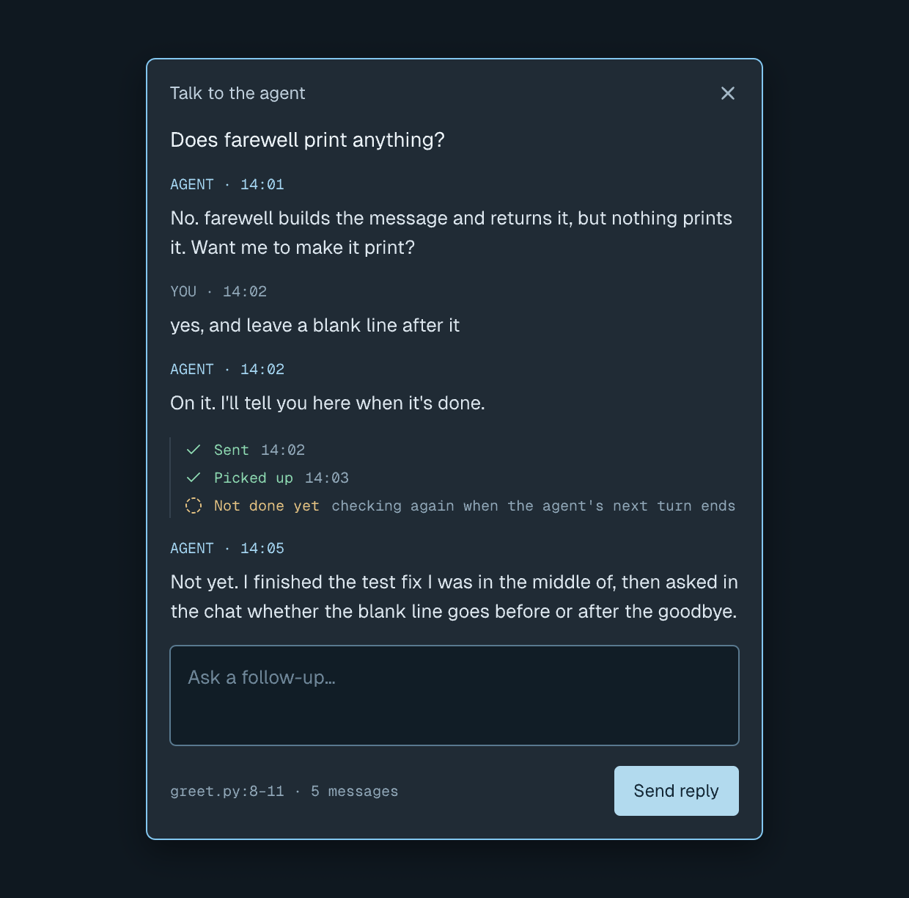 |
| Not delivered | The chat's process ended before the agent read the request (a turn end or Stop alone leaves it Sent) | `hmHJ8` | 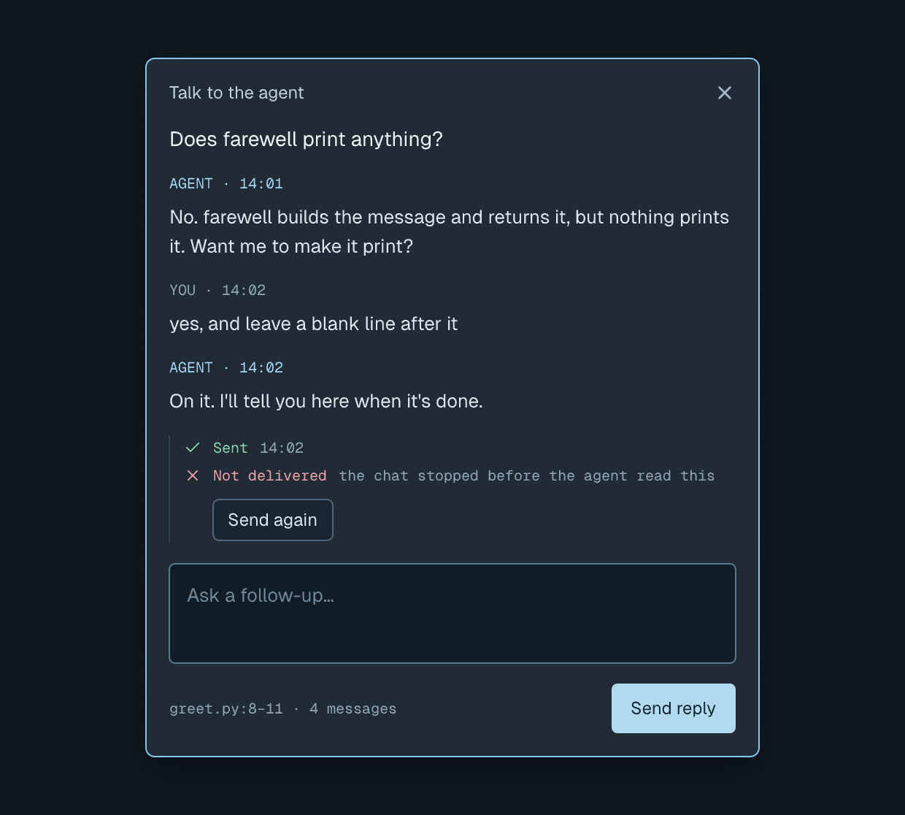 |
| Couldn't answer | No answer came back (failure or time limit) | `ioMFE` | 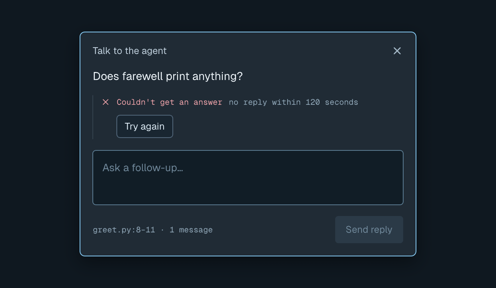 |
| Delivery unknown | The app restarted after the request was sent but before delivery was confirmed; it is never re-sent on its own | `ySOQE` | 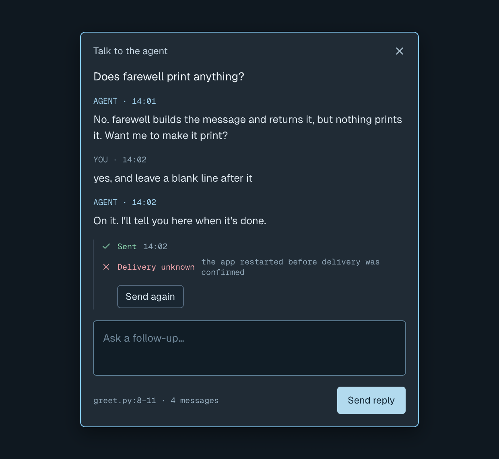 |
| Couldn't check | The agent's turn ended but checking whether the change was made failed (failure or time limit). It says nothing about the change itself | `hGH5E` | 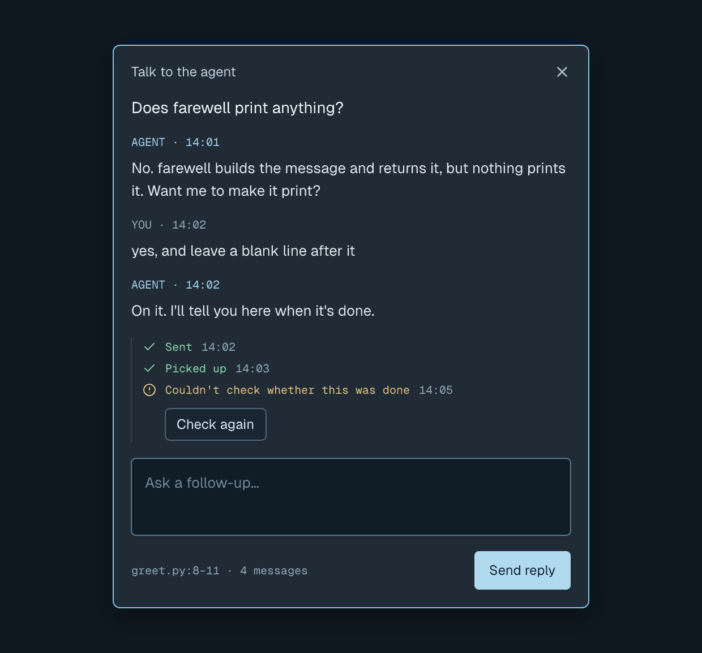 |

An idle agent has no separate state: the request starts its turn at once, so the thread goes from
"On it" straight to Picked up.

Line text:
- Answering: "AGENT · thinking…"; **Send reply** is disabled.
- Sent: "Sent · 14:02 · the agent will read this after its current step"
- Picked up: "Picked up · 14:03"
- Working: "Working · changes seen in greet.py" (one line per file). "Changes seen", not
  "edited": the change stream shows a file changed, not who changed it
- Done: "Done · sent 14:02 · picked up 14:03 · greet.py" (no line counts; the app computes none)
- Not done yet: "Not done yet · checking again when the agent's next turn ends"
- Not delivered: "Not delivered · the chat stopped before the agent read this", with **Send again**
- Couldn't answer: "Couldn't get an answer · <reason>", with **Try again**. Reasons: "no reply
  within 120 seconds", "the chat couldn't be reached", "the reply couldn't be read", "it couldn't
  be saved". The mockup shows the first
- Delivery unknown: "Delivery unknown · the app restarted before delivery was confirmed", with
  **Send again**
- Couldn't check: "Couldn't check whether this was done · 14:05", with **Check again** (disabled
  while a check runs)

Progress lines sit under the answer that accepted the request. A thread with two change requests
shows each under its own turn, each with its newest attempt only (Phase 5 [16]).

**New question, not yet answered:** a temporary question bar appears at the asked lines at once,
reading "Waiting", and opens this thread in Answering. If the answer fails it reads "Not
delivered" and the thread shows Couldn't answer. Once the answer is saved the bar becomes the
thread's normal bar (Phase 5 [17]). It uses the existing bar labels, so it has no new mockup.

The agent's lines are always in the agent's voice; nothing in the thread mentions a copy, a
read-only helper, or Slipstream.

## Chat console
- **Status:** Changed
- **Surface:** client
- **Address:** n/a (native) — right-hand chat panel of the workspace window, the linked tab
- **Access:** anyone using the app on this Mac
- **Navigated to from:**
  - Workspace picker → choose a workspace (unchanged)
- **Navigates to:**
  - Nothing new; the "From Ask" tag is plain text, not a link back to the thread
- **Changed from today:** a change request from a question thread shows in the linked tab as a
  message from the user. It carries a "From Ask · <file>:<lines>" tag, the quoted question and
  answer it refers to, and the user's own words unchanged. While the agent is mid-turn the request
  waits, faded, at the bottom of the conversation. Sending it again happens from the question
  thread, so the console gains no button. The link icon and tab strip are unchanged.
  Current screen: 

| State | When it shows | Node | Mockup |
|---|---|---|---|
| Waiting (agent busy) | The request was written to the tab mid-turn and the agent hasn't read it yet | `h0BWO` | 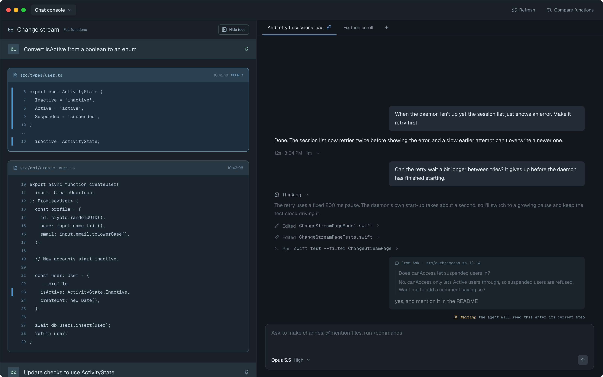 |
| Picked up | The agent read the request (or an idle agent started its turn with it) | `TZ28w` | 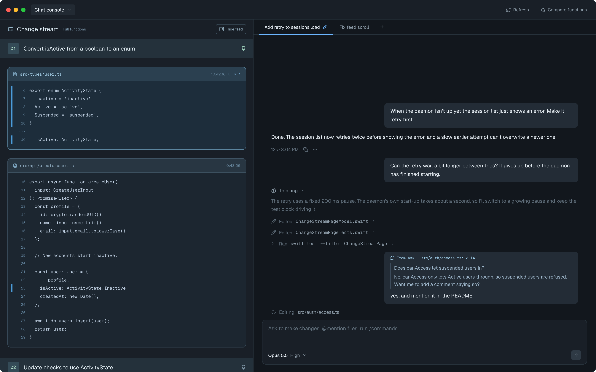 |
| Not delivered | The tab's process ended before the agent read the request | `OinZB` | 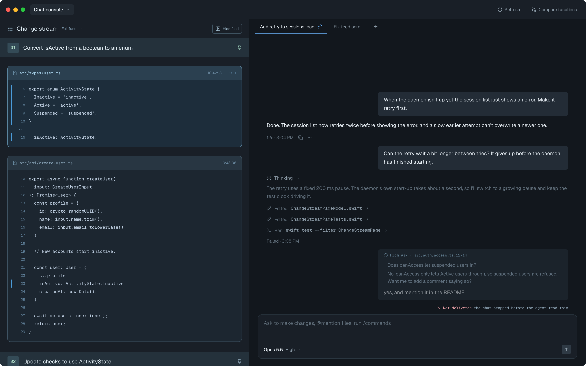 |

Line text:
- Waiting: "Waiting · the agent will read this after its current step"
- Not delivered: "Not delivered · the chat stopped before the agent read this"

## Ask panel
- **Status:** Changed
- **Surface:** client
- **Address:** n/a (native) — the Ask panel opened from a changed line in the change stream
- **Access:** anyone using the app on this Mac
- **Navigated to from:**
  - Change stream → Ask on a changed line (unchanged)
- **Navigates to:**
  - **Ask agent** → Question thread, in its Answering state
- **Changed from today:** when an app chat tab is linked, Ask is ready as soon as that tab has
  sent its first message; the "Connected tab hasn't confirmed" notice no longer applies to app
  tabs. Outside chats (Conductor, terminal) keep today's notices unchanged. The capture strip still
  reads "Linked — changes are possibly the agent's" for a linked app tab (decided in Phase 4, D2:
  wording kept).
  Current screen: 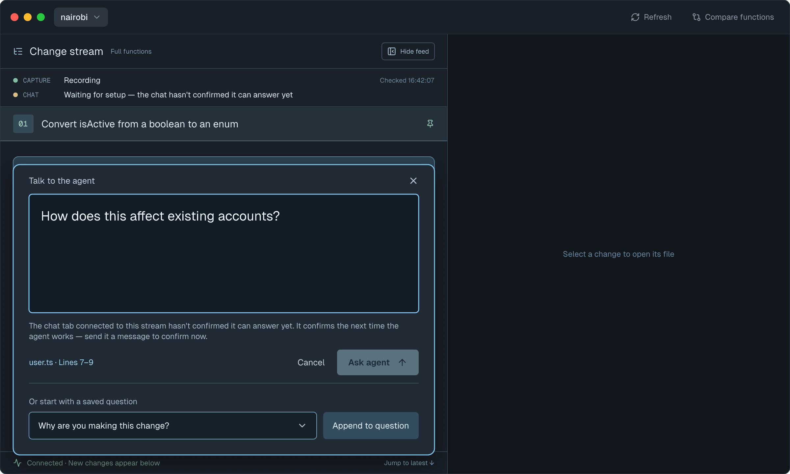

| State | When it shows | Node | Mockup |
|---|---|---|---|
| Ready | An app chat tab is linked and has sent a message | `W6Pkh` | 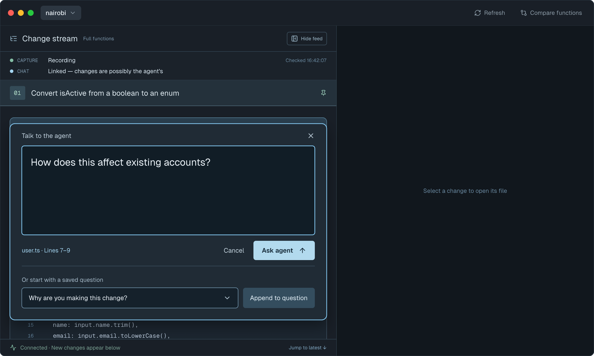 |
| Nothing connected yet | No chat is linked, usually because no tab has sent a message yet (unchanged from linked-chat) | `s2EAnj` | 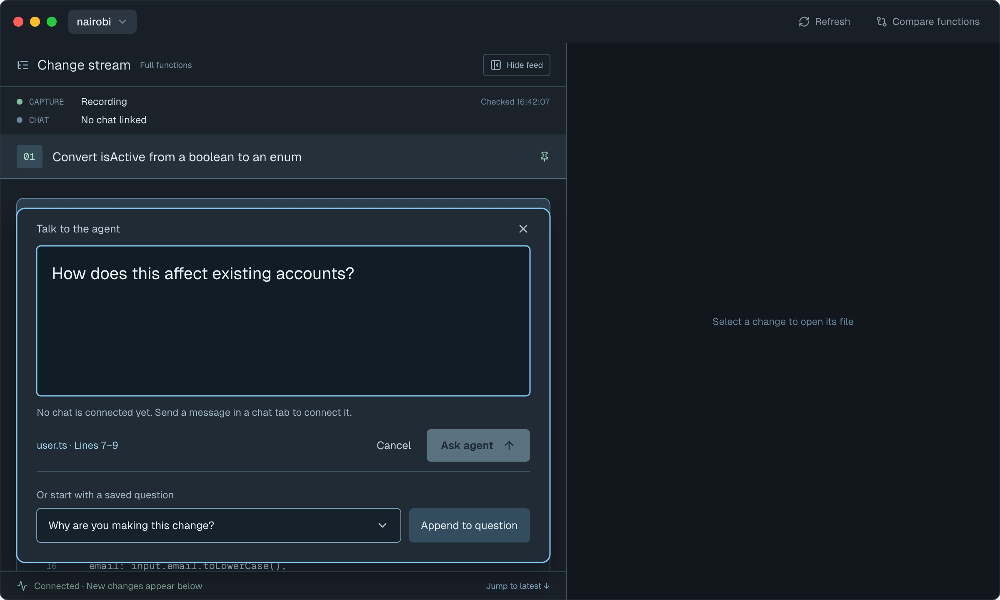 |

Notice text:
- Ready: none.
- Nothing connected yet: "No chat is connected yet. Send a message in a chat tab to connect it."
  (unchanged)

## Question bar
- **Status:** Changed
- **Surface:** client
- **Address:** n/a (native) — a bar in the change stream under the asked lines
- **Access:** anyone using the app on this Mac
- **Navigated to from:**
  - Ask panel → **Send**
- **Navigates to:**
  - Click → Question thread
- **Changed from today:** the status label gains **Working** (amber) while a requested change is
  in progress and **Done** (green) once the agent reports it made. Today's Waiting, Answered and
  New reply labels stay.

| State | When it shows | Node | Mockup |
|---|---|---|---|
| Working and Done | Working: a change request is sent, picked up or in progress. Done: the agent reported the change made | `yhSA1` | 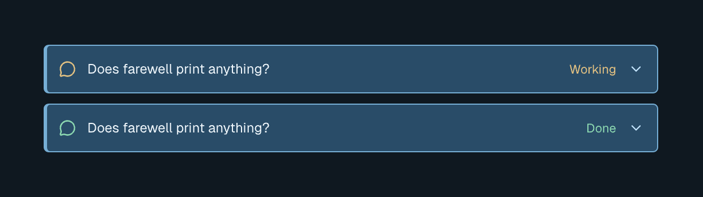 |
