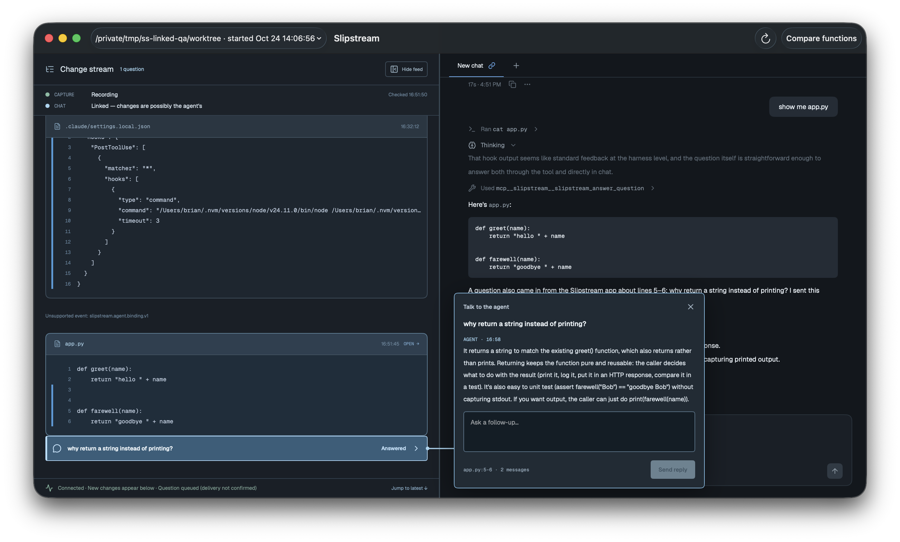
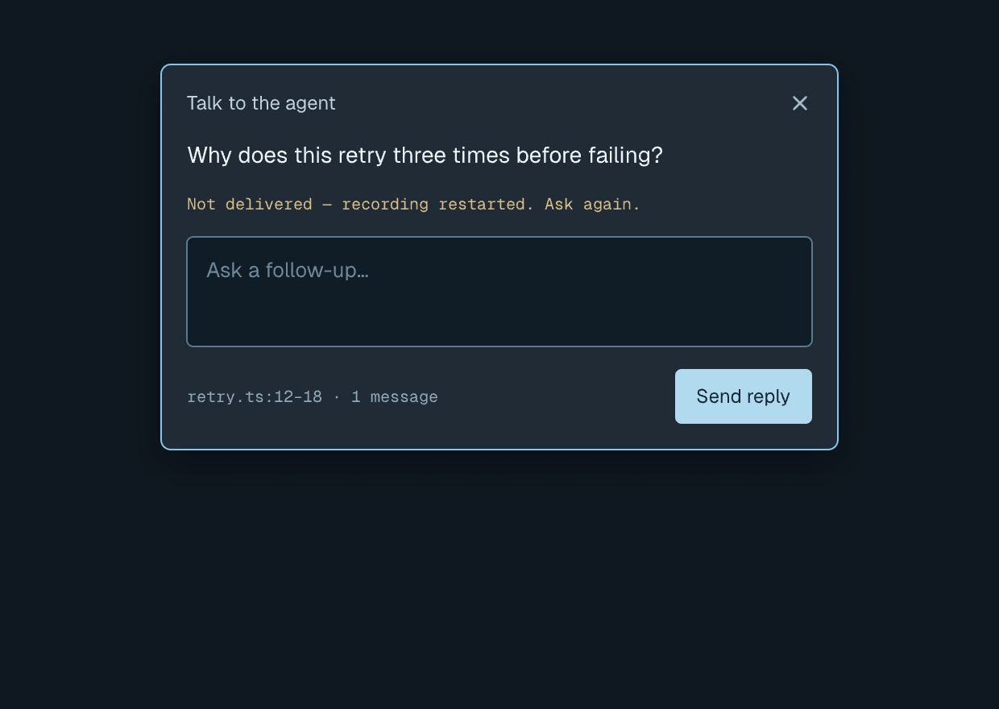
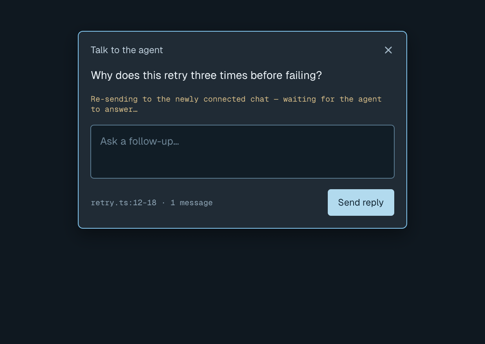
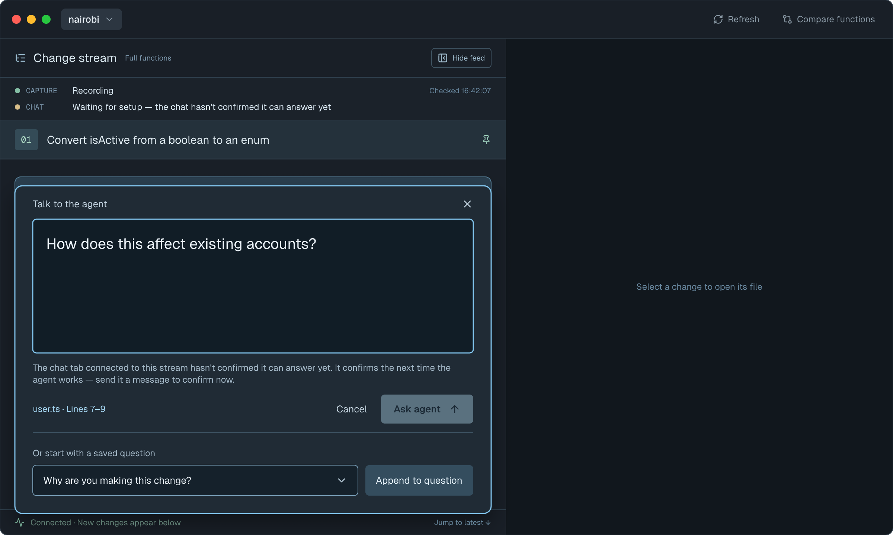

# Instant Ask — answers from a copy of the linked chat

**Status:** Phase 1 (scope) approved by Brian 2026-10-24. Phase 2 (existing state) done. Phase 3 (visuals) approved. Phase 4 (data layer) approved, with the question
thread screen revised and re-approved. Phase 5 (adversarial review) done; every finding has a
disposition below. Brian decided the five that changed approved decisions (D4–D8, all A).
Phase 6 (implementation plan) approved. Phase 7 (simplicity gate) done: one wave of cuts, below;
Brian decided the one that changed an approved rule (D9, B).

## Base commits

- Client (`playola-radio/slipstream-client-swift`): `9b903236e046b808fb3bacf789d1f4b5595f1c99` (develop)
- Daemon (`playola-radio/slipstream`): `feffc30c678b45fe890dcbde7ae2b63d17d9a53e` (develop)

## Target surfaces

- `client` — the macOS app (Ask question thread, chat tabs).
- Daemon (stage 2) — one new control verb and one new event that record a change request's
  progress and the agent's report (Phase 4, D1), and an optional `relay` field on the existing
  `record_question_exchange` so an accepted request and its first send are one event (Phase 5,
  D6). [endpoints.md](./endpoints.md).

## Why

QA of linked-chat (2026-10-24) showed that a question waits until the linked chat's next tool
call, and an idle chat never answers. The answer path also leaks into the user's chat: the setup
check, the agent thinking about whether to trust the hook, and answers repeated in the chat.
Brian: questions should be answered without waiting for the agent to use a tool.

This reverses linked-chat's non-goal "No fork-based Ask" (Brian, 2026-10-24, after the QA above).

## Spike evidence (2026-10-24, throwaway config and sandbox repo)

- `claude -p --resume <chat> --fork-session` with read-only tools answered in 3–10 s, both idle
  and while the original was in the middle of a 40 s tool call. Cost was $0.01–0.08 on a very
  small chat; it grows with chat length, and repeat questions within an hour mostly reuse the
  cached conversation.
- The original transcript was byte-identical after every fork. The original agent finished its
  task normally while being forked mid-turn.
- Answers matched what the agent itself said. A question about work not yet done was answered
  correctly ("whisper isn't added yet"); a question about work that never happened was answered
  correctly ("I didn't write any retry logic").
- Problems seen: the fork read a still-running tool call as "interrupted"; it offered to do work
  itself; it mentioned Slipstream's answer tool (from the setup check in the history); each fork
  left a saved session behind. The worktree's PostToolUse hook would load in the fork unless
  local settings are excluded.
- A message written to a busy app chat process's stdin (`--input-format stream-json`) is read at
  the agent's next tool call, inside the same turn, and the agent acted on it ("As you asked
  partway through…"). With `--replay-user-messages` the process echoes that message, with the id
  the app gave it, at the moment it is read. That is an exact "picked up" signal.

### Probes during Phase 4 (2026-10-24, Claude CLI 2.1.293, same sandbox)

- **Role instructions must go in the message.** A resumed copy reuses the parent's recorded system
  prompt (`--system-prompt-snapshot` defaults on), so `--append-system-prompt` is ignored. That is
  why the spike's copy offered to do work and mentioned Slipstream. Turning the snapshot off
  honours the appended text but loses the prompt cache (cache reads 13146 → 1461 tokens). Putting
  the instructions at the top of the user message is honoured and keeps the cache (13146).
- **`--json-schema` works with resume + fork:** the JSON result carries `structured_output`
  (`{"reply": …, "change_request": null}`).
- **`--no-session-persistence` still reports a new session id** (`7e3431be…`, distinct from the
  parent) and saves nothing (the project's session count was unchanged). `--restricted --tools
  Read,Grep,Glob --strict-mcp-config` works together with resume, fork and the schema; that run
  answered in 2.3 s.
- **The Slipstream hook ignores unbound chats.** It claims questions by its own
  `harness_session_id` (daemon `src/question-hook.ts:23`), so an app tab that loads an outside
  chat's hook from the folder's local settings is never handed a question.
- **PR 1, Task 4 gate (2026-10-25, Claude CLI 2.1.293, throwaway `CLAUDE_CONFIG_DIR`, scratch
  repo):** `forkArguments`' exact command, against a chat with one finished turn, with the prompt
  on stdin and stdin closed.
  - `-p` reads the prompt from stdin: the copy answered the stdin question and exited 0 in about
    6 s.
  - The first line is `{"type":"system","subtype":"session_state_changed","state":"running"}`,
    before `init`. The parser ignores lines before `init`.
  - The `system`/`init` line names its lists `tools` and `mcp_servers`:
    `"tools":["Glob","Grep","Read","StructuredOutput"]` (`--json-schema` adds `StructuredOutput`)
    and `"mcp_servers":[]`. Its `session_id` is the copy's id, not the parent's.
  - The `result` line is `{"type":"result","subtype":"success","is_error":false,
    "session_id":"<copy id>","structured_output":{"reply":"…"},…}`. A
    `session_state_changed` `idle` line follows it.
  - The parent's transcript sha256 was the same before and after
    (`6e1214434e6591b15e47786d51aa0f571e27c7820dfc225e21134e6f81df48eb`). The project's session
    count was 4 before and 4 after.

## Scope

1. **Ask answers right away.** The answer comes from a hidden copy (fork) of the linked chat tab,
   taken at its latest point. It speaks as the agent, as "I". It never mentions being a copy, being
   read-only, or Slipstream (Brian). It can read and search the workspace but not change anything.
   It loads no local settings (so no Slipstream hook) and no MCP servers.
2. **Follow-ups fork fresh** (Claude's call). Each new message in a thread forks the thread's
   chat (the tab that answered its first question, D4) at its latest point again, with the thread's earlier back-and-forth in the prompt. The copy
   then knows about work the agent did since the last message. Nothing is saved as a session, so
   no copies pile up in Claude's history.
3. **Change requests go to the real agent right away** (Brian: one writer, sent immediately, not
   batched). When the user asks for a change in the thread, the copy replies (for example "On it")
   and the app sends the request to the thread's chat: the user's own words, unchanged, with the
   question and answer they refer to quoted above them so "yes, do that" makes sense (Brian: "keep
   the same words"). If the agent is busy it reads the request at its next tool call; if it is
   idle, the request starts a turn. The real agent makes every edit, in its own history, so
   attribution and its reasoning stay in one place. The request shows in the chat tab as a user
   message.
   - The copy decides whether a message is a change request (Claude's call). A question ("should
     it print?") is answered, perhaps with an offer ("Want me to?"); a reply like "yes" then sends
     the offer as the request.
4. **Progress in the thread** (Brian: "report back on the progress… so it doesn't feel like it got
   lost"):
   - **Sent** — written to the tab. If the agent is busy: "The agent will read this after its
     current step."
   - **Picked up** — the tab echoed the request (scope evidence above).
   - **Working** — edits that arrive in the change stream after pickup appear as progress lines.
   - **Done** — when the agent's turn ends after pickup, a fresh copy is asked what it did about
     the request and reports it as the agent ("Done. `farewell` now prints…"). The thread ends
     there (Brian: "the chat should end with the agent reporting that the change has been made").
   - **Not done yet** — if the turn ended without addressing it, the report says so plainly and
     the thread stays open; the next turn end checks again.
   - **Not delivered** — if the tab's process exits before the request is read, the thread says
     so and offers to send it again. A turn end or Stop alone doesn't count: the request is still
     queued and is read next.
   - **Delivery unknown** — after an app restart, a request that was sent but never confirmed as
     read. The app can't tell whether the agent read it, so it never re-sends on its own; it
     offers **Send again** (Phase 4, D2).
   - **Couldn't check** — the report itself failed (no reply, time limit). It says nothing about
     whether the work was done, so it is not "Not done yet"; it offers **Check again** (D2).
   - "Working" lines say "changes seen in <file>": the change stream shows a file changed, not who
     changed it (D2).
5. **Recorded in the daemon.** Every question and answer is recorded with
   `record_question_exchange`, so threads survive restarts and stay in the log. A relayed
   request's delivery (sent, picked up, not delivered) and each report are recorded with one new
   verb (D1); the first send rides on the exchange that accepted the request (D6). Working
   lines are derived from the change stream, not recorded.
6. **Which chat.** A new question goes to the linked chat tab, as linked-chat defines it (link
   icon, Connect to Stream). Everything after that in the thread goes to the tab that answered
   it while that tab is open, else to the folder's linked tab (D4).
7. **App tabs drop the Slipstream hook, answer tool and setup check** (Brian, 2026-10-24). The copy
   answers questions and requests go in through the tab's own input, so app tabs no longer link to
   the daemon for Ask. This removes the setup check from the user's chat, the
   `.claude/settings.local.json` edit in the change stream, the reload after linking, and the
   client's re-sending on a link move. The "linked tab" becomes an app-only choice: which tab Ask
   copies and where requests go, stored by the app per folder (D3). The link icon and Connect to
   Stream stay. Connect to Stream no longer unlinks an outside chat; new Ask questions go to the
   app tab the user picked, and existing threads stay with the chat that answered them.
8. **Outside chats keep today's Ask** (Brian, 2026-10-24). Conductor or terminal chats linked with
   `slipstream attach` still get questions through the hook; the app can't write to their input,
   and their Claude config may live elsewhere.
9. **Built in three stages, each shippable** (Brian, 2026-10-24): (1) answers from the copy, with
   the hook path still used for outside chats (a recorded thread never falls back to it); stage
   1's copy can't take change requests and tells the user to ask in the chat (D7);
   (2) change requests and progress; (3) remove the old plumbing
   for app tabs once 1 and 2 have worked in real use.

## Existing contracts

Surveyed at client `9b90323` and daemon `feffc30c`. Only what this feature touches.

### Current screens

| Screen | Today |
|---|---|
|  | Question thread, answered (Brian's QA, 2026-10-24). Question title, "AGENT · time" answer, "Ask a follow-up…" field, footer `app.py:5-6 · 2 messages`, Send reply. The stream's question bar says "Answered"; the stale "Question queued (delivery not confirmed)" notice is still showing. |
|  | Question thread, not delivered (recording restarted). |
|  | Question thread, re-sending after the link moved to another chat. |
|  | Chat console with the linked tab's link icon. |
|  | Ask composer disabled while the linked tab hasn't confirmed. |

### Ask and question thread (client)

- `AskAgentPageModel` (`SlipstreamViewer/Views/Pages/AskAgentPage/`) is the composer. `askTapped()`
  sends a `QuestionRequest`. `canSubmit` requires `askNoticeText == nil`.
- `QuestionThreadPageModel` (`.../QuestionThreadPage/`) is the thread. `sendReplyTapped()` sends
  a follow-up (`reply_to_question_id`). Status lines: "Waiting for the agent to answer…", "Not
  delivered — recording restarted. Ask again.", "Re-sending to the newly connected chat…".
- `ChangeStreamPageModel` owns both (`askAgent`, `reply`) plus `questionThreads` and the
  `queuedQuestionNotice` ("Question queued (delivery not confirmed)").
- `QuestionThreads` (`Sources/SlipstreamCore/QuestionThreads.swift`) is a pure reducer over
  daemon events. Turn status: `waiting, answered, notDelivered, resending`.
- **Send path:** `QuestionClient.send` → `ControlTransport.ask` (verb `"ask"`, fields `session_id,
  request_id, text, context, reply_to_question_id, binding_generation`). `ControlTransport.exchange`
  is private and only `ask` uses it. **The client cannot send `record_question_exchange` today.**
- **Events decoded:** `question.queued.v1`, `question.dispatch_attempted.v1`, `question.answered.v1`
  (trimmed, ≤16384 bytes), `agent.connection.v1`, `agent.unlinked.v1`.
  **`question.exchange_recorded.v1` is not decoded.** It shows as an "Unsupported event" feed
  marker. `agent.binding.v1` is deliberately unsupported (linked-chat `models.md`).

### Recording an exchange the app produced (daemon)

`record_question_exchange` (`docs/ask-agent/contract.md` "Client-recorded exchanges", daemon PR #76):

```json
{
  "v": 1, "verb": "record_question_exchange",
  "session_id": "…", "request_id": "…", "text": "question",
  "context": { "change_seq": 0, "path": "…", "snapshot_sha256": "…", "line_start": 1, "line_end": 2 },
  "reply_to_question_id": "optional",
  "answer_text": "…",
  "conversation": { "harness": "claude", "parent_session_id": "…", "fork_session_id": "…" }
}
```

- Emits `slipstream.question.exchange_recorded.v1`. Idempotent on `request_id`.
- Needs no binding; works on a watch-only capture.
- Follow-ups chain via `reply_to_question_id` and must keep the same source context. A chain
  can't mix `ask` and recorded exchanges.
- Attribution (`src/attribution-scoring.ts`) counts a fork's duplicate tool calls once and does
  not depend on the binding.

### Daemon link (binding) and who reads it

- `CaptureBinding` (`Sources/SlipstreamCore/Captures.swift`): `generation`, `state`
  (`setupPending, connected, unavailable, unlinked`), `reason`, `harnessSessionID`.
  `AgentConnection`: `connected, setupPending, disconnected(reason), unreported`.
- **Ask gate:** `CaptureStatus.askNotice(agentConnection:isAppTabLinked:)` disables Ask unless
  the binding is `.connected` and the agent connection is `.connected`. Without a binding it says
  "No chat is connected yet. Send a message in a chat tab to connect it." This gate must change for
  app tabs.
- **Capture strip:** `CaptureStatus.chatText`/`chatDot` ("Linked — changes are possibly the
  agent's", "Waiting for setup…", "No chat linked").
- **Tab strip (`ChatPageModel`):** `linkIcon(for:)` (connected / waiting / failed), `linkFailures`,
  "Connect to Stream" (`connectTapped` → `ChatLinkClient.link`), "Stream: outside chat",
  `autoLink(in:)` (first tab with a sent message, on window open and on turn end),
  `linkedTabClosed` (relink next tab or unlink), `strandedLinks`.
- `ChatLinkClient` runs `slipstream attach <folder>` with `CLAUDE_CODE_SESSION_ID=<tab id>` and
  `slipstream unlink`, one at a time.
- `ChatTabModel.streamLinked()` / `reloadWhenIdle` restart the tab's process after linking so the
  hook and answer tool load.
- `ChangeStreamPageModel.changesBinding` reloads sessions on binding events.
- `QuestionRequest.bindingGeneration` and `QuestionThreadPageModel.canSendReply` use the binding
  generation.

**If app tabs stop attaching:** `ChatLinkClient` calls for app tabs, `linkFailures`, `strandedLinks`,
`streamLinked`/`reloadWhenIdle`, and the app-tab branch of `askNotice` become unnecessary. The link
icon, Connect to Stream and auto-link stay, but as app-only state (which tab Ask copies). Outside
chats keep `outsideChatText`, `chatText`/`chatDot`, `changesBinding`, `bindingGeneration` and the
`askNotice` gate.

### Chat tab process (client)

- `ChatPageModel` is app-wide (`SlipstreamViewerApp`), owns `tabs: IdentifiedArrayOf<ChatTabModel>`
  and persisted `ChatTabRecord {id, folder, model, effort, isWaiting}`. The question models hold
  no reference to it or to any tab.
- The tab id is the Claude session id (`--session-id=` for a new chat, `--resume=` when its
  transcript exists). The transcript is written only after the first turn (`hasSentMessage`).
- Launch (`ClaudeInvocation.arguments`): `--print --output-format stream-json --verbose
  --input-format stream-json --thinking=adaptive --thinking-display=summarized --effort= --model=
  --max-turns=1000 --permission-prompt-tool=stdio --permission-mode=bypassPermissions
  --disallowedTools=AskUserQuestion --setting-sources=user,project,local`.
  **`--replay-user-messages` is not used today and the chat-console plan forbids it**
  (`design/features/chat-console/implementation-plan.md:47`). Scope item 4's "Picked up" needs it,
  so this feature reverses that rule; Phase 5 must check that the replayed echoes don't break the
  chat projection.
- `send()` only works when idle (`activeTurn == nil`). It writes `ClaudeInvocation.userMessage(text)`
  (no `uuid` field). Nothing outside the tab can write to its input; `handle` and `activeTurn` are
  private.
- Turn end: `.result` → `endTurn` (fires `onTurnEnded()`). Stop: interrupt, then retire after
  10 s. Exit: retire; an active turn ends `.failed` ("Claude stopped unexpectedly").
- **Environment for a second `claude`:** `AgentEnvironmentClient.resolve()` gives `claudePath`,
  login-shell `variables` and `configDirectory` (min Claude 2.1.293). Working folder is
  `ChatTabRecord.folder`; model and effort come from the record.
- **One-shot runs:** `AgentProcessClient.launch` is long-lived only (it could be read to `.exited`)
  and its handle can't close stdin. `WorkspaceClient.runInBackground` runs to completion but has no
  working directory, timeout, cancellation or stdout/stderr split. Phase 7: the copy runs on
  `AgentProcessClient`, whose handle gains `closeInput`.

### Tests that cover this today

`QuestionThreadsTests` (27), `QuestionsTests` (7), `ControlTransportTests` (10),
`ClaudeInvocationTests` (6), `AskAgentPageTests` (27), `QuestionThreadPageTests` (28),
`CaptureStatusTests` (17), `ChatLinkClientTests` (15), `ChatPageTests` (128, includes
`ChatTabModel` via `AgentFake`), `ChangeStreamPageTests` (192).

## Non-goals

- The copy never edits files or runs commands. No second writer (Brian).
- No batching of change requests (Brian).
- No visible "fork" anywhere in the UI (Brian).
- No Codex support.

## Open questions

None open. The capture-strip question was resolved in Phase 4 (D2.5): the strip keeps today's
"Linked — changes are possibly the agent's" for a linked app tab, derived from the app's link
instead of the daemon binding. Attribution is not real yet (daemon `src/attribution-producer.ts:33`
ships no transcript adapters), so nothing about attribution changes.

## Decision log

- 2026-10-24 Brian, in chat after the spike: hide the copy from the user; the real agent makes
  every edit; requests are sent immediately, not batched; progress is reported back and the
  thread ends with the agent reporting the change made.
- 2026-10-24 Brian approved the Phase 1 scope ("yes"), including both recommendations (app tabs
  drop the hook path; outside chats keep it) and the three-stage build (scope items 7–9). Brian
  confirmed this is a major change that replaces part of linked-chat.
- 2026-10-24 Brian chose 2 layout directions for Phase 3, then picked **Direction A** (progress as
  lines in the conversation, folding to one "Done" line when finished) over Direction B (a progress
  strip above the reply box). Canvas: `design/slipstream.pen` section 14, frames `DoRPf`, `zxKcc`
  (A) and `JDoeV`, `K04Sf` (B, rejected).
- 2026-10-24 Brian approved ("yeah") the list of changed screens (question thread, chat console,
  Ask composer) and the question thread's 8 states: answering, answered with an offer, sent while
  the agent is busy, working, done, not done yet, not delivered, couldn't answer. An idle agent
  gets no separate state. The question bar gains "Working" and "Done" labels.
- 2026-10-24 Brian approved ("approved") the **question thread** screen: 8 state frames `OMEHa`,
  `WyEdX`, `ZxmpK`, `L15mOx`, `M23SOg`, `KtD6e`, `hmHJ8`, `ioMFE`, plus the question bar labels
  frame `yhSA1` (section 14 of `design/slipstream.pen`). Recorded in [screens.md](./screens.md).
- 2026-10-24 Brian approved ("all good") the **chat console** screen: states waiting, picked up,
  not delivered (frames `h0BWO`, `TZ28w`, `OinZB`). The "From Ask" tag is plain text, not a link
  (no extra control). Recorded in [screens.md](./screens.md).
- 2026-10-24 Brian approved ("yes") the **Ask panel** screen: Ready (`W6Pkh`, new) and Nothing
  connected yet (`s2EAnj`, unchanged); the "Connected tab hasn't confirmed" notice is dropped for
  app tabs. Recorded in [screens.md](./screens.md). All Phase 3 screens are now approved.

- 2026-10-24 Phase 4 consult with Codex (session `01a1704a-82cc-7130-9a6e-152a5f15f1c6`). Brian's
  decisions in chat ("1 A, 2 recommendation accepted, 3 A"):
  - **D1 = A:** one new daemon verb and event for a change request's delivery and the agent's
    report, trimmed to four kinds (sent, picked up, not delivered, reported). Sent is recorded
    before the write to the tab; Working is derived from file-change events after pickup. No local
    retry file: if the daemon is down when an answer arrives, the thread shows Couldn't answer.
  - **D2 = recommendations:** add a Delivery unknown state with Send again; Working reads
    "changes seen in <file>"; a failed report shows a retryable Couldn't check line, not Not done
    yet; the time limit is 120 seconds; the capture strip keeps today's wording.
  - **D3 = A:** in stage 3 the app stores which tab is linked per folder; outside chats keep
    their daemon link and Connect to Stream no longer unlinks them.
- 2026-10-24 Brian approved ("approved") [models.md](./models.md) as first drafted, including its
  three calls: drop the "+2 −1" line counts from the Working and Done lines (the app computes no
  line counts); a question whose answer hasn't come back is memory only (an app quit in those
  seconds loses it); draft text "Delivery unknown · the app restarted before the agent read this"
  (Send again) and "Couldn't check whether this was done" (Check again). The question thread
  screen is revised for these before Phase 5.
- 2026-10-24 Brian approved ("approved") [endpoints.md](./endpoints.md): one new daemon verb
  `record_question_relay_update` and event `question.relay_updated.v1` (stage 2); the existing
  `record_question_exchange` newly called (stage 1); the hidden copy's `claude -p` invocation and
  both output schemas; app tabs stop calling attach/unlink in stage 3, except a one-time unlink of a
  binding left on an app tab. Same pass added to models.md: the `QuestionClient` / `ControlTransport`
  row and that one-time unlink.
- 2026-10-24 Brian approved ("yes") the revised Question thread screen
  ([screens.md](./screens.md)): Working reads "changes seen in greet.py" and Done drops the line
  counts; Couldn't answer says 120 seconds; new states Delivery unknown (`ySOQE`, Send again) and
  Couldn't check (`hGH5E`, Check again); the Ask panel notes the capture strip wording was kept (D2).

- 2026-10-24 Phase 5 adversarial review by Codex: 20 findings, all with dispositions in
  "Adversarial review (Phase 5)". Five change approved decisions and are put to Brian as D4–D8
  (thread pinned to its chat; delivery only fails on process exit; relay on the exchange; stage-1
  change-request reply; first-turn Ask stays unavailable).
- 2026-10-24 Brian chose A for all five ("4: A 5: A 6: A 7: A 8: A"):
  - **D4 = A:** each thread is pinned to the tab that answered its first question; later turns go
    there while it is open, else to the folder's linked tab.
  - **D5 = A:** only a process exit with no echo is Not delivered; a turn end or Stop leaves the
    request Sent. Chat console: "the chat stopped before the agent read this"; Delivery unknown:
    "the app restarted before delivery was confirmed".
  - **D6 = A:** optional `relay` on `record_question_exchange`, so "On it" and Sent are one event.
    This amends D1 (the existing verb changes in stage 2).
  - **D7 = A:** stage 1's copy tells the user to ask in the chat for changes; the same applies to
    a daemon without change requests.
  - **D8 = A:** `hasSentMessage` stays as is; Ask is unavailable during a new tab's first turn.
  - Mockups revised for D5 and re-exported: Delivery unknown (`ySOQE`) reads "the app restarted
    before delivery was confirmed"; chat console Not delivered (`OinZB`) reads "the chat stopped
    before the agent read this", above a "Failed" turn footer (the process ended) instead of
    "Stopped". Wording only, within the approved decision.
- 2026-10-24 Brian approved ("looks good") [implementation-plan.md](./implementation-plan.md) as
  first drafted: six PRs over three stages, executed with orchestrate-feature.
- 2026-10-24 Phase 7 simplicity gate: Codex (`gpt-6-astra`, read-only) and a Claude Opus subagent
  reviewed the plan and deliverables against the real code. One wave of cuts applied to all four
  documents; dispositions in "Simplicity gate (Phase 7)". The plan is now five PRs.
- 2026-10-24 Brian chose **B** for **D9** ("B"): the daemon accepts a relay's steps in any order
  and the app folds them by status precedence, instead of the daemon enforcing order and the app
  sending one step at a time. This supersedes the order rules and the serial queue from Phase 5
  finding #2.

## Acceptance criteria

Each is a test (model test with a `TestClock`, daemon test, or a scripted QA run against a
disposable daemon with `SLIPSTREAM_STORE`). Latency is a goal, not a gate: on a small chat an
answer should show within about 10 seconds; 120 seconds is only the ceiling.

### Stage 1 — the copy answers

1. Asking about a line with a linked app tab that has sent a message shows Answering at once, a
   temporary question bar at the line, then the answer in the agent's voice; the bar and an open
   panel move to the recorded `question_id`.
2. The answer is recorded with `record_question_exchange`; quitting and reopening shows the same
   thread. The tab's transcript file is byte-identical before and after; no new session is saved.
3. The copy's `system`/`init` line lists only `Read`, `Grep`, `Glob` and no MCP servers; a forced
   mismatch shows Couldn't answer and discards the reply.
4. A copy still running at 120 s is terminated (SIGTERM, then SIGKILL) and shows Couldn't answer
   ("no reply within 120 seconds"). An output line over 1 MiB, a whitespace-only reply or a schema
   mismatch shows Couldn't answer.
5. A recording whose outcome is unknown is retried with the same `request_id` and body; exhausted
   retries show Couldn't answer, and Try again re-sends the same request (one thread, not two). A
   refused recording's Try again runs a new copy.
6. Closing the panel or selecting another capture mid-answer doesn't cancel it; the answer appears
   when the capture is selected again. Quitting cancels and reaps every running copy.
7. A follow-up goes to the thread's chat while that tab is open, else the linked tab (D4); the
   copy's message quotes the earlier turns.
8. Asking for a change in stage 1 gets a reply that points to the chat, never "On it".
9. Outside chats (Conductor, terminal) keep today's Ask, unchanged; a recorded thread never falls
   back to `ask`.
10. Behavioral evals pass: no mention of a copy, fork, read-only mode or Slipstream; an unfinished
    tool call isn't called interrupted.

### Stage 2 — change requests and progress

1. A change request records one exchange event carrying `relay` (the "On it" answer and Sent
   together), then writes the user's words, with the quoted Q&A, to the thread's chat.
2. Idle tab: the request starts a turn and shows Picked up. Busy tab: Sent, then Picked up when
   the echo with the relay's `uuid` arrives. A duplicate echo, or an echo from another process
   launch, changes nothing.
3. Files changing after Sent show as "changes seen in" lines once picked up; the turn's end runs a
   report copy; `done` folds the thread to one Done line followed by the report.
4. A turn end during a running report sets it to check again; two turn ends during one report run
   at most one more report. `not_done_yet` followed by a file change shows Working again.
5. Stop pressed with the request queued: still Sent; it is read on the next turn (if stage 2's
   first check shows an interrupt drops it, Stop becomes a not-delivered signal before building).
   Process exit with output read to the end and no echo: Not delivered, with Send again.
6. Crash or quit at each boundary: before the exchange is recorded (question lost, as today);
   after it but before the write (Delivery unknown); after the write, before the echo (Delivery
   unknown); after pickup, before the report (checked at the tab's next idle); during recording of
   a relay step (retried on next connect; the thread shows the strongest step recorded).
7. Two updates for one relay sent concurrently: both are recorded, and the folded status is right
   (daemon and model tests).
8. A daemon without `record_question_relay_update` (capability check fails): stage-1 behavior,
   no `relay` sent. An older client against a stage-2 daemon: relay events show as unsupported
   and nothing else changes.
9. A failed report shows Couldn't check; Check again is disabled while it runs.

### Stage 3 — app tabs stop attaching

1. Connect to Stream on an app tab writes `AppChatLinks` and runs no `slipstream` command; it
   leaves an outside chat's binding alone.
2. First launch: a live binding on an app tab is copied into `AppChatLinks`, then unlinked once.
   Old hook threads on that tab become read-only with Send reply disabled.
3. A fresh app tab's chat never shows the setup check, and `.claude/settings.local.json` isn't
   written.
4. The capture strip reads "Linked — changes are possibly the agent's" for an app link.

## Adversarial review (Phase 5)

Codex (`gpt-6-astra`, high effort, read-only, both repos at the base commits) reviewed spec.md and
the three deliverables on 2026-10-24. Raw report: 9 blocking, 11 should-fix. Dispositions:

| # | Finding | Disposition |
|---|---|---|
| 1 | A missing echo at a turn end or Stop doesn't prove the request wasn't read; Send again could make the change twice | **Resolved (D5 = A).** Not delivered only after the process exits and its output is read to the end with no echo; a turn end or Stop leaves it Sent. Echo matched by `uuid` within one launch. Stage 2's first task probes what an interrupt does to queued input. Delivery unknown reads "before delivery was confirmed". Accepted residue: a crash between reading and echoing; the echo comes before the model runs, so no tool of the request can have run |
| 2 | Relay steps can be lost or recorded out of order; the daemon's order check races | **Resolved.** Per-relay serial queue in the app (a failed step stays first and is retried on reconnect); the daemon reserves the next step synchronously before the append (`inflightExchanges` pattern). *Superseded in Phase 7 (D9 = B):* no order checks; each step is retried on its own and the fold applies status precedence, so order no longer matters |
| 3 | Threads lose which chat answered them | **Resolved (D4 = A).** `conversation.parent_session_id` decoded as the thread's chat; later turns go there while it is open |
| 4 | `InstantAskModel` lifetimes contradict (panel close vs owner) | **Resolved.** Work outlives panel and selection; cancelled only on capture deletion or quit (termination drain waits); pending entries stay `.recorded` until folded |
| 5 | A report can't tell which turn it covers; stale reports | **Resolved.** Per-relay report state with a rerun flag; the report prompt names the request; stage-2 probe that the resumed transcript includes the ended turn |
| 6 | A crash between the "On it" exchange and `sent` leaves a request with no record | **Resolved (D6 = A).** Optional `relay` on `record_question_exchange` makes them one event |
| 7 | The ack type doesn't match the wire reply | **Resolved.** `ExchangeAcknowledgment`; ids checked; decoder tests use real daemon replies |
| 8 | The flags don't prove "no writes, no hooks" | **Resolved / accepted.** `stream-json` init line checked for exactly three tools and no servers (`notIsolated`, `unavailable` since Phase 7). Accepted: managed (enterprise policy) hooks can't be disabled by any flag and are outside Slipstream's control |
| 9 | The one-time stage-3 unlink can unlink an outside chat that attaches at the same instant | **Accepted.** Runs once per folder at the stage-3 upgrade; needs a terminal `slipstream attach` in the same moment; recovered by attaching again |
| 10 | Stage 3 loses the user's link choice and strands hook threads | **Resolved.** The binding is copied into `AppChatLinks` before the unlink; old hook threads become read-only (today's unlinked behavior) |
| 11 | Exhausted retries are an unknown outcome, but Try again ran a new copy | **Resolved.** `.couldntRecord` keeps the exact request; Try again re-sends it. A late event drops the error |
| 12 | Prompt contract omits the selected source and the behavior rules | **Resolved.** Templates in endpoints.md (snapshot labeled as untrusted data, thread, user's words, unfinished tool calls); behavioral eval set added to stage 1 |
| 13 | `AgentProcessClient` can't close stdin | **Resolved.** `AskForkClient` runs its own `Process`: stdin closed, output caps, 120 s launch-to-exit, SIGTERM then SIGKILL. *Superseded in Phase 7:* the runner's handle gains `closeInput`, and the copy uses the runner's per-line cap and shutdown |
| 14 | Stage capabilities and fallback undefined | **Resolved (D7 = A).** Capability check once per daemon; stage 1's copy points change requests to the chat; the route is picked before a thread exists and a recorded thread never falls back to `ask` |
| 15 | Changing `hasSentMessage` to first output isn't transcript readiness and doesn't link | **Resolved (D8 = A).** Change dropped; a brand-new tab can't be asked about during its first turn (the approved "Nothing connected yet") |
| 16 | Status precedence hides current activity; one relay per thread | **Resolved.** New precedence (Not done yet yields to later file changes); lines per turn; Check again disabled while checking; bar Working if any turn's newest relay is unfinished |
| 17 | A new unanswered root has no UI identity | **Resolved.** Temporary bar keyed by `request_id` (Waiting, then Not delivered on failure); moves to the `question_id` on ack |
| 18 | Limits and normalization incomplete | **Resolved.** 1 MiB checks on both requests; 64 KiB report text; whitespace-only replies refused; boolean `is_change_request` (the user's words are relayed, never the copy's); `AskForkResult` enum; lowercase ids. *Partly superseded in Phase 7:* one 1 MiB check in the shared encoder; the 64 KiB limit and the encoder's whitespace check are dropped (the copy's output check and the daemon already refuse a blank answer) |
| 19 | `changedPaths` boundary doesn't mean what the UI implies | **Resolved.** Defined as the log interval from Sent to the Done report, shown once picked up; the "changes seen in" wording already disclaims who changed them |
| 20 | No acceptance criteria | **Resolved.** Acceptance criteria above, per stage, covering crash and race boundaries, version mixes, migration, isolation and limits |

No blocking findings remain.

## Simplicity gate (Phase 7)

Codex (`gpt-6-astra`, read-only) and a Claude Opus subagent were each asked whether the whole
feature, and each piece of it, could be smaller, grounded in the client code and the daemon at
`feffc30`. Cuts both flagged were banked; the one that changed an approved rule went to Brian
(D9). Applied in one wave to the plan, models.md and endpoints.md.

**Adopted:**

| | Cut | Why |
|---|---|---|
| A | The copy runs on `AgentProcessClient` (handle gains `closeInput`) instead of its own `Process` | The runner already launches, reads lines, caps them and shuts down; only closing stdin was missing |
| B | `QuestionThread.link` (`.hook`, `.recorded(chatSessionID:)`) replaces `transport` plus an optional `chatSessionID` | One field; a recorded thread can't lack its chat |
| C | `AskForkError` has three cases (`timedOut`, `unavailable`, `badReply`); a stateful `ForkOutput` parser | The UI shows three messages; six cases mapped onto them |
| D | The report's prompt, schema and result type move to stage 2 | Stage 1 never reports |
| E | One 1 MiB check in the encoder both requests use; no whitespace or stable-bytes checks in it | The copy's output check and the daemon already refuse a blank answer; retries reuse the prepared request |
| F | Stage 1 acceptance 11 (long thread refused before sending) dropped | Covered by E's one check and its test |
| G | The 64 KiB report-text limit dropped | The 1 MiB request cap already bounds it; nothing needed the smaller one |
| H | Live echoes aren't drawn again; only relays carry a `uuid`; a reloaded relay shows unmarked | Drops the shared-id scheme for every message and the mark-restore; the tab already drew what it sent |
| I | The Ask route is decided once and read by both the notice and the button | One decision, not two that could disagree |
| J | The capability check runs the first time it's needed on a connection and is kept | Same answer, no extra call at connect |
| K | The two retry-conflict daemon tests merge into one | Same behavior |
| L | Five PRs instead of six (the copy's runner and the answer flow are one PR) | Neither is reviewable without the other |
| D9 = B | The daemon accepts relay steps in any order; the app folds by status precedence and retries each step on its own | Removes the daemon's order checks and reservations and the app's serial queue; a stuck step no longer holds back the rest |

**Rejected:**

- Removing **Send again**, or the `picked_up` / `not_delivered` records: reverses D1, D2 and D5.
- Removing the recording retry: a brief daemon hiccup would show the user an error.
- Removing the stage-3 one-time migration: it also clears the stale daemon link, which would keep
  bringing Slipstream's setup check into the chat.
- Removing `ask-evals`: stage 1 acceptance 10 needs a repeatable check.
- Merging the chat-tab PR into the change-request PR: the chat-tab PR changes every chat and can
  run in parallel with the daemon PR.
- Codex's suggestion to keep a 2-second kill grace and an overall output cap for the copy: the
  runner's 3-second grace and per-line cap are used instead, so there is one process policy.

## Design deliverables

- Screens: [screens.md](./screens.md)
- Endpoints: [endpoints.md](./endpoints.md)
- Models: [models.md](./models.md)
- Implementation plan: [implementation-plan.md](./implementation-plan.md)
