# Linked chat — Screens

Pen file: `design/slipstream.pen` (zone "13 · Linked chat")

## Navigation map
| Screen | Surface | Address | Reached from |
|---|---|---|---|
| Chat console | client | n/a (native) — the chat panel of a workspace window | Opening a workspace window |
| Ask panel | client | n/a (native) — the Ask popover on a changed line | Ask on a line in the change stream |
| Question thread | client | n/a (native) — the reply panel on a question bar | A question bar in the change stream |

## Chat console
- **Status:** Changed
- **Surface:** client
- **Address:** n/a (native) — right-hand chat panel of the workspace window
- **Access:** anyone using the app on this Mac
- **Navigated to from:**
  - Workspace picker → choose a workspace
- **Navigates to:**
  - Tab right-click → **Connect to Stream** moves the Ask link to that tab (stays on this screen);
    greyed out until that chat has sent a message
  - Tab right-click → **Close Tab** closes it; if it was the connected tab, the link moves to the
    first remaining tab (strip order) whose chat has sent a message. Closing the last tab already
    opens a fresh one, which then shows the waiting icon
- **Changed from today:** the connected tab shows a link icon beside its title; tabs gain a
  right-click menu (**Connect to Stream**, **Close Tab**); hovering the icon explains the link; when an
  outside chat holds the link, a "Stream: outside chat" label sits at the right end of the tab strip.
  Current screen: 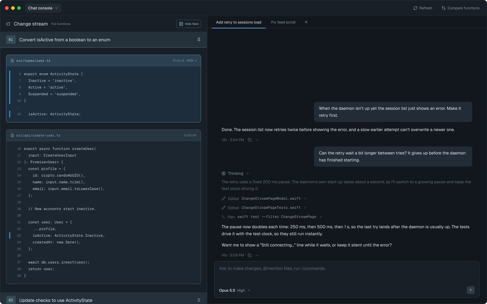

| State | When it shows | Node | Mockup |
|---|---|---|---|
| Connected | A tab in this workspace is connected (the first tab, automatically) | `bgbqq` |  |
| Tab menu open | Right-click on a tab that isn't connected | `A5mpnw` | 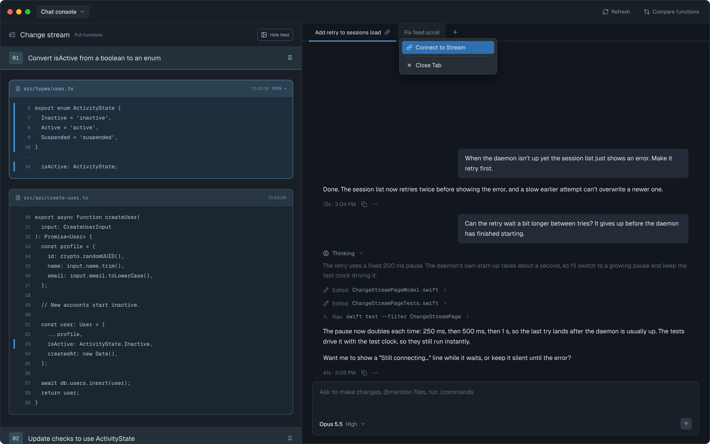 |
| Waiting to confirm | The link just moved to a tab (Connect to Stream, or the connected tab closed) and the chat hasn't confirmed yet; icon is amber, hover shows the explanation | `x19r6e` | 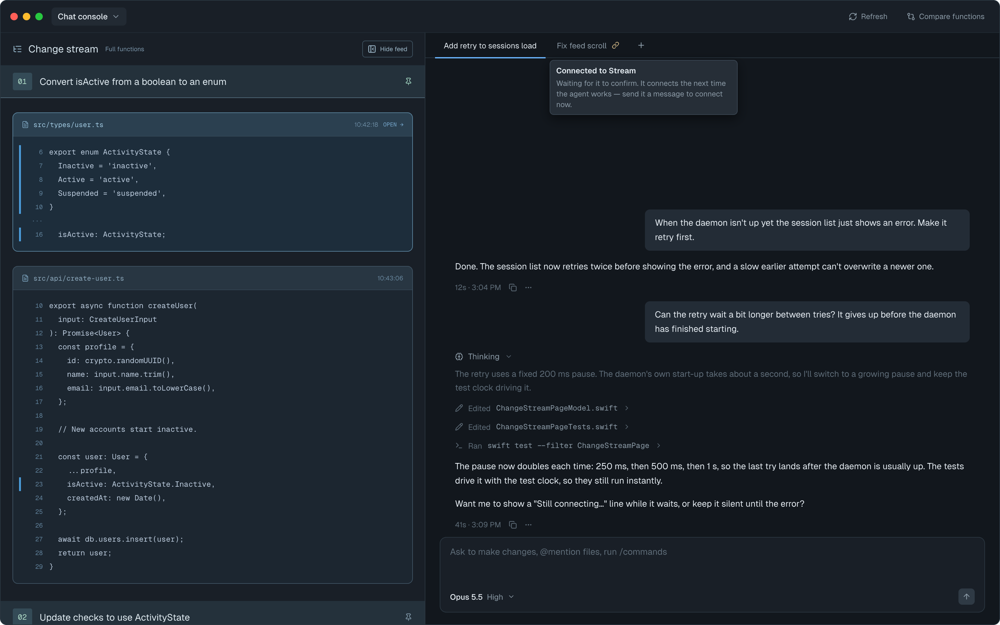 |
| Outside chat connected | A Conductor or terminal chat holds the link; no tab has the icon | `QNVHN` |  |
| Connect to Stream greyed out | Right-click on a tab whose chat hasn't sent a message yet (Slipstream can't link it until then) | `ui5E0` | 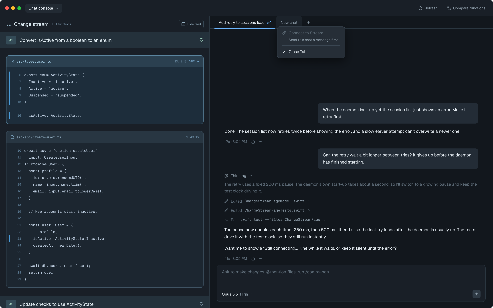 |
| First tab waiting | Nothing is linked and no tab has sent a message (e.g. a brand-new workspace); the first tab shows the amber icon and links automatically after its first message | `ex52E` | 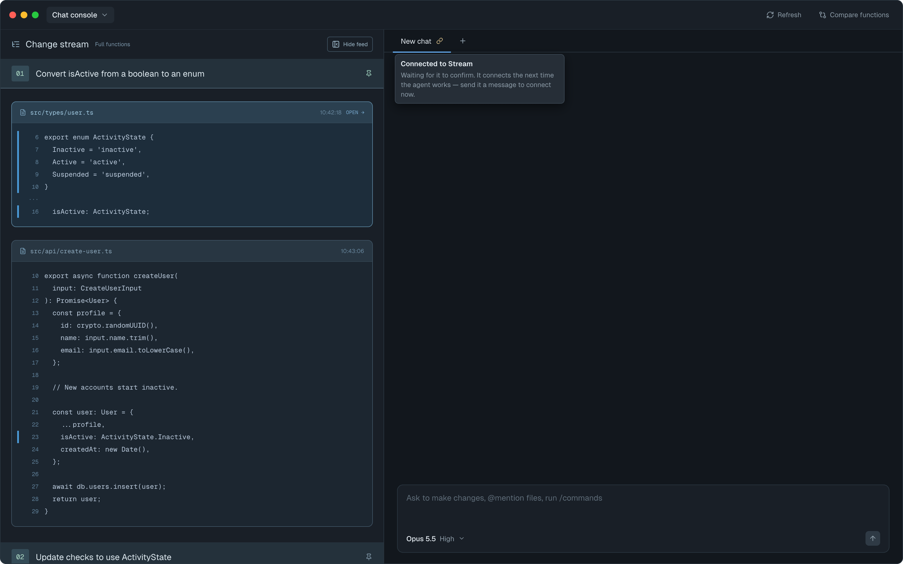 |
| Couldn't connect | Linking a tab failed; orange broken-link icon, hover explains why. Right-click → Connect to Stream retries | `M4jmt` | 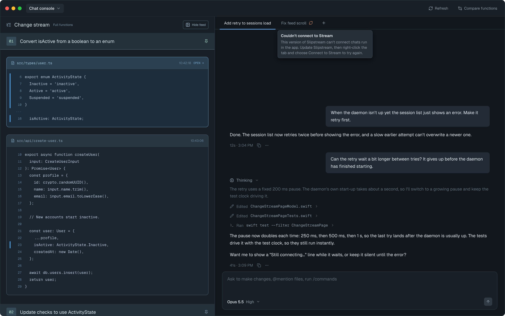 |

Hover text on the link icon: title "Connected to Stream"; while waiting (including the first-tab
waiting state), the body reads "Waiting for it to confirm. It connects the next time the agent
works — send it a message to connect now."

Disabled menu item hint: "Send this chat a message first."

"Couldn't connect" hover: title "Couldn't connect to Stream"; body by reason (`LinkRefusal`,
models.md):
- Slipstream too old: "This version of Slipstream can't connect chats run in the app. Update
  Slipstream, then right-click the tab and choose Connect to Stream to try again."
- Link slots full: "Slipstream is already connected to 10 chats, its limit. Unlink one with
  `slipstream unlink`, then right-click the tab and choose Connect to Stream to try again."
- Setup incomplete or other: "Slipstream said: <its message> Right-click the tab and choose
  Connect to Stream to try again."

## Ask panel
- **Status:** Changed
- **Surface:** client
- **Address:** n/a (native) — the Ask panel opened from a changed line in the change stream
- **Access:** anyone using the app on this Mac
- **Navigated to from:**
  - Change stream → Ask on a changed line
- **Navigates to:**
  - Nothing new; the notice under the question box only changes its wording
- **Changed from today:** the notice under the question box speaks to app chat tabs instead of
  telling the user to run `slipstream attach`. When an outside chat holds the link, the notices
  keep today's wording.
  Current screens: 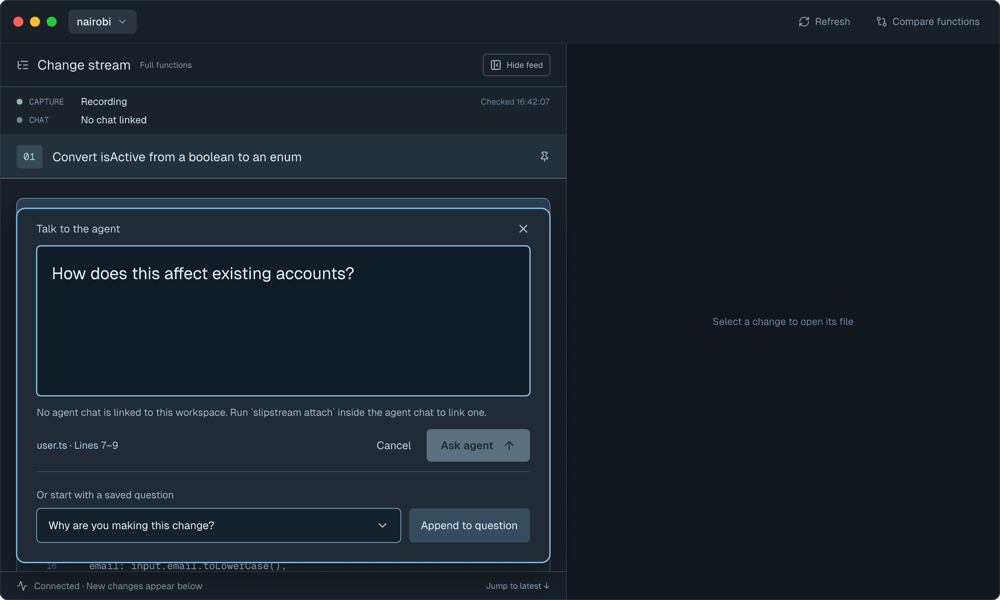
  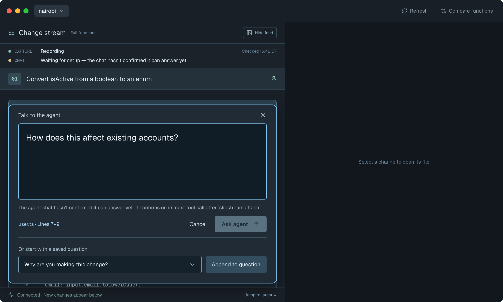

| State | When it shows | Node | Mockup |
|---|---|---|---|
| Nothing connected yet | No chat (app tab or outside) is linked to this workspace's stream — usually because no tab has sent a message yet | `s2EAnj` | 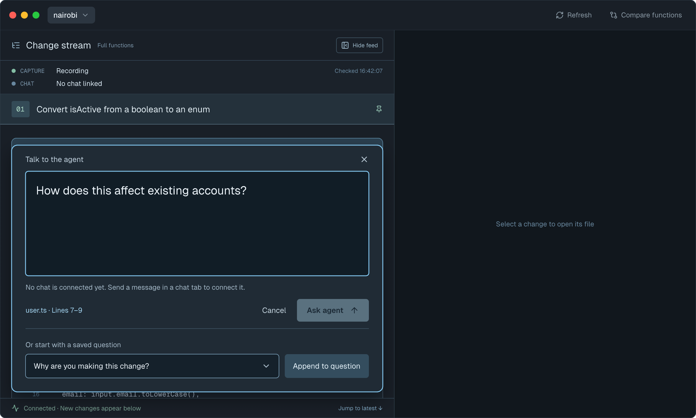 |
| Connected tab hasn't confirmed | An app tab is connected but its link is still waiting to confirm | `liVhQ` | 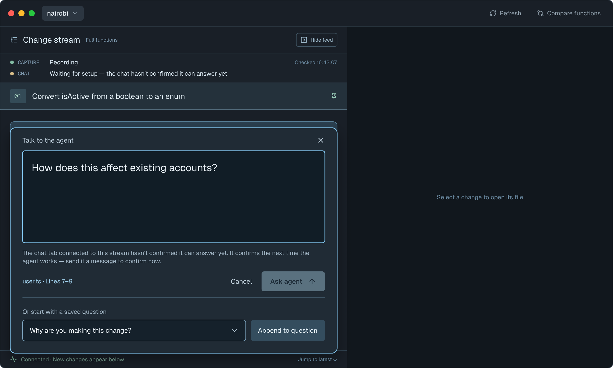 |

Notice text:
- Nothing connected yet: "No chat is connected yet. Send a message in a chat tab to connect it."
  (Phase 7: the old "No chat tab open" state could never show, because the workspace always
  keeps at least one tab.)
- Connected tab hasn't confirmed: "The chat tab connected to this stream hasn't confirmed it can
  answer yet. It confirms the next time the agent works — send it a message to confirm now."

## Question thread
- **Status:** Changed
- **Surface:** client
- **Address:** n/a (native) — the reply panel opened from a question bar in the change stream
- **Access:** anyone using the app on this Mac
- **Navigated to from:**
  - Change stream → a question bar
- **Navigates to:**
  - Nothing new
- **Changed from today:** when the chat link moves (Connect to Stream, or the connected tab
  closes), unanswered questions go to the newly connected chat automatically (Slipstream keeps
  them for it). The amber line under the question says so until the new chat picks it up, then
  returns to today's "waiting" line. Questions dropped because recording restarted keep today's
  wording.
  Current screen: 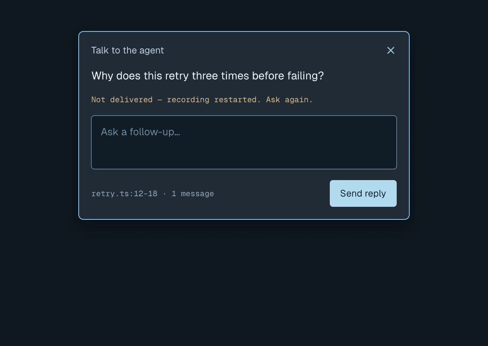

| State | When it shows | Node | Mockup |
|---|---|---|---|
| Re-sending after the link moved | The link moved before the question was answered, and the newly connected chat hasn't picked it up yet | `Ycgxv` | 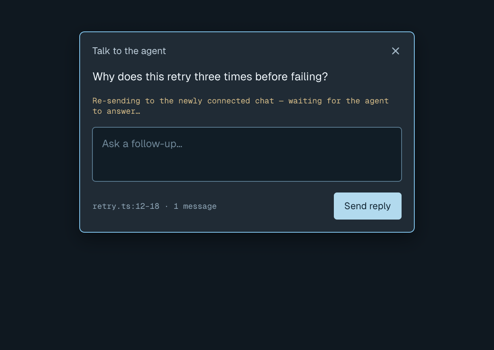 |

Line text:
- Re-sending: "Re-sending to the newly connected chat — waiting for the agent to answer…"

(Phase 7 removed the "Not delivered in time" state: Slipstream now keeps a moved question for the
next chat, so the app no longer re-sends or times out a re-send itself.)
