# PR status bar — Screens

Pen file: `design/slipstream.pen`. The frames are in zone "Zone · PR status bar" (`o1YFJQ`): screen A
(`g4p4Cf`) holds the header states, screen B (`N9K28`) the chat messages. Measurements and colours
are in [`exports/pr-status-bar.json`](exports/pr-status-bar.json); the HTML exports are next to it.

## Navigation map
| Screen | Surface | Address | Reached from |
|---|---|---|---|
| Workspace window, right column header | client | n/a (native): a new 40pt row at the top of the right column of `Window("Slipstream", id: "main")`, above the Change stream / Terminals tabs | Selecting a workspace in the sidebar |
| Workspace window, chat transcript | client | n/a (native): the chat column | Selecting a workspace; a PR bar button that hands work to the agent |

## Workspace window, right column header (the PR status bar)
- **Status:** Changed
- **Surface:** client
- **Address:** n/a (native). A new 40pt row at the top of the right column, above the Change
  stream / Terminals tabs (`rightPaneStrip`). Nothing occupies this space today; the
  `conductor-top-bar` preview below sketched the area but only the system toolbar was built.
- **Access:** anyone using the app on this Mac. It shows only when a workspace is selected.
- **Navigated to from:**
  - Sidebar → choosing a workspace row. The bar shows that workspace's PR.
- **Navigates to:**
  - PR number chip `#61 ↗` → opens the PR on GitHub in the default browser.
  - **Create PR** (⌘⇧P) → sends the agent "Create a PR" with `PR instructions.md` attached. The chat
    shows the message (screen B).
  - **Commit and push** → sends the agent "Commit and push all changes".
  - **Resolve conflicts** → sends the agent "Rebase your branch onto the remote branch (`<target>`)
    and resolve conflicts. Stage the resolved files and run `git rebase --continue`, then push
    --force-with-lease."
  - **Fix errors** (⌘⇧X) → sends the agent "Fix the failing CI actions. I've attached the failure
    logs." with `Fix errors instructions.md` attached.
  - **Merge** (⌘⇧M) → merges the PR on GitHub directly (no agent), with the repository's default
    merge method, only if the PR head is still the one shown.
  - **Continue** → starts a new branch in the same workspace from the latest target branch (no
    agent). The chats stay.
  - **Archive** → archives the workspace, as the sidebar's Archive does today.
  - **Details** → a popover with the failed command, its exit status and its full output, with Copy.
- **Changed from today:** a new row is added above the tabs. It shows, left to right: the PR
  number chip (when a PR exists), where things stand (icon, label, muted detail), a spacer, and the
  one next-step button. Only one situation shows at a time. Which one is decided by the rules in
  spec.md ("How the status is derived"); the table lists the states, not their precedence.
  While an agent button's message is being sent and its agent turn runs, that button is dimmed, as
  Merge is in Merging.

  Current screen (the reference preview from `conductor-top-bar`):
  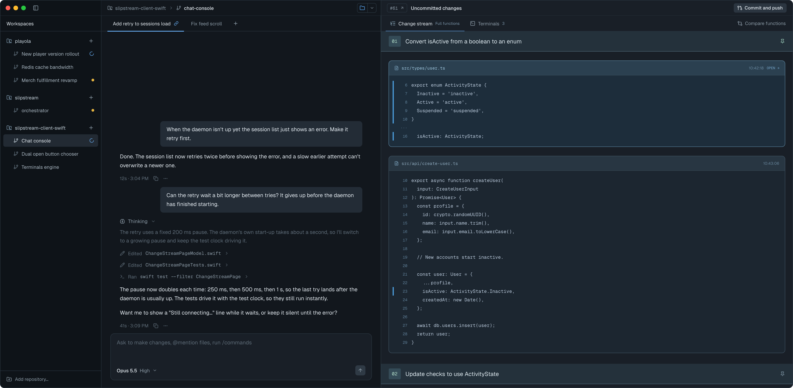

  Conductor, for reference: 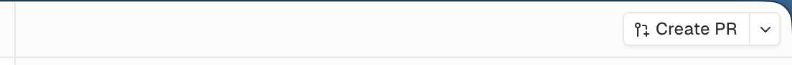
  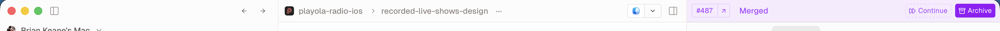

| State | When it shows | Node | Mockup |
|---|---|---|---|
| Checking | The selected workspace has no status result yet (later checks keep the last state). Muted spinner and "Checking for a pull request…" | `T2P1PA` | 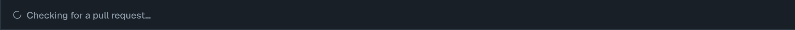 |
| Couldn't check | `git` or `gh` failed (gh missing, signed out, no network, timeout). Red title and **Details**. The title names the operation: "Couldn't check the pull request", "Merge failed", "Couldn't start a new branch", "Couldn't send Create PR"… | `jdgs9` | 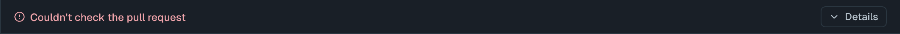 |
| Couldn't check, Details open | **Details** clicked: the operation, folder, command, how it ended (exit status, timeout, launch failure) and full output, selectable, with Copy | `kZazI` | 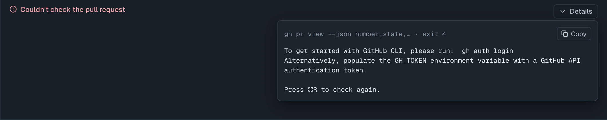 |
| Merging | **Merge** clicked and GitHub hasn't answered. "Merging…", the Merge button dimmed | `tB8z2` | 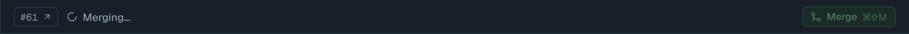 |
| Merged | The branch's PR is merged, its head is still this branch's HEAD, and nothing is uncommitted. The strip is tinted purple; **Continue** and **Archive** | `C9CBi` | 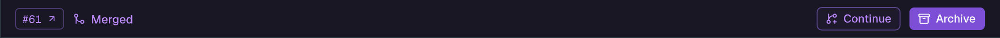 |
| Closed | The branch's PR was closed without merging, with the same head-and-clean rule as Merged. Muted "Closed"; **Create PR** opens a new one | `yl9BJ` | 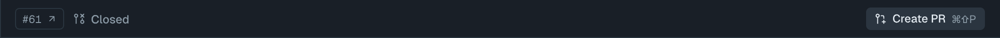 |
| PR open, uncommitted or unpushed | A PR is open and the worktree has uncommitted changes, or local HEAD is ahead of the PR's head. **Commit and push** | `lSWPx` | 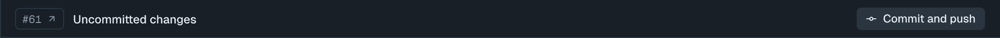 |
| PR open, merge conflicts | GitHub reports the PR conflicts with its base. Amber "Merge conflicts with develop"; **Resolve conflicts** | `b92tO` | 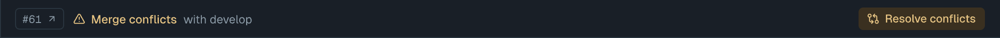 |
| PR open, checks failed | At least one check failed. Red "Checks failed · 2 of 9 failed"; **Fix errors** | `yzc6y` | 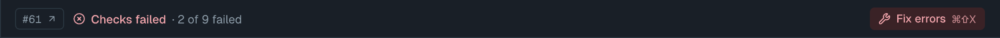 |
| PR open, checks running | Checks are still running and none has failed. Muted "Checks running · 6 of 9 done"; no button | `iba7s` |  |
| PR open, ready | Not a draft, nothing failed or running, and GitHub says it can merge (`MERGEABLE` and `CLEAN`). Green "Ready to merge"; **Merge** | `sWeoC` | 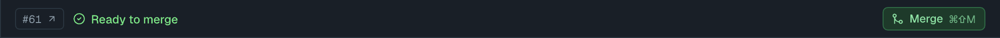 |
| PR open, draft | Would be "ready", but the PR is a draft (gh won't merge drafts). Muted "Draft · all checks passed"; no button (spec D6) | `uhPcs` | 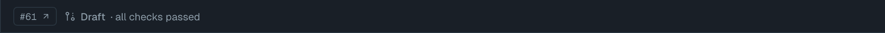 |
| PR open, waiting | Nothing to fix, but GitHub won't merge yet: still computing, review required, changes requested, behind the target, blocked by branch rules, or the branch is out of sync with the PR. Muted hourglass, "Waiting on GitHub · <reason>"; no button (spec D12) | `dGTED` | 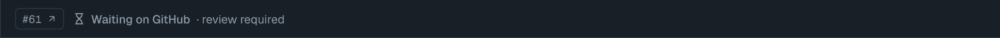 |
| No PR, uncommitted | No PR for the branch, and the worktree has uncommitted changes. **Create PR** | `ccdpv` | 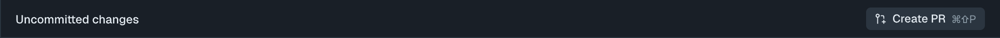 |
| No PR, committed | No PR, clean worktree, branch has commits its target doesn't. "Ready for a pull request · 3 commits ahead of develop"; **Create PR** | `eaMA1` | 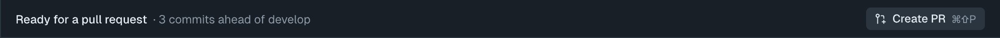 |
| Nothing to submit | No PR, clean worktree, nothing ahead of the target. The strip is empty | `XXB3S` | 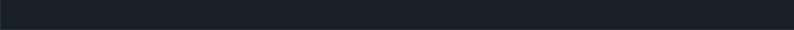 |

## Workspace window, chat transcript
- **Status:** Changed
- **Surface:** client
- **Address:** n/a (native). The chat column's transcript.
- **Access:** anyone using the app on this Mac.
- **Navigated to from:**
  - A PR bar button that hands work to the agent. The message appears in the workspace's chat; if no
    chat is open for the workspace, one is opened first.
- **Navigates to:**
  - Attachment chip → opens the attached file in its default app.
- **Changed from today:** a user message ending in a well-formed `@⟦name⟧(path)` marker (grammar in
  spec.md) shows the text before the marker, then a file chip labelled with `name`, instead of the
  raw marker. Other messages are unchanged. If the file is gone, clicking the chip shows an alert
  naming the path.

| State | When it shows | Node | Mockup |
|---|---|---|---|
| Create PR sent | **Create PR** was clicked | `f00glz` |  |
| Fix errors sent | **Fix errors** was clicked; the failure logs are inside the attached file | `X6l6V` | 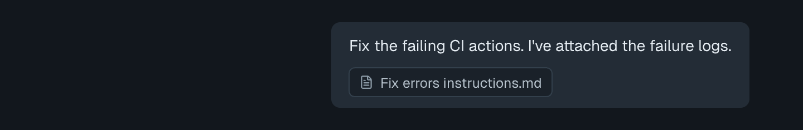 |
| Plain message sent | **Commit and push** or **Resolve conflicts** was clicked (no file) | `iQKtW` | 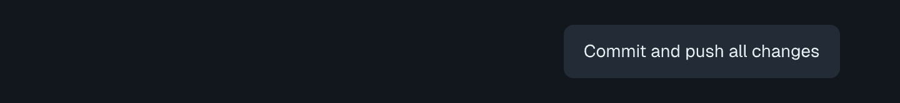 |
