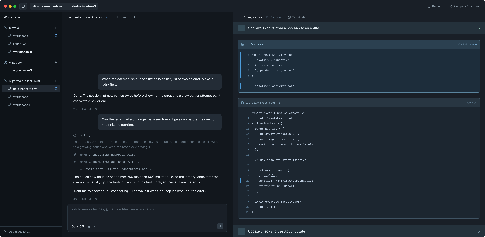
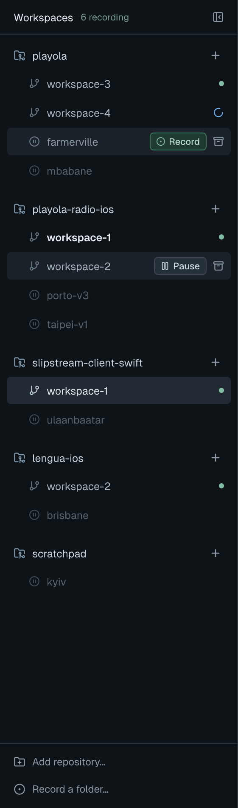
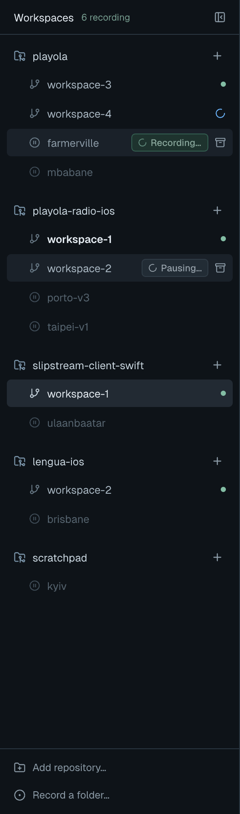
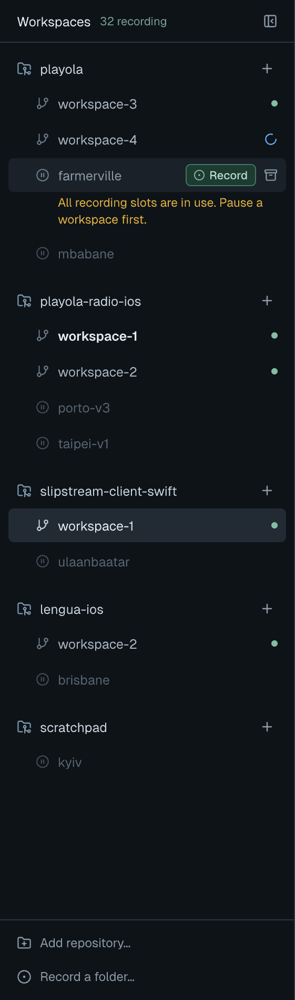
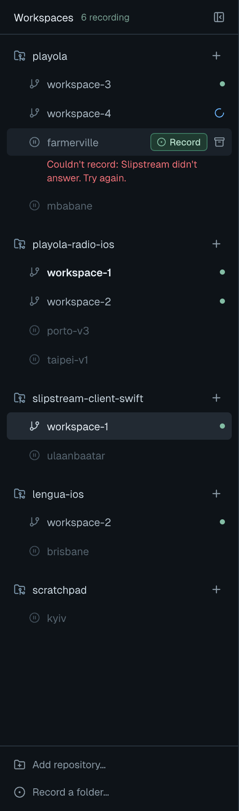
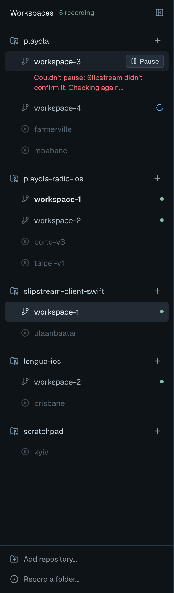
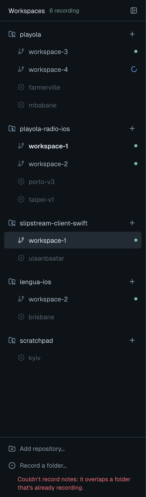
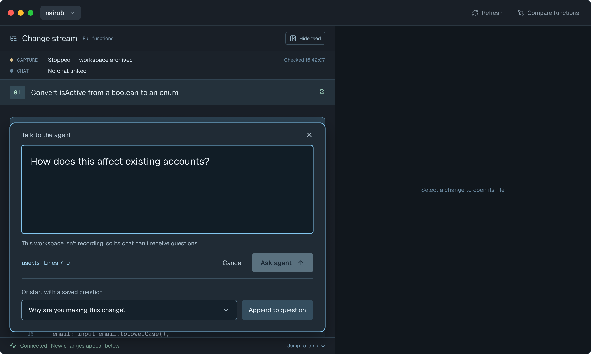
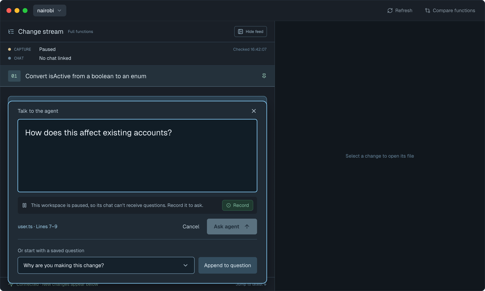
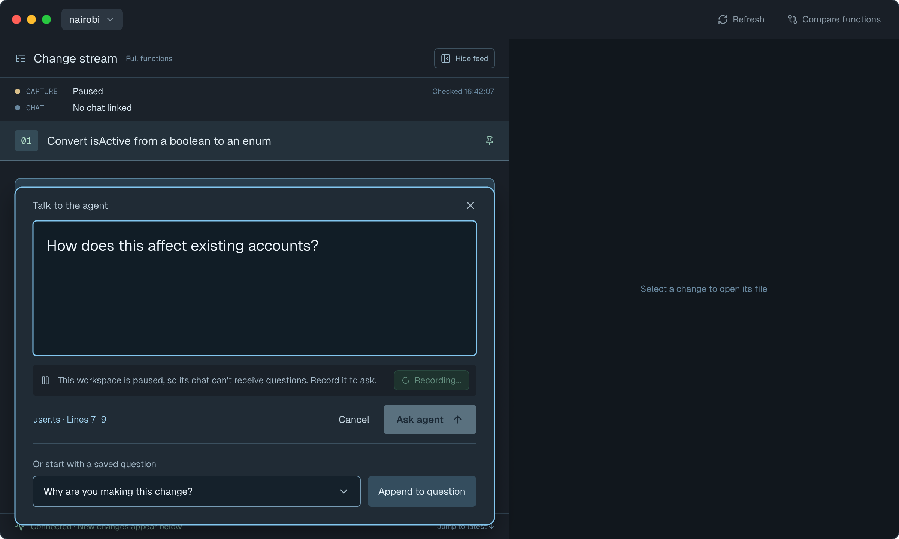

# Recording controls — Screens

Pen file: `design/slipstream.pen`. The approved state frames are in the zones
"recording-controls — sidebar states" (`ZcE7b`) and "recording-controls — ask paused" (`KNAm8`).
The layout exploration they came from is in the zone "recording-controls — layout exploration"
(`gOF3X`).

## Navigation map
| Screen | Surface | Address | Reached from |
|---|---|---|---|
| Workspace sidebar | client | n/a (native): the left column of `Window("Slipstream", id: "main")` | Launching the app |
| Ask the agent | client | n/a (native): the question composer over the stream | A change's or a selection's ask action, as today |

## Workspace sidebar
- **Status:** Changed
- **Surface:** client
- **Address:** n/a (native). The sidebar column of the app's one window, as designed in
  [workspace-sidebar/screens.md](../workspace-sidebar/screens.md).
- **Access:** anyone using the app on this Mac
- **Navigated to from:**
  - Launching the app (the sidebar is open unless it was hidden at last quit)
- **Navigates to:**
  - Row click → that workspace's stream and chat. This works for paused rows too.
  - Row hover or keyboard focus → **Pause** (recording row) or **Record** (paused row), shown
    next to the archive icon. Each is also an accessibility action on the row.
  - **Record a folder…** (sidebar footer) → the macOS folder picker. The chosen folder starts
    recording and appears as a row.
  - **Add repository…** and repo-header **+** → New Workspace, unchanged. The new workspace
    records, as it does today.
- **Changed from today:**
  - **Rows are folders.** One row per workspace folder. When the daemon has more than one capture
    for a folder (a folder deleted and recreated), the row shows the current one, by the rule the
    chat already uses (`[CaptureSummary].current(in:)`): a live chat link, then an active capture,
    then the first the daemon lists. Pause and Record act on the folder; after either, the row
    shows whatever the next refresh reports for it.
  - **Paused rows are shown.** Today the sidebar hides every inactive session unless it is
    selected. Now a workspace that was paused (`stopped{detached}`) stays in its repo group,
    dimmed, with a pause icon in place of the branch icon. A paused row appears only while its
    folder exists. The app checks this through an injected file-system dependency, once per
    refresh; a folder it can't read counts as missing.
  - **Not-recording rows are shown.** A capture that failed and is retrying (`not_recording`)
    still holds a slot. Today it is hidden unless selected; now it shows as a normal row without
    the green dot, with **Pause** on hover, so a slot can always be freed from the sidebar.
  - **Other stopped rows, as today.** Archived workspaces, and stops that aren't a pause
    (maintenance, missing folder, watcher failed), stay hidden unless selected.
  - **Recording dot.** A recording row shows a small green dot at its right end. The blue
    agent-working spinner takes its place while an agent turn runs.
  - **Header count.** The header shows "N recording" next to "Workspaces". N counts rows that are
    recording now, not slots in use; starting and retrying captures hold a slot but aren't
    counted. So "Full" can appear while N is under 32.
  - **Footer.** It gains a second line, **Record a folder…**. A refusal for a picked folder has no
    row to sit under, so its message shows under the footer. Cancelling the picker does nothing.
    Picking a folder that is already recording selects its row.
  - **One operation per folder.** While Pause or Record runs for a folder, both its sidebar
    button and Ask's **Record** show the working state and are disabled. A reply that arrives
    after the user moved to another workspace still updates that folder's row, and never moves
    the selection.
  - **After the daemon accepts.** Accepting a Record means the capture is admitted, not yet
    recording. The row follows the next refresh: starting, then recording, or a failure shown as
    today.
  - **No reply.** If the request was sent but no reply came back, the app doesn't claim either
    outcome. It shows "…not confirmed. Checking…", refreshes, and shows what the daemon reports.
  - **New Workspace** still records. If the daemon is full, the workspace is still created but
    isn't recorded or listed; its Setup tab shows the daemon's "NOT recording" line, and
    **Record a folder…** records it once a slot is free.
  - Not included: a "Remove from sidebar" action for paused rows.

  Current sidebar: 

| State | When it shows | Node | Mockup |
|---|---|---|---|
| Default + hover | Normal use. Hovering farmerville (paused) shows **Record**; hovering workspace-2 (recording) shows **Pause** | `qrTx8` |  |
| Working | After Pause or Record is clicked, until the daemon replies. The button spins, reads "Pausing…" or "Recording…", and is disabled | `OPNrE` |  |
| Full | Record was refused because all 32 slots are in use. An amber line under the row reads "All recording slots are in use. Pause a workspace first." The header still shows the real recording count. The line clears on the next click | `pkqIf` |  |
| Record failed | Any other Record refusal. A red line under the row gives the reason, for example "Couldn't record: couldn't reach Slipstream." The line clears on the next click | `T9EHei` |  |
| Pause failed | Pause was refused or not confirmed. A red line under the row, for example "Couldn't pause: Slipstream didn't confirm it. Checking again…". The line clears on the next click | `W3IjdQ` |  |
| Record a folder failed | A folder picked with **Record a folder…** was refused. A red line under the footer, for example "Couldn't record notes: it overlaps a folder that's already recording." The line clears on the next click | `G8j5Wn` |  |

Strings, all from the approved frames; the full list of error wordings is in
[endpoints.md](./endpoints.md):
- Header count: "6 recording"
- Row buttons: "Pause", "Record"; while working: "Pausing…", "Recording…"
- Footer: "Add repository…", "Record a folder…"
- Full: "All recording slots are in use. Pause a workspace first."
- Record failed: "Couldn't record: <reason>"
- Pause failed: "Couldn't pause: <reason>"
- Record a folder failed: "Couldn't record <folder>: <reason>"

## Ask the agent
- **Status:** Changed
- **Surface:** client
- **Address:** n/a (native). The question composer, as designed in
  [capture-states/screens.md](../capture-states/screens.md).
- **Access:** anyone using the app on this Mac
- **Navigated to from:**
  - A change's or a selection's ask action, unchanged
- **Navigates to:**
  - **Record** (in the paused notice) → records the workspace. It runs the same request as the
    sidebar's **Record**.
  - Cancel / close → back to the stream, unchanged
- **Changed from today:**
  - **Paused notice.** When the workspace is paused, the notice line above the buttons becomes a
    row: a pause icon, "This workspace is paused, so its chat can't receive questions. Record it
    to ask.", and a **Record** button. **Ask agent** stays disabled. Pause unlinks the chat, so a
    paused workspace never has a linked chat; the chat line reads "No chat linked". Today this
    case shows "This workspace isn't recording, so its chat can't receive questions." with no way
    to fix it from here.
  - **Capture line.** A paused workspace's capture line reads "Paused" instead of "Stopped —
    capture detached".
  - **After Record.** The notice gives way to today's notices as the workspace starts recording.
    **Ask agent** enables only when today's rules allow it: the workspace is recording and a chat
    is linked and checked. After Record the app tries its usual chat auto-link once, so a
    chat with messages links again (see [endpoints.md](./endpoints.md), attach from a chat).
  - A refused Record shows the same message as the sidebar (amber when full, red otherwise) in
    place of the notice text, cleared on the next click. Closing Ask doesn't cancel the request;
    the sidebar row shows its outcome.

  Current screen: 

| State | When it shows | Node | Mockup |
|---|---|---|---|
| Paused | The workspace is paused | `PHH8d` |  |
| Recording… | After **Record** is clicked, until the daemon replies. The button spins, reads "Recording…", and is disabled | `blDch` |  |

Strings, all from the approved frames:
- Notice: "This workspace is paused, so its chat can't receive questions. Record it to ask."
- Button: "Record"; while working: "Recording…"
- Capture line: "Paused"
- Chat line: "No chat linked"
