# Stream names — Screens

Pen file: `design/slipstream.pen`, zone `XxvOh` ("10 · Stream names · rename streams").

## Navigation map
| Screen | Surface | Address | Reached from |
|---|---|---|---|
| Stream picker | client | `n/a (native)`, toolbar menu in the Change stream window | Change stream window toolbar → stream picker title |
| Rename sheet | client | `n/a (native)`, sheet on the Change stream window | Stream picker → "Rename Stream…", or ⇧⌘R |

## Stream picker
- **Status:** Changed
- **Surface:** client
- **Address:** `n/a (native)`, the `Menu` on the Change stream window's toolbar
- **Access:** the local user of the app (daemon bearer token in memory)
- **Navigated to from:**
  - Change stream window → click the stream picker title in the toolbar
- **Navigates to:**
  - A stream row → switches the window to that stream (unchanged)
  - "Rename Stream…" (⇧⌘R) → Rename sheet for the stream being watched
- **Changed from today:** labels show the effective name (`user name ?? agent name`) instead of the
  full worktree path. An unnamed stream falls back to `<worktree folder name> · started MMM d HH:mm`.
  Same-named streams get ` · started MMM d HH:mm` appended. Any labels that still collide (including
  a name that matches another stream's fallback) get ` · <stream id>` appended. A stream whose start
  record didn't load keeps its name, or, if unnamed, is labelled by its id. The recording stream
  keeps ` · Recording`. The picker title shows the watched stream's label. A divider and
  "Rename Stream…" (⇧⌘R) are added at the bottom.
- **Rename availability:** "Rename Stream…" and ⇧⌘R share one model predicate.
  - Against a daemon that does not report names, every label uses the fallback, and "Rename
    Stream…" is disabled with the hint "Update Slipstream to rename streams".
  - With no stream selected, or with the selected stream removed, it is disabled with no hint.
  Current screen: 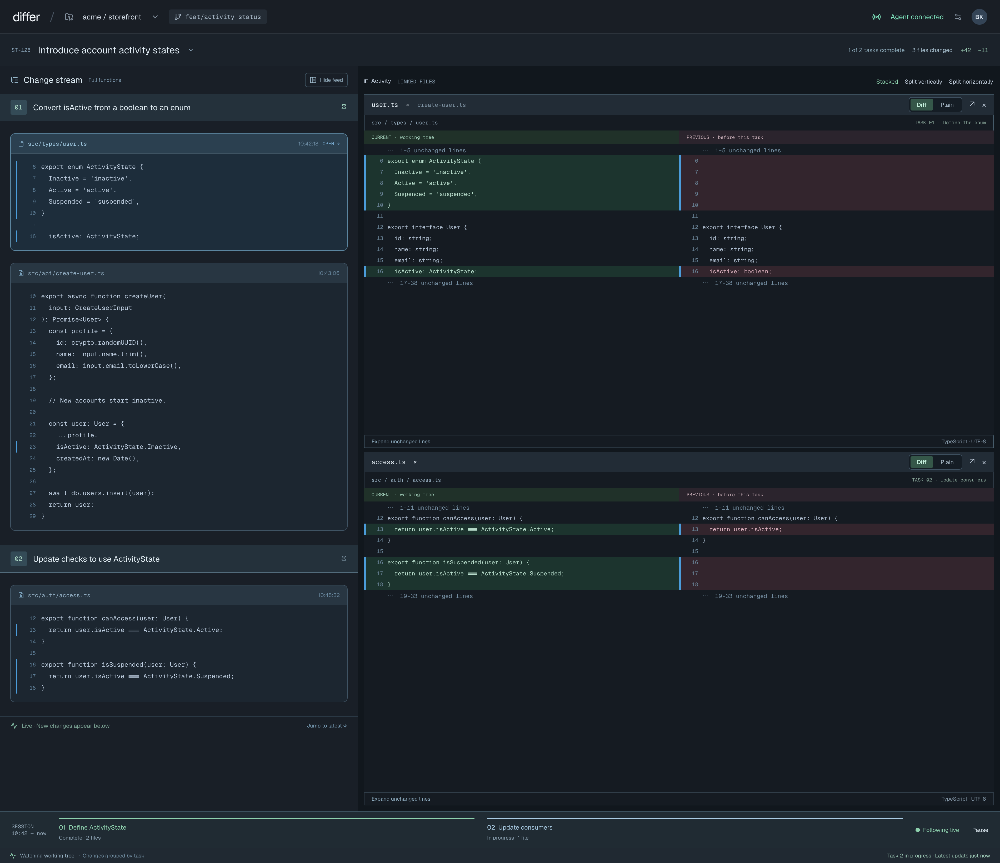

| State | When it shows | Node | Mockup |
|---|---|---|---|
| Menu open | Picker opened against a daemon that reports names; covers a stream named by the user, one named by the agent, two with the same name, an unnamed stream, and the recording stream | `BNJ5S` | 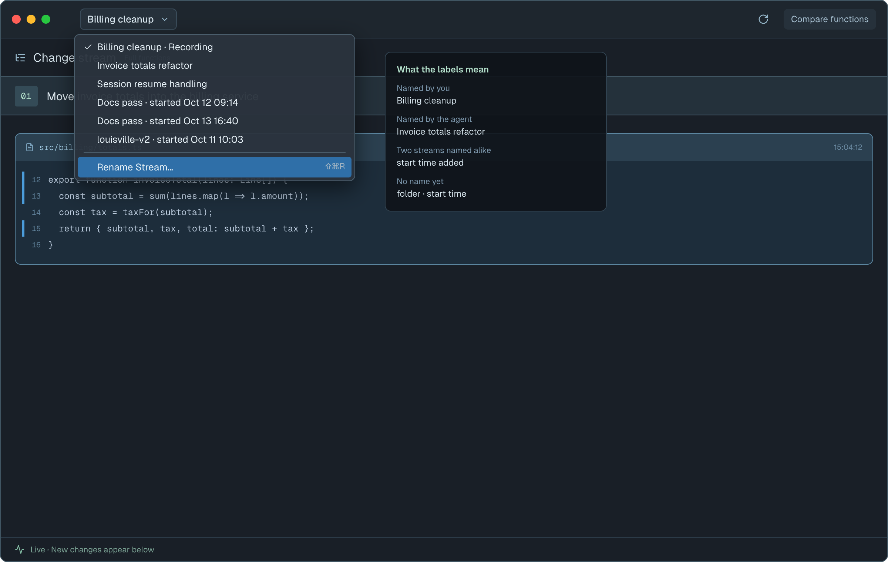 |
| Rename unavailable | Picker opened against an older daemon that does not report names | `G5M93` | 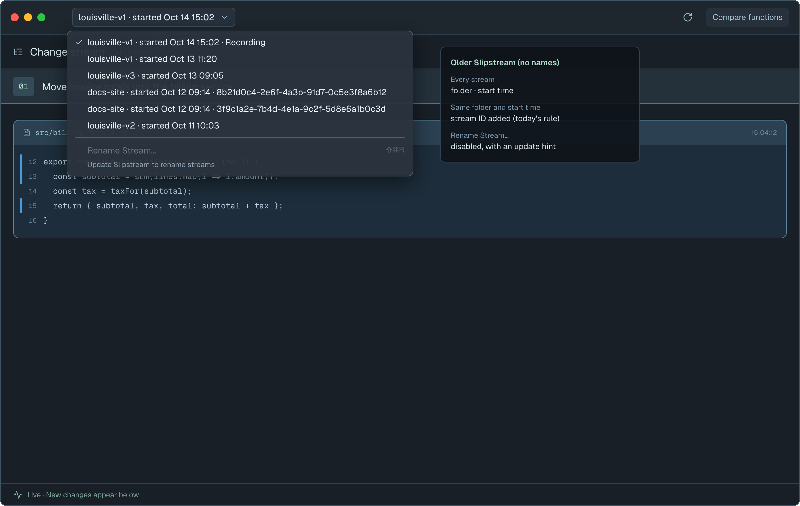 |

## Rename sheet
- **Status:** New
- **Surface:** client
- **Address:** `n/a (native)`, a sheet attached to the Change stream window
- **Access:** the local user of the app; only offered when the daemon reports names
- **Navigated to from:**
  - Stream picker → "Rename Stream…"
  - Change stream window → ⇧⌘R
- **Navigates to:**
  - Save (or Return) → closes the sheet after the daemon confirms; the stream list refreshes
    and the picker title shows the new name
  - "Use agent's name" → clears your name immediately (same saving and failure states as
    Save), then closes
  - Cancel (or Esc) → closes with no change
- **Behaviour:**
  - Renames the stream being watched. The subtitle is the fallback label (folder · start time),
    so the stream stays identifiable whatever it's called.
  - The field opens with the current name selected: your name, else the agent's name, else
    empty with the placeholder "Name this stream".
  - Save is enabled only when the trimmed text is valid and differs from the current name.
  - "Use agent's name" shows only when you have set a name.
    - When the agent has given no name, the row reads "No name from the agent" and the
      button reads "Use default name". This is improvised from the Your name frame.
  - Saving the agent's current name unchanged is not possible (Save stays disabled), so you
    cannot pin it against a later agent rename. That is intentional.
  - The sheet's target stream is fixed when it opens.
  - Validation runs as you type and mirrors the daemon exactly. The rules and their order
    are in [models.md](./models.md#session-name-file-sessionsidnamejson-new).
  - While saving, Cancel and Esc are disabled, because a sent rename cannot be withdrawn.
  - On success the sheet closes and the list is reloaded, which shows the new name. That
    reload supersedes any list refresh started before the save.
  - Save failures keep the sheet open with your text:
    - An unreachable daemon, `STORAGE_UNAVAILABLE`, `CAPTURE_NOT_READY`, `PROTOCOL`, an
      unknown code, or a malformed reply shows the banner below.
    - `SESSION_NOT_FOUND` shows "This stream was deleted." with Save disabled.
    - `INVALID_NAME` shows as the field error.
    - When the transport reports the outcome as unknown (the reply was lost after
      sending), the banner reads "Slipstream didn't confirm the rename. Check the stream
      picker, or try again." The list is refreshed. Nothing is resent automatically.
  - The queued-question notice keeps the label it was given when the question was queued.
    It is a momentary message.

| State | When it shows | Node | Mockup |
|---|---|---|---|
| No name yet | Neither you nor the agent has named the stream | `p60lo9` | 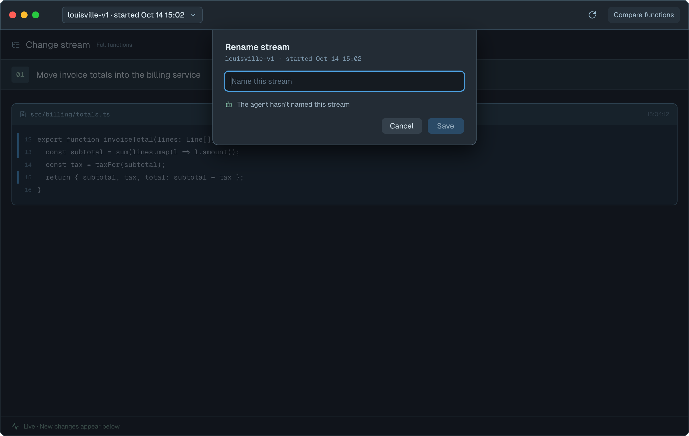 |
| Agent's name | Only the agent has named it | `AHgJG` | 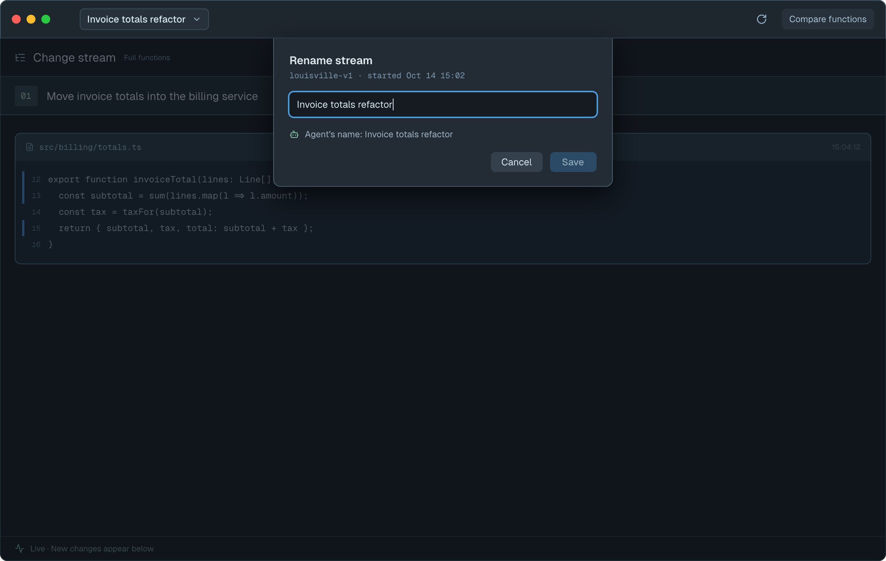 |
| Your name | You have renamed it; "Use agent's name" is offered | `qeFrb` | 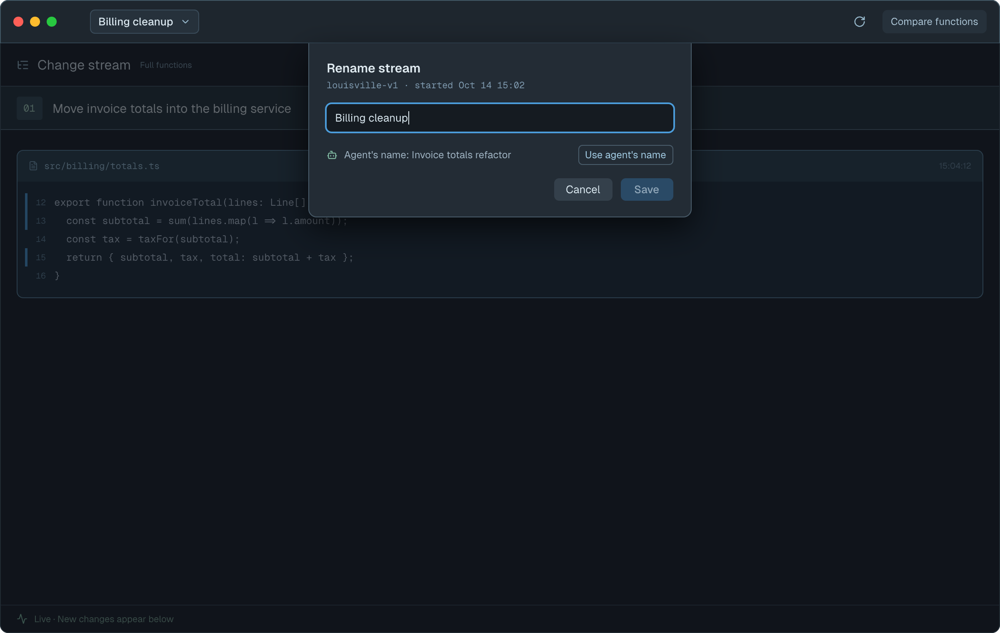 |
| Empty | The field is cleared | `wpFbu` | 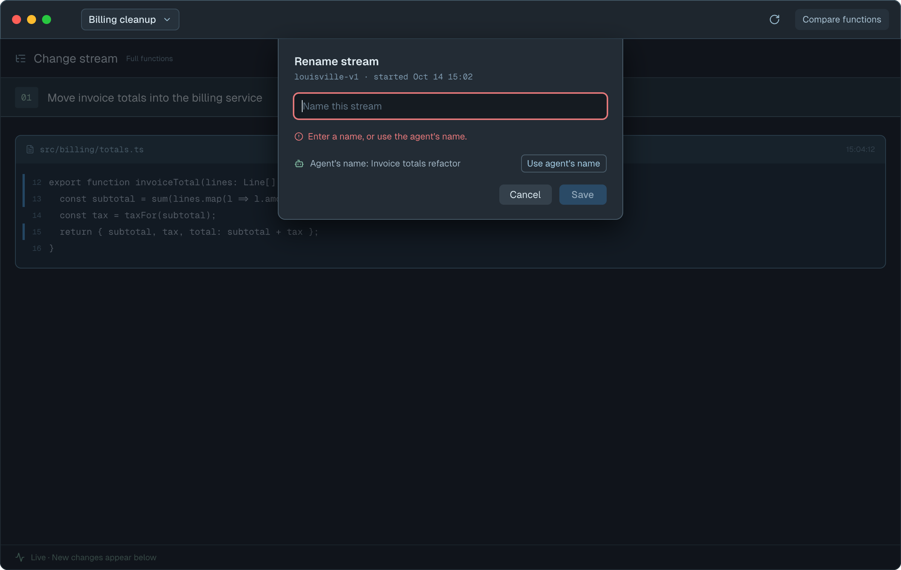 |
| Too long | More than 64 bytes after trimming | `pmfs5` | 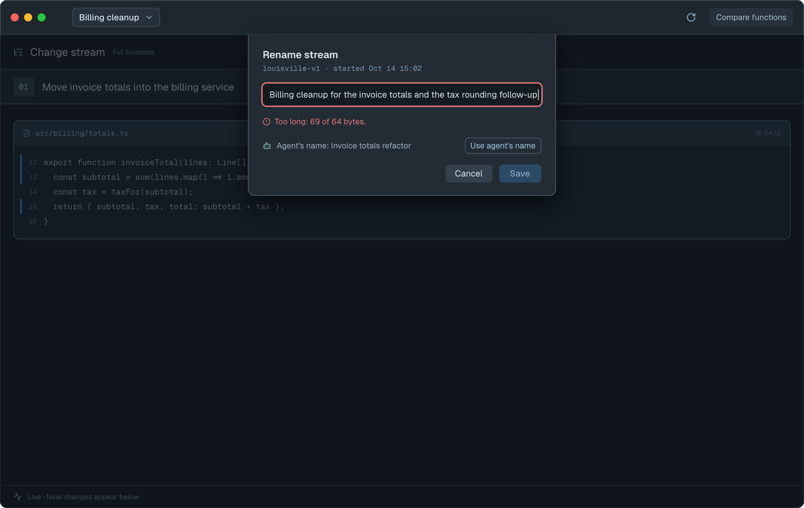 |
| Invalid characters | Text contains a line break or control character (e.g. pasted) | `QAebu` | 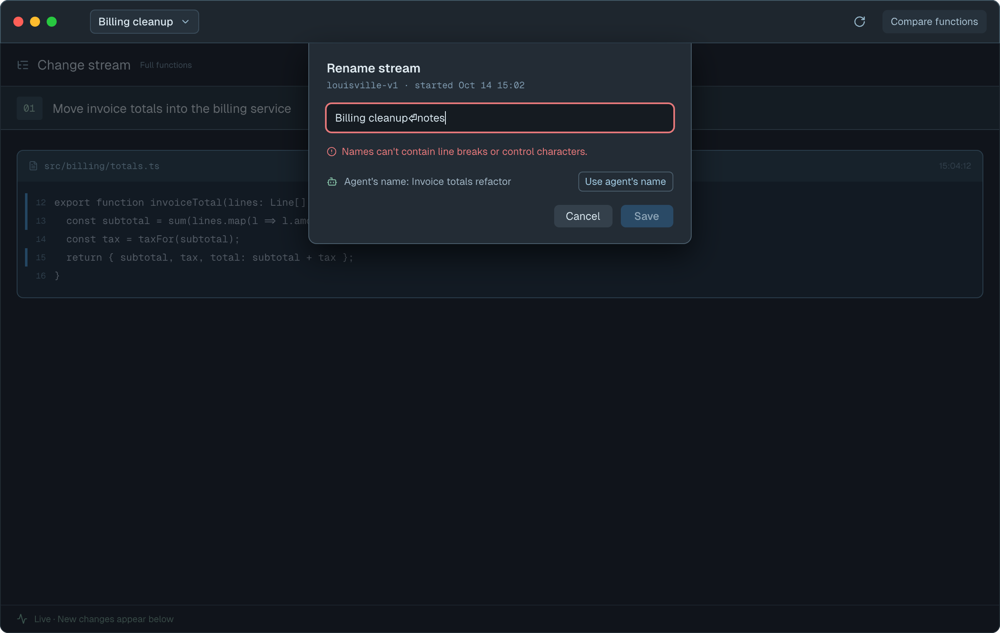 |
| Saving | Rename sent, waiting for the daemon | `RhnOw` | 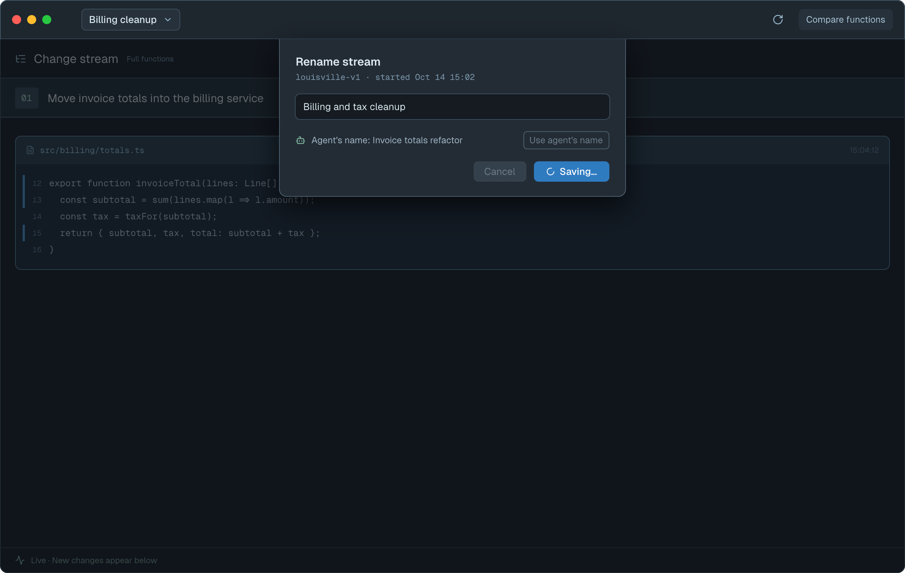 |
| Save failed | The daemon could not be reached or could not store the name | `QoKyQ` | 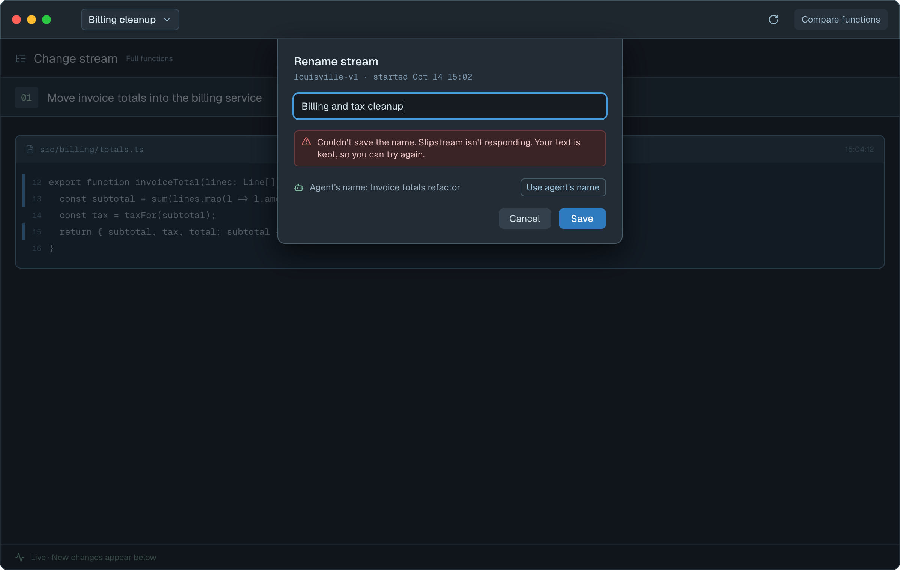 |
