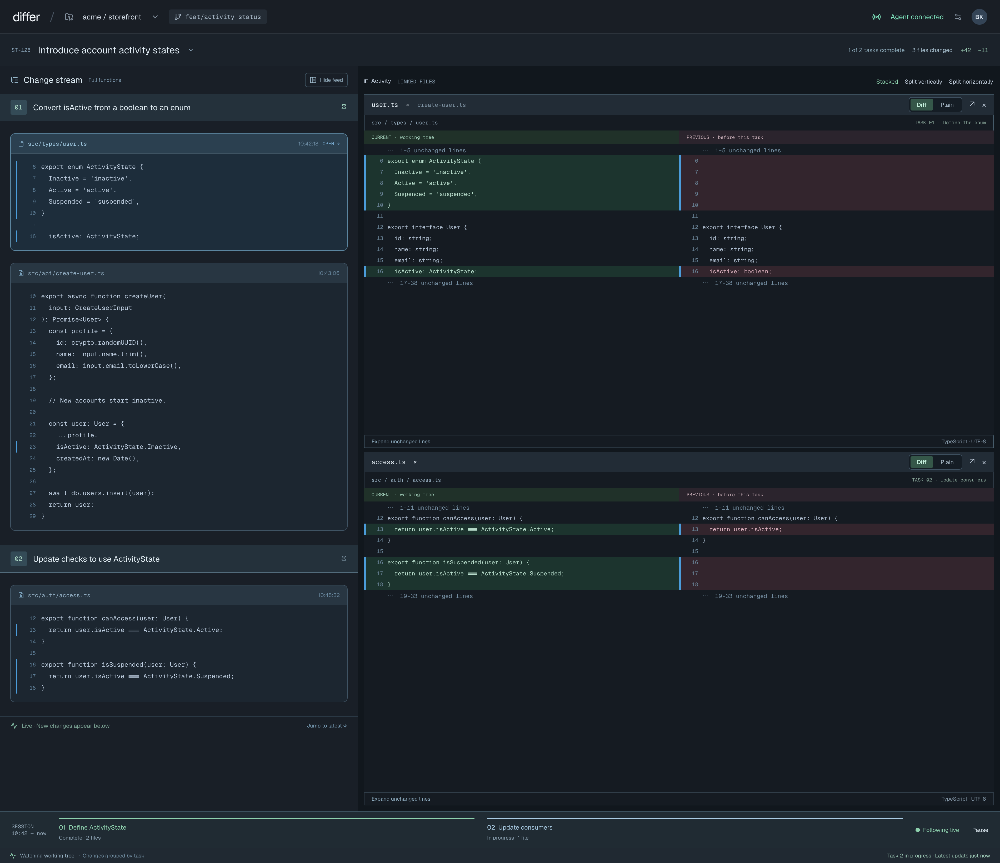

# Stream names

Rename workspace streams from the app, and have the agent give its workspace a name when it
attaches.

## Base commits

| Repo | Branch | SHA |
|---|---|---|
| Client `playola-radio/slipstream-client-swift` | `develop` | `54de11d` |
| Daemon `briankeane/slipstream` (owns the wire contract) | `origin/develop` | `63add07` |

## Target surfaces

- `client`: the macOS app (`SlipstreamViewer`) and `SlipstreamCore`.
- Daemon: store, control socket, `GET /v1/sessions`, `slipstream attach`, `SKILL.md`, README,
  `docs/ask-agent/contract.md`.

## Scope

- The user can rename any retained stream (recording or detached) from the app, and can clear
  their rename to fall back to the agent's name.
- On attach, the agent supplies a short workspace name with `slipstream attach --name "…"`.
  Re-running attach with a new name updates the agent's name.
- `SKILL.md`, the README and the attach output tell the agent to do this.
- The effective name shows in the stream picker, the picker title, and every other place the
  app labels a stream (the queued-question notice).
- With no name, the label falls back to the worktree folder name plus start time.

## Non-goals

- Merging the streams that were duplicated before resume shipped.
- Rename history, or a rename record in the session log.
- A new MCP tool for naming.
- Unique names (duplicates are allowed and disambiguated in the label).
- Periodic polling of the session list.
- HTTP write endpoints (HTTP stays GET-only).

## Decisions (approved 2026-10-14)

Architecture from the Codex consult (session `01a13c90-222d-7a50-8568-aa6b8ba83724`,
`gpt-6-astra`), adjudicated by Claude, decided by Brian in chat on 2026-10-14.

| # | Decision | Choice |
|---|---|---|
| D1 | Storage | Sidecar `sessions/<id>/name.json`, published with the same crash-safe pattern as the tombstone (`src/maintenance.ts:55`). Not a log record. |
| D2 | Precedence | Store `agent_name` and `user_name` separately. Effective name = `user_name ?? agent_name ?? fallback`. Attach only writes `agent_name`; the app only writes or clears `user_name`. |
| D3 | Fallback and validation | Fallback label `<worktree folder name> · started MMM d HH:mm`, then ` · <id>` on collision (today's rule). Daemon is authoritative; the app mirrors the rules for instant feedback. Trim leading/trailing whitespace; reject empty or whitespace-only; reject C0/C1 controls, newlines, U+2028/U+2029 (checked before trimming); max 64 UTF-8 bytes after trimming. Duplicates allowed. |
| D4 | Delivery | `GET /v1/sessions` items carry the names. No new event type. The app refreshes the list at its existing moments (appear, Refresh, select, watched stream resumed) plus right after a rename and when the window becomes active. |
| D5 | Agent entry point | Optional `--name` on `slipstream attach`, carried as `name` on the control `attach` envelope. Gated by a new `attach_features` entry; `--name` against an old daemon fails with an upgrade message. |

Layout directions for the rename UI (approved 2026-10-14): explore two, side by side.
A) "Rename Stream…" in the picker menu opening a sheet. B) Inline edit of the stream name in
the header.

D6 (decided 2026-10-14): Direction A. "Rename Stream…" (⇧⌘R) at the bottom of the stream
picker menu opens a rename sheet. Direction B is not pursued. Exploration frames: canvas zone
`XxvOh`, A1 `QS4AU`, A2 `x7JKQ`, B1 `lG7Sx`, B2 `mYXcU`.

D7 (decided 2026-10-14, refines D3): same-named streams are disambiguated with
` · started MMM d HH:mm` first, then ` · <id>` only if the start time also collides. The
fallback label keeps today's ID rule.

### Screen approvals

| Screen | States | Frames | Approved |
|---|---|---|---|
| Stream picker | Menu open, Rename unavailable | `BNJ5S`, `G5M93` | 2026-10-14, in chat ("all approved") |
| Rename sheet | No name yet, Agent's name, Your name, Empty, Too long, Invalid characters, Saving, Save failed | `p60lo9`, `AHgJG`, `qeFrb`, `wpFbu`, `pmfs5`, `QAebu`, `RhnOw`, `QoKyQ` | 2026-10-14, in chat ("approved") |

Waiver (Brian, 2026-10-14): the rename sheet's "stream was deleted" failure has no frame. The
implementation improvises it from the save-failed layout, using the copy in
[screens.md](./screens.md#rename-sheet).

### Data layer approval

[models.md](./models.md) and [endpoints.md](./endpoints.md) approved by Brian in chat on
2026-10-14 ("Approved"), including these choices:
- A deleted stream gives `SESSION_NOT_FOUND`; `INVALID_NAME` is the only new code.
- Re-attaching with `--name` updates `agent_name`.
- The attach name is written before activation, and a failed write fails the attach.
- The attach reply is unchanged.
- An absent `naming` key means an older daemon.
- `--name` is feature-gated on both CLI paths.

### Constraints carried from the Codex consult

- Rename must not go through `runMaintenance`; it rejects any work while any capture is active
  (`src/daemon.ts:868-883`), which would block renaming detached streams while recording.
- Deleting a stream must remove `name.json` too; cleanup removes only `events.jsonl` today
  (`src/maintenance.ts:30,86`). Rename never recreates a removed or missing session directory.
- A malformed or unknown-version `name.json` is a storage error, not "unnamed".
- The attach name is written before the capture is activated, so the session-list refresh
  triggered by `session.resumed` already sees it.
- A failed list refresh keeps the previous labels instead of clearing the picker.

## Adversarial review (Phase 5)

Codex consult (`gpt-6-astra`, session `01a13c90-222d-7a50-8568-aa6b8ba83724`), 2026-10-14. It ran
against the approved spec, models, endpoints and screens, read alongside daemon `63add07` and client
`54de11d`. Fifteen findings, none left blocking.

| # | Finding | Disposition |
|---|---|---|
| 1 | Metadata lock had no shutdown lifetime | **Resolved.** models.md "Lock lifetime": teardown awaits the lock's chain tail, queued operations re-check ownership and state under the lock, failures don't break the chain |
| 2 | Tombstone publication was outside the lock | **Resolved differently (Phase 7).** Delete and gc stay outside the lock. A `name.json` left in a removed stream is harmless: the list reports null names for removed streams, and gc re-runs history removal |
| 3 | Uncertain outcomes treated as failed saves | **Resolved.** endpoints.md "Outcome" + screens.md: outcome-unknown banner, refresh, no auto-resend; Cancel/Esc disabled while saving (already so in frame `RhnOw`); same-field last-writer-wins accepted |
| 4 | Optional decoding blurs absent vs `null` | **Resolved.** Hand-written decoder; `naming` absent = old daemon, `naming: null` or a missing inner key = malformed; the sidecar requires both keys and valid strings |
| 5 | "Whitespace" not interoperable | **Resolved.** models.md enumerates the order, ECMAScript trim set (matching `contract.md:75`), the surrogate check, and no normalization |
| 6 | Named re-attach adds an await to `attachAgain` | **Resolved.** Re-check the binding under the lock; if it changed, nothing is written and the existing `CAPTURE_NOT_READY` retry reply is returned |
| 7 | "Fails attach" implied rollback | **Resolved.** Uses the existing post-start failure branch: `STORAGE_UNAVAILABLE` for a new session, `SESSION_RESUME_FAILED` for a resumed one; no rollback, retry = same attach |
| 8 | Freshness unbounded; HTTP naming ≠ write availability | **Resolved / accepted.** Refresh moments enumerated, and staleness until the next one accepted (D4). Rename failures against a missing socket use the unreachable banner |
| 9 | Duplicated presentation state | **Resolved.** A confirmed rename closes the sheet and reloads the list (the reload supersedes earlier refreshes; Phase 7), and the sheet's target is fixed. **Accepted:** the queued notice keeps its snapshot label (momentary message) |
| 10 | Collision handling incomplete | **Resolved.** Every session is labelled, the start time isn't doubled on fallbacks, and a final id pass covers names that collide with fallbacks |
| 11 | Missing UI states | **Resolved.** "Use default name" when there's no agent name, disabled with no selection or a removed selection, menu and shortcut share one predicate, PROTOCOL/unknown/malformed → banner. **Accepted:** you can't pin the agent's current name unchanged |
| 12 | gc coupled to name validity | **Resolved.** Only the HTTP list reads names; `listSessions` is unchanged |
| 13 | Check order contradicts outer guards | **Resolved.** The outer guards are listed first |
| 14 | CLI `name:` overstated | **Resolved.** The already-active wording is revised; the `agent_name:` output line was dropped (Phase 7) |
| 15 | Window title out of scope; N start fetches | **Resolved:** window-title naming dropped. **Accepted:** the per-session start fetch exists today and is unchanged by this feature |

Screen additions from the review, improvised from approved frames:
- "Use default name" with the "No name from the agent" row (from `qeFrb`)
- the outcome-unknown banner copy (from `QoKyQ`)

Waiver (Brian, 2026-10-14, "looks good"): both are improvised from those frames, with no new
frames drawn.

### Acceptance criteria

1. **Concurrent writes.** A user rename and an agent attach preserve both fields. Same-field
   writes are last-writer-wins in lock order.
2. **Rename vs delete or gc.** Delete and gc do not take the metadata lock. Removed sessions
   report null names without reading `name.json`, so a file left behind by a rename that raced
   a delete is never served, and delete and gc remove it (`HISTORY_FILES`).
3. **Teardown.** Shutdown drains admitted name writes by construction (teardown awaits the
   lock's chain tail), queued operations re-check store ownership before they publish, and a
   failed write doesn't break the chain. This is verified by code review, not by an automated
   test.
4. **Faults and reply loss.** Faults at write, fsync, rename and dir-fsync leave `name.json`
   whole, either old or new. A lost reply shows the outcome-unknown state.
5. **Named attaches.** Fresh, resumed and already-active named attaches preserve the identity
   checks and `user_name`, and give the specified errors on a failed write or a changed
   binding.
6. **Validation fixtures.** Shared Swift/TS fixtures give the same verdicts for:
   - every trim code point
   - controls, U+2028 and U+2029
   - lone surrogates and astral characters
   - 63, 64 and 65 byte names
   - null versus missing keys
7. **Version mixes.** These behave as specified:
   - old app with new daemon
   - new app with old daemon (rename disabled, fallback labels)
   - unnamed legacy attach
   - `--name` against an old daemon on both CLI paths
8. **No events.** No new event type, and a rename does not change `durable_seq`.
9. **Refreshes.** Each refresh moment updates names. A failed refresh keeps the previous
   labels. A successful rename reloads the list, and that reload supersedes any earlier
   in-flight refresh.
10. **Labels.** Duplicate names, name-vs-fallback collisions, missing start records and identical
    start minutes all stay distinguishable.
11. **Sheet outcomes.** Each of these is tested at the model level: save, clear, use default,
    outcome unknown, deleted, unreachable, protocol, malformed reply. ⇧⌘R follows the menu
    predicate.
12. **gc.** A malformed `name.json` gives a 500 on the list. It does not block gc, because
    only the HTTP list reads names (by construction, not a separate test).
13. **Regression suites.** Affected pre-existing suites pass: daemon attach, maintenance and
    reader; client page model.
14. **End-to-end.** The real envelopes are exercised end-to-end against a disposable daemon
    (`SLIPSTREAM_STORE`).

## Simplicity gate (Phase 7)

Both Codex (`gpt-6-astra`) and a Claude Opus subagent reviewed the implementation plan for
excess on 2026-10-14; the dispositions are below.

| # | Finding | Source | Disposition |
|---|---|---|---|
| a | Task 3 metadata lock: delete the `inflightMetadata` set and its bookkeeping; teardown awaits `metadataChain`, whose tail already waits for every earlier operation | Phase 7 review | Adopted |
| b | Task 10: `StreamName.check` rejects forbidden scalars, then reuses `QuestionRequest.trim`; the custom trim table and scalar-boundary walk are deleted | Phase 7 review | Adopted |
| c | Task 13: `openedWithName` is computed from the opening snapshot, not stored | Phase 7 review | Adopted |
| d | Task 7: the `requireSetupCheck` "slipstream stop" message repair, its test and the Task 8 `grep -n "slipstream stop"` gate leave this feature; the names-capability refusal stays | Phase 7 review | Adopted |
| e | Task 3: delete the shutdown-during-rename test (it can pass without exercising the drain); the teardown drain stays and is verified by code review; Review Focus and acceptance 3 reworded | Phase 7 review | Adopted |
| f | A successful rename closes the sheet and reloads the list: `rename_session` replies `{session_id}` only, `RenameClient.rename` returns `Void`, `RenameOutcome` has no payload, no manual patching of names or generation bump (`relabel` stays, list loading still calls it) | Phase 7 review | Adopted (changes approved contract detail; confirmed by Brian 2026-10-15) |
| g | Delete and gc stay outside the metadata lock; only rename and the attach-name write take it. A leftover `name.json` in a removed stream is harmless (the list reports null names for removed streams; gc re-runs history removal). The delete-vs-rename race test and its Review Focus item are removed; `name.json` stays in `HISTORY_FILES` | Phase 7 review | Adopted (changes approved contract detail; confirmed by Brian 2026-10-15) |
| h | Task 4: drop the pre-lock `metadataClosed()` check in `renameSession`; keep the one inside the queued operation | Phase 7 review | Adopted |
| i | Tasks 12 and 14: don't copy `naming` into `selectedSession`; availability and the sheet read `sessions[id: selectedSession.id]` | Phase 7 review | Adopted |
| j | Task 12: the label helper takes the session options and `sessionStarts` directly; the separate `ids` array and names dictionary are deleted; both collision passes stay | Phase 7 review | Adopted |
| k | Task 6: the list builds each item with one `Promise.all(sessions.map(async …))`, replacing the parallel `namings` array and positional index | Phase 7 review | Adopted |
| l | Task 3: delete the test "gc finishes an interrupted delete even when its name file is malformed" (gc never reads names) | Phase 7 review | Adopted |
| m | Drop the `agent_name: <name>` CLI attach output line and its test assertion | Phase 7 review | Adopted (changes approved contract detail; confirmed by Brian 2026-10-15) |
| R1 | Store the user's name in the app | Opus #1 | Rejected: reverses D1 and D4 |
| R2 | Decode malformed name files leniently | Opus #6 | Rejected: reverses the approved malformed-data rule and would wrongly show the "Update Slipstream" hint |
| R3 | Drop the `INVALID_NAME` field-error mapping | Opus #8 | Rejected: the daemon and the app release independently, so `INVALID_NAME` is reachable on version skew, and the generic banner copy would be wrong |
| R4 | A lighter name check on read | Opus #10 | Rejected: one validator keeps every served name valid |
| R5 | Merge `RenameClient` into an existing client | Opus #12 | Rejected: the repo uses one client per concern, and merging touches existing code |

Considered and kept (Codex): reusing `runMaintenance` for renames would be unsafe, removing the
serialization would be unsafe, and storing names as events, collapsing the two names, or removing
the capability flag would each reverse D1, D2 or D5.

## Open questions

- None blocking. Exact error codes and envelopes are settled in `endpoints.md`.

## Design deliverables

- Screens: [screens.md](./screens.md)
- Endpoints: [endpoints.md](./endpoints.md)
- Models: [models.md](./models.md)

## Existing contracts

### Daemon (origin/develop `63add07`)

- Control socket `<store>/control.sock`: owner-only, NDJSON `v:1` envelopes, the only write path.
  HTTP reader is GET-only with Bearer auth.
- `GET /v1/sessions` item (`src/http-reader.ts:166-185`):
  `{ id, durable_seq, removed, agent_connection }`.
- Store: `sessions/<id>/events.jsonl`; tombstone `sessions/<id>/removed.json = {"version":1}`.
- `session.started.v1` data: `{ session_id, root, max_bytes, started_at_ms }` (first record).
- Control `attach { worktree, harness, harness_session_id, root_transcript }` →
  `{ session_id, agent_connection, already_active? }`. `status.attach_features` currently
  includes `agent-connection-v1`.
- Resume picks the newest non-removed session (by final event time) whose `session.started`
  root equals the canonical worktree.

### Client (`54de11d`)

- `SessionSummary { id, durableSeq, removed, agentConnection }`
  (`Sources/SlipstreamCore/DaemonTransport.swift:3-35`); unknown keys ignored.
- `SessionOption { id, label, agentConnection, readinessSeq }`
  (`SlipstreamViewer/Models/FeedContent.swift:5-10`).
- Labels: `sessionLabels(_:)` builds `<root> · started MMM d HH:mm:ss`, appending ` · <id>` on
  collision (`ChangeStreamPageModel.swift:840-855`). Picker: toolbar `Menu(sessionPickerTitle)`
  with " · Recording" on the live stream (`ChangeStreamPageView.swift:295-316`).
- Control socket client exists for `ask` (`Sources/SlipstreamCore/ControlTransport.swift`).

### Current screen

