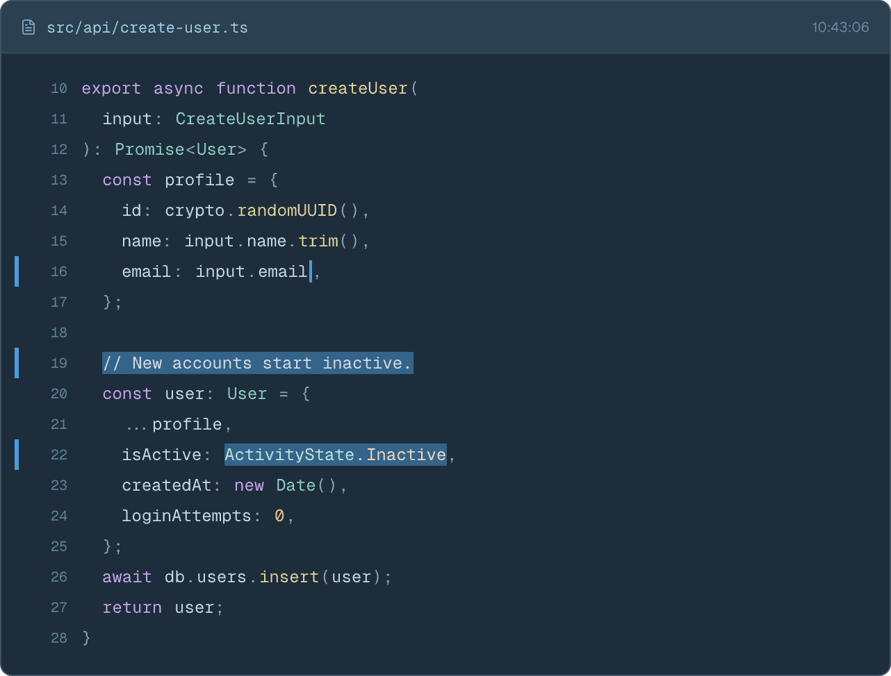
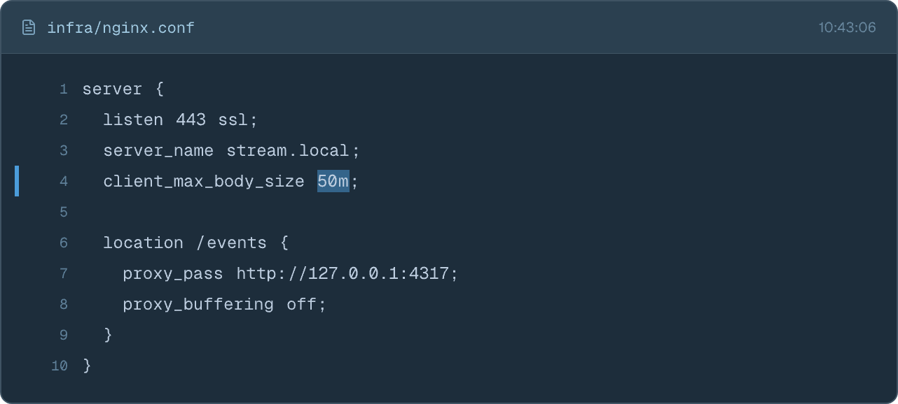
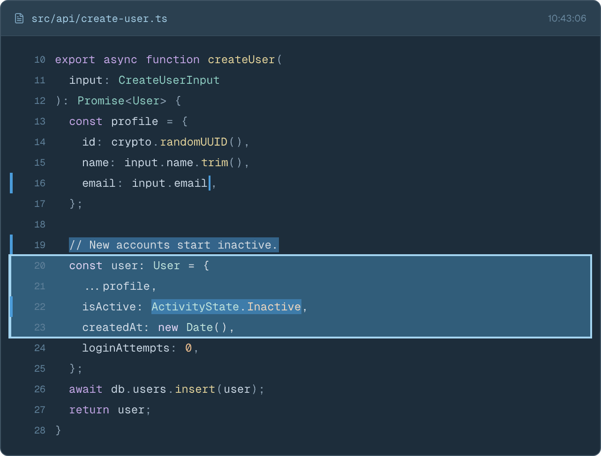
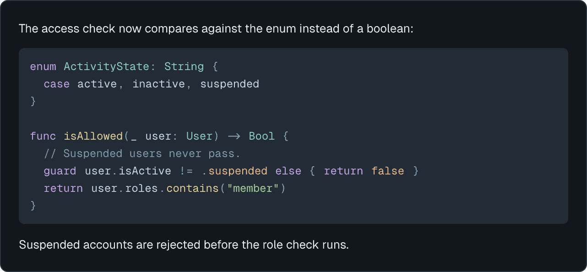
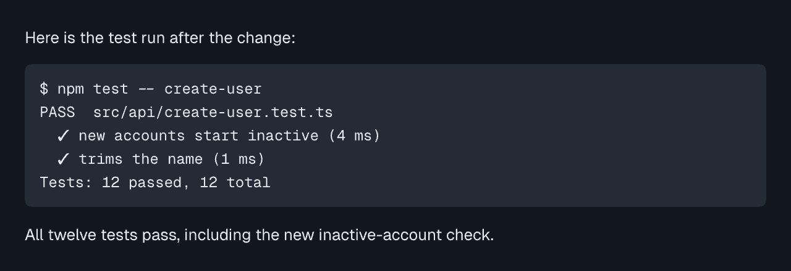

# Syntax highlighting — Screens

Pen file: `design/slipstream.pen`, zone "Zone · Syntax highlighting" (`CLeqn`).

## Navigation map

| Screen | Surface | Address | Reached from |
|---|---|---|---|
| Change-stream card | client | n/a (native) | Change-stream window → any capture event |
| Chat reply code block | client | n/a (native) | Chat tab → any agent reply containing a fenced code block |

## Change-stream card

- **Status:** Changed
- **Surface:** client
- **Address:** `n/a (native)`. This is a card in the change-stream window's event list.
- **Access:** anyone using the app
- **Navigated to from:** Change-stream window, where each capture event renders a card.
- **Navigates to:** unchanged. Selecting lines starts an Ask, as today.
- **Changed from today:**
  - Source lines are coloured by token kind instead of flat `#BDCDDF`.
  - The change marker, run tint and removal tick are unchanged. The tint draws behind the text and the tick in front of it, as today.
  - Inside a change tint, every token lifts toward white to at least 4.5:1 so changed words stay readable.
  - Lines inside an Ask selection use the same lifted colours across the whole line.

| State | When it shows | Node | Mockup |
|---|---|---|---|
| Highlighted | File extension is a supported language | `O5yb0` |  |
| Unsupported language | File extension isn't supported, drawn flat as today | `I8nfWI` |  |
| Ask selection | User has selected lines to ask about; selected lines use the lifted colours | `hwIGn` |  |

## Chat reply code block

- **Status:** Changed
- **Surface:** client
- **Address:** `n/a (native)`. This is a block inside an agent reply in a chat tab.
- **Access:** anyone using the app
- **Navigated to from:** Chat tab, where an agent reply's Markdown contains a fenced code block.
- **Navigates to:** none
- **Changed from today:** a fence with a supported language tag is coloured with the same palette.
  Untagged or unknown fences stay flat, as today.

| State | When it shows | Node | Mockup |
|---|---|---|---|
| Tagged fence | Fence tag is a supported language (e.g. ```` ```swift ````) | `KaEDj` |  |
| Untagged or unknown fence | No tag, or a tag that isn't supported | `iO7Nd` |  |
