# Terminals — Screens

Pen file: `design/slipstream.pen` (zone "14 · Terminals")

## Navigation map
| Screen | Surface | Address | Reached from |
|---|---|---|---|
| Workspace window — Terminals pane | client | n/a (native) — right-hand pane of the workspace window | Opening a workspace window; New Workspace |

## Workspace window — Terminals pane
- **Status:** Changed
- **Surface:** client
- **Address:** n/a (native) — a fixed 440pt pane to the right of the chat in the one
  `Window("Slipstream", id: "main")`
- **Access:** anyone using the app on this Mac
- **Navigated to from:**
  - Workspace picker → choose a workspace (the pane shows that workspace's last selected tab)
  - Toolbar → **New Workspace** → choose a repository (a **Setup** tab opens and is selected; the
    pane shows itself if it was hidden)
  - Chat tab strip → **Show terminals** (only while the pane is hidden)
- **Navigates to:**
  - **+** → a new **Terminal N** tab, selected (stays on this screen)
  - Tab **×** → closes the tab; if something is running, the tab first shows the "Still running"
    box (**Keep** / **Close**)
  - **Hide terminals** (right end of the pane's tab strip) → the hidden state; the chat strip
    gains **Show terminals**
- **Changed from today:** the window gains a third column, the Terminals pane, to the right of
  the chat. Its tab strip matches the chat tabs. The window's minimum width grows from 1000 to
  about 1440 while the pane shows, never more than the screen's visible width. New Workspace no longer runs out of sight and no longer shows
  the "Couldn't finish creating the workspace" alert; its output streams into the Setup tab.
  Current screen: 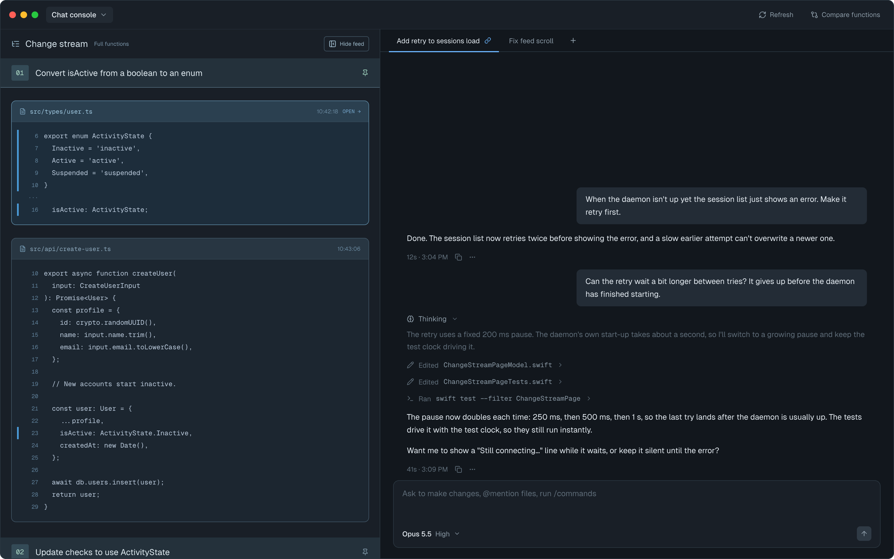

| State | When it shows | Node | Mockup |
|---|---|---|---|
| Setup running | New Workspace is running; spinner on the Setup tab, footer "Setting up workspace-3…" | `y46ro` | 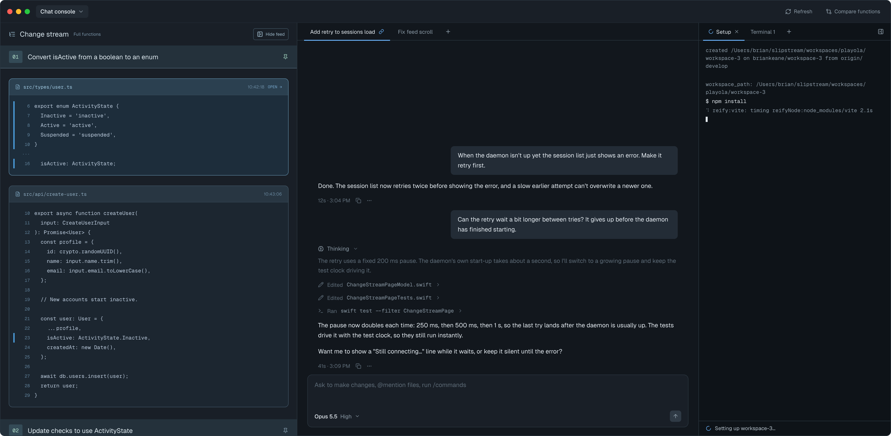 |
| Setup finished | The create command exited 0; check on the tab, output kept (addresses and ports), footer "Setup finished · 14s" | `hEY8y` | 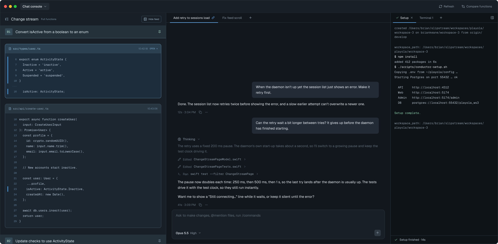 |
| Setup failed | The setup script failed after the workspace was created; alert on the tab, footer "Setup failed — exit 1. The workspace was created." | `NTKN7` | 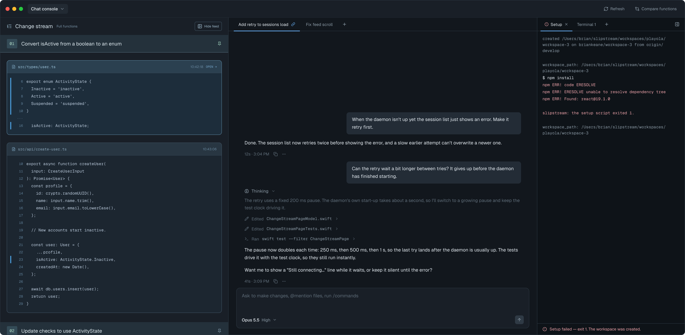 |
| Setup failed, no workspace | The command failed before the folder existed (no `origin`, fetch failed, `slipstream` not found); the tab stays at the front of the strip until closed, footer "Setup failed — no workspace was created. Close this tab to dismiss." | `q45pa` | 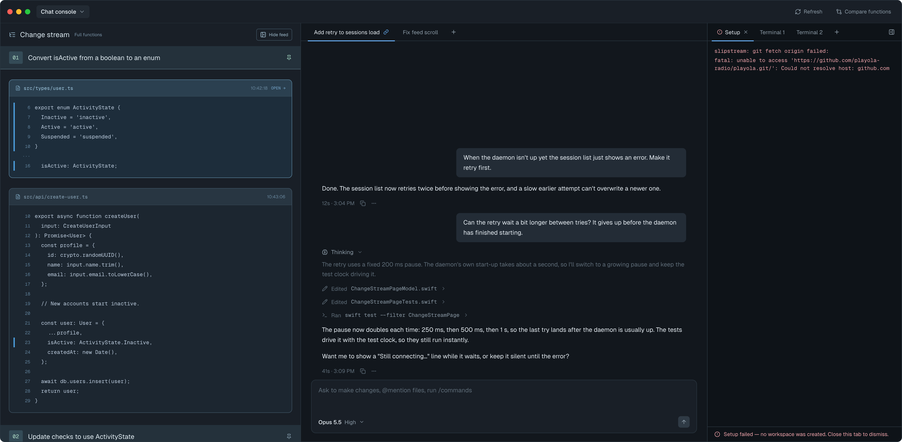 |
| Terminal | A terminal tab is selected: a login shell in the workspace folder | `QPmYb` | 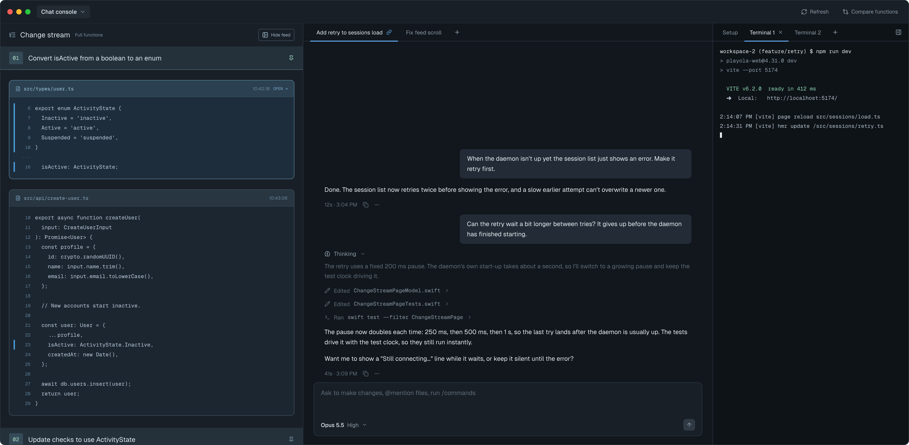 |
| Still running | × on a tab whose foreground program isn't the shell (or a Setup tab still running); the box sits at the bottom of that tab | `M7WFX` | 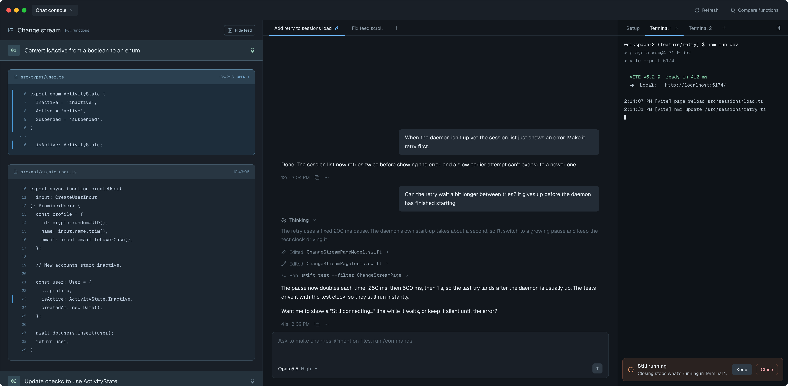 |
| Restored | After relaunch: saved output, the divider "Restored — earlier processes ended", then a fresh prompt | `Vuydd` | 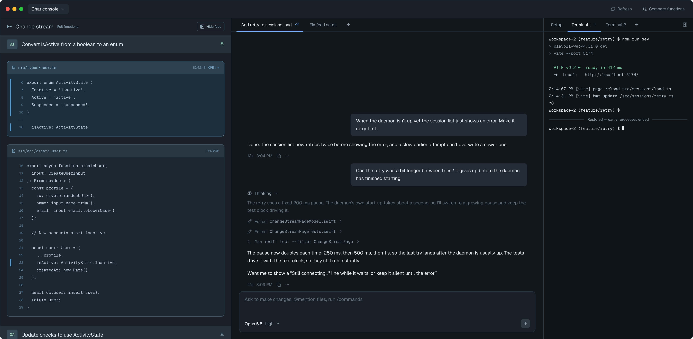 |
| No Setup tab | A workspace this app didn't create (Conductor-made, or made before this feature): Terminal 1 only | `itKKe` | 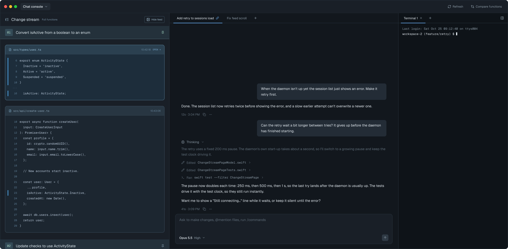 |
| Folder missing | A terminal tab whose workspace folder no longer exists; "This folder no longer exists", the path, "No shell was started." A Setup tab replays its output instead | `D8Kx1` | 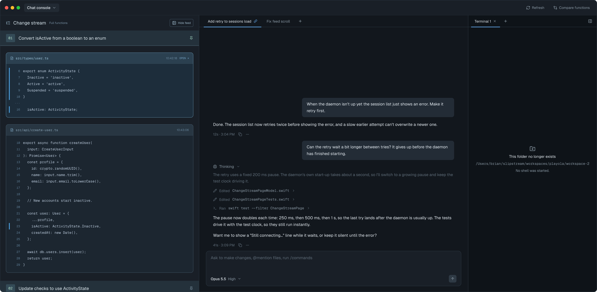 |
| No workspace | No workspace is selected and no Setup tab is waiting for one; "Choose a workspace / Its terminals appear here." A folderless Setup tab shows here instead (as Setup running / Setup failed, no workspace) | `mouwC` | 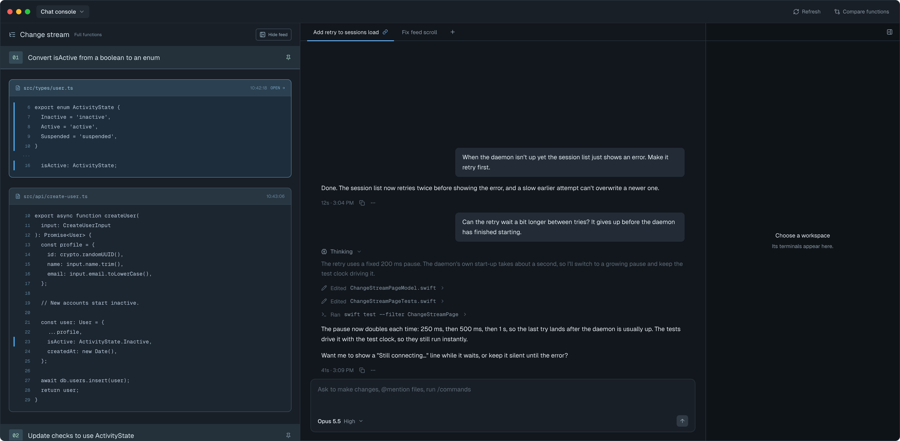 |
| Hidden | The user hid the pane; the chat tab strip shows **Show terminals** at its right end | `Eotfj` | 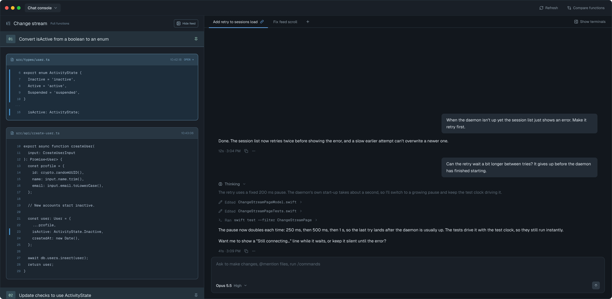 |

Strings, all from the approved frames:
- Tab titles: "Setup", "Terminal 1", "Terminal 2", …
- Setup footer: "Setting up <workspace>…", "Setup finished · <duration>",
  "Setup failed — exit <N>. The workspace was created.",
  "Setup failed — no workspace was created. Close this tab to dismiss.", and
  "Setup was interrupted" (a Setup tab still running when the app quit; same look as Setup failed)
- Close box: "Still running" / "Closing stops what's running in <tab title>." / **Keep** / **Close**
- Divider: "Restored — earlier processes ended"
- Shell ended (written into the terminal, no new frame; same look as terminal output):
  "Process exited (exit <N>)" or "Process exited (signal <name>)", or the shell's launch error.
  The tab stays until × closes it
- Buttons: "Hide terminals" (icon, pane strip), "Show terminals" (chat strip)
