# Workspace names — Screens

Pen file: `design/slipstream.pen`, zone "Zone · Workspace names".

## Navigation map
| Screen | Surface | Address | Reached from |
|---|---|---|---|
| Sidebar (rows show names) | client | n/a (native) — main window sidebar | Always visible when the sidebar is open |
| Row context menu | client | n/a (native) — context menu on a sidebar row | Right-click a workspace row |
| Rename workspace dialog | client | n/a (native) — sheet on the main window | Row context menu → "Rename…" |

## Sidebar (rows show names)
- **Status:** Changed
- **Surface:** client
- **Address:** n/a (native) — the main window's sidebar; the breadcrumb in the toolbar
- **Access:** anyone using the app
- **Navigated to from:**
  - App launch → main window
- **Navigates to:**
  - Right-click a row → Row context menu
  - Click a row → that workspace's chat (unchanged)
- **Changed from today:** each row and the breadcrumb show the workspace's name instead of the
  folder name. Rows with no name yet still show the folder name (`bilbao-v1`, `tacoma-v3`). Agent
  names and your names look the same.

  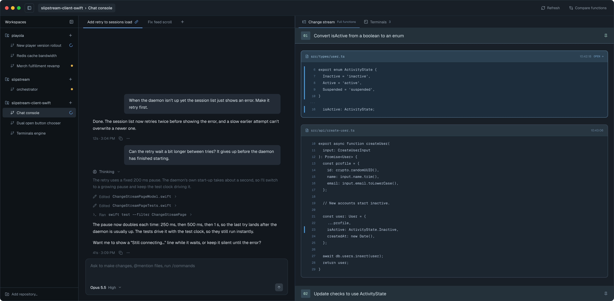

| State | When it shows | Node | Mockup |
|---|---|---|---|
| Names | Some workspaces are named, some fall back to the folder | `m4oCq` | 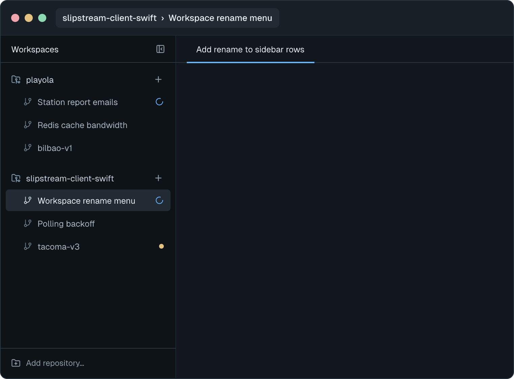 |

## Row context menu
- **Status:** New
- **Surface:** client
- **Address:** n/a (native) — context menu on a sidebar workspace row
- **Access:** anyone using the app
- **Navigated to from:**
  - Sidebar → right-click any workspace row
- **Navigates to:**
  - "Rename…" → Rename workspace dialog
  - "Use agent's name" → clears your name; the row shows the agent's name (or the folder name)
  - "Archive" → archives the workspace (the existing archive action; shown only where the row can
    be archived today)

A failed "Use agent's name" shows the app's existing workspace-failure alert, titled
"Couldn't switch back to the agent's name". The message is the raw error (`CODE: message`, the
same text as the dialog's error block below), and the alert gains a "Copy error" button next to
OK.

Every item has an icon. "Rename…" is enabled or disabled, with no inline explanation; hovering a
disabled "Rename…" shows a tooltip with the reason. New items go above the divider.

| State | When it shows | Node | Mockup |
|---|---|---|---|
| Agent-named row | No name of yours is set; "Use agent's name" is disabled | `xfT4i` | 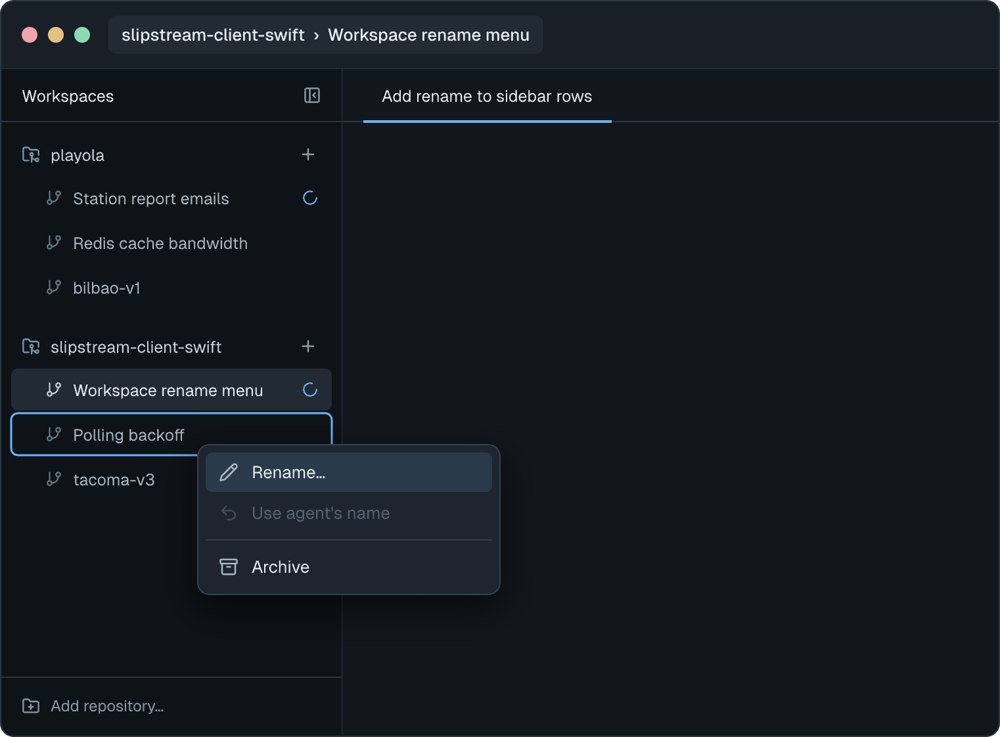 |
| You renamed it | Your name is set; "Use agent's name" is enabled | `xZXUI` | 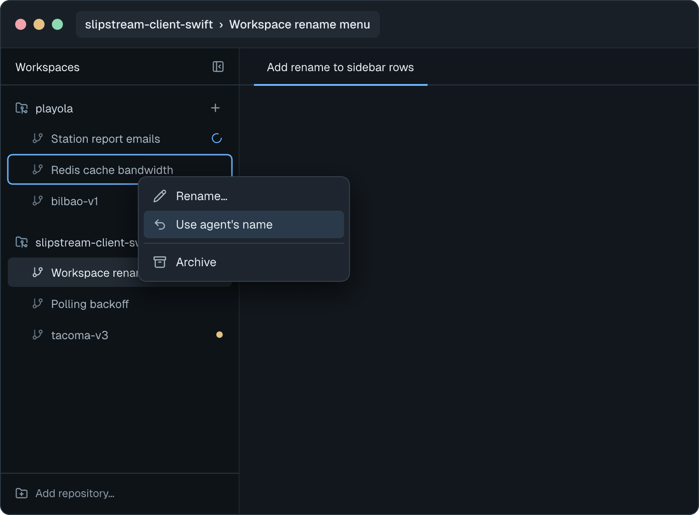 |
| No activity yet | Row has no session history; "Rename…" is disabled, tooltip "Can be named once work starts here." The same frame covers an older daemon, with the tooltip "This version of the Slipstream daemon can't rename workspaces." | `U3Dpwr` | 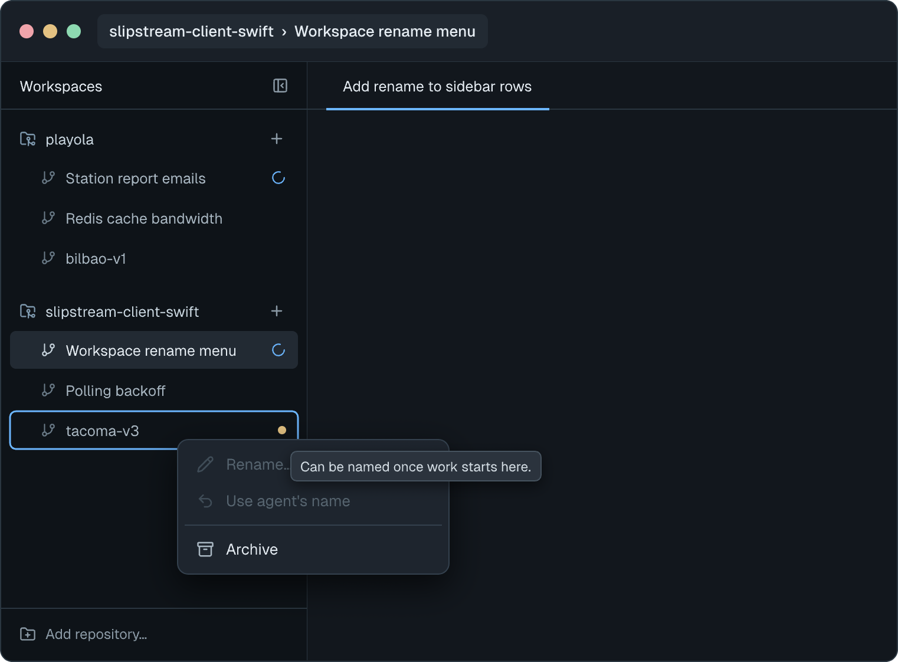 |

## Rename workspace dialog
- **Status:** New
- **Surface:** client
- **Address:** n/a (native) — modal sheet over the main window
- **Access:** anyone using the app
- **Navigated to from:**
  - Row context menu → "Rename…"
- **Navigates to:**
  - "Rename" or Return → saves, closes, the row shows the new name
  - "Cancel" or Esc → closes without saving
  - "Close" (workspace gone) → closes

The field opens with the current name fully selected; polls never change the draft. Under it: "Only changes the name shown in
Slipstream. The folder and branch stay the same."

| State | When it shows | Node | Mockup |
|---|---|---|---|
| Editing | Dialog just opened, or typing a valid name | `T7NimN` | 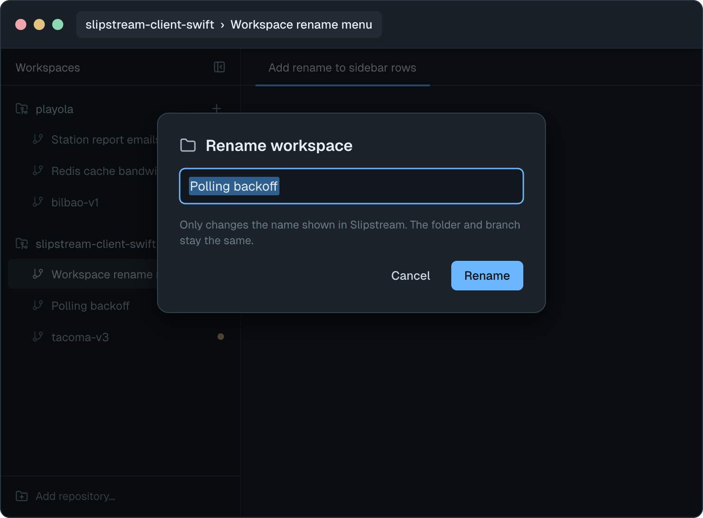 |
| Empty | The field is empty or only spaces; "Rename" is disabled | `VsUYq` | 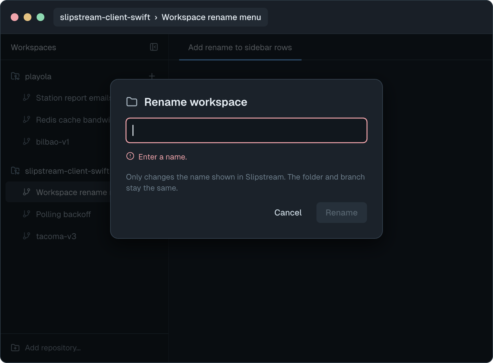 |
| Too long / invalid | The name is over 64 UTF-8 bytes ("That name is too long. Shorten it to save."), or contains a line break or control character ("Names can't contain line breaks or special characters."); "Rename" is disabled | `vSnUH` | 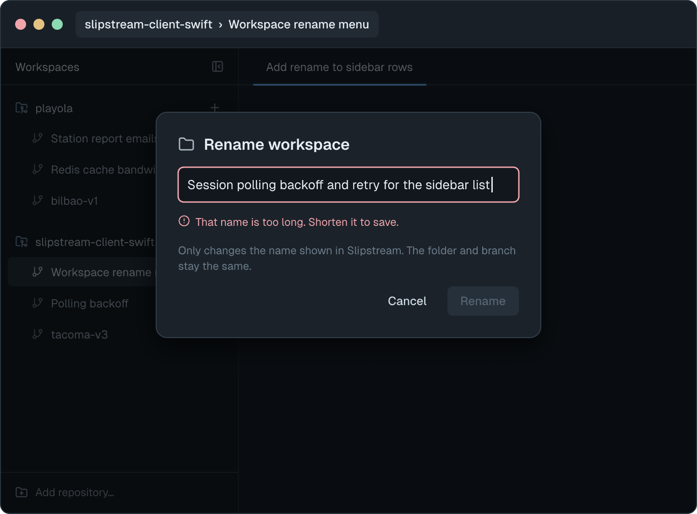 |
| Saving | The rename request is in flight; field, Cancel and Esc are disabled. While either a rename or Use agent's name request is in flight, both naming menu actions are disabled so mutations cannot race | `I3qxN` | 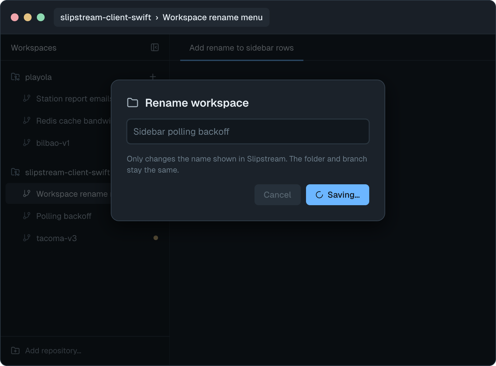 |
| Save failed | No reply, an error other than not-found, or a malformed reply. A headline that names the failure, then the raw error in a selectable monospace block with a Copy button (see "Error text" below). The list refreshes in the background, so a save that did land shows in the row; "Try again" resends | `WQ2uK` | 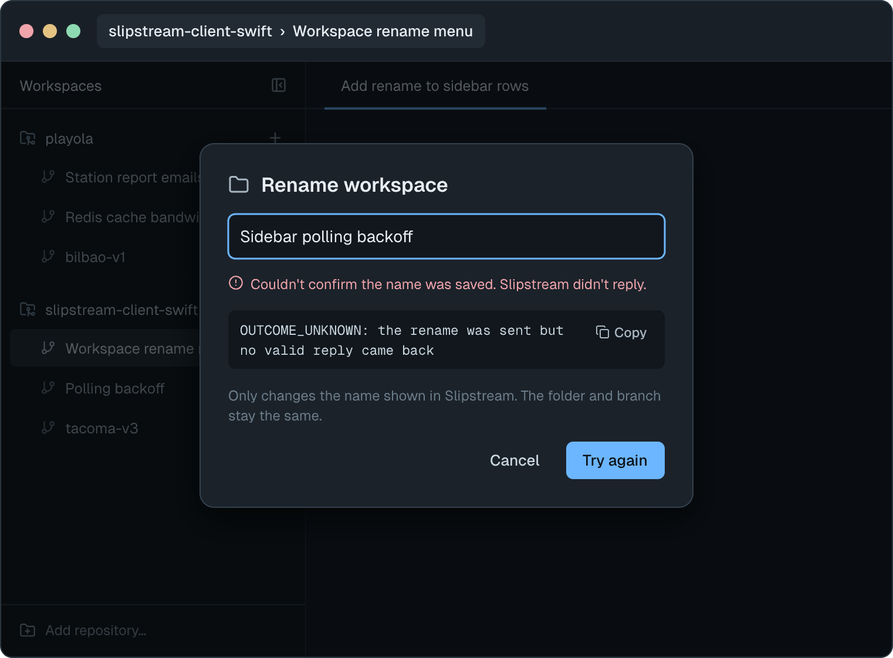 |
| Workspace gone | The daemon replied `SESSION_NOT_FOUND` (the session was deleted). Copy: "This workspace was deleted, so it can't be renamed." Only "Close". Archiving doesn't trigger this; archived workspaces can still be renamed | `q1Niht` | 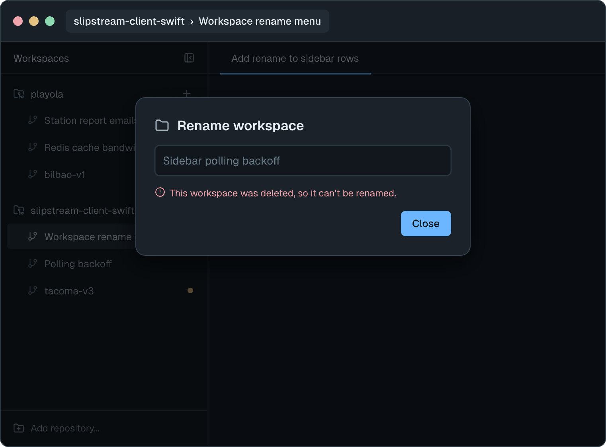 |

**Error text.** Every failure shows the whole error, never a generic line on its own. The
headline depends on the failure; the block underneath is the raw error, selectable, in Geist
Mono, with a Copy button:

| Failure | Headline | Error block |
|---|---|---|
| No reply, or a reply the app couldn't read | "Couldn't confirm the name was saved. Slipstream didn't reply." | `OUTCOME_UNKNOWN: the rename was sent but no valid reply came back` |
| The app couldn't connect | "Couldn't reach Slipstream, so the name wasn't saved." | `DAEMON_UNAVAILABLE: couldn't connect to Slipstream's control socket` |
| The daemon refused it (any code except `SESSION_NOT_FOUND` and `INVALID_NAME`) | "Slipstream refused the rename." | `<CODE>: <daemon message>`, verbatim |

The bearer token never appears in error text; the control socket doesn't use it.
