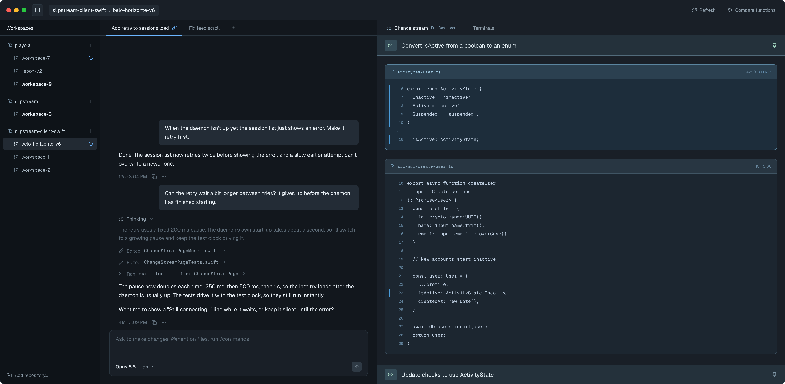
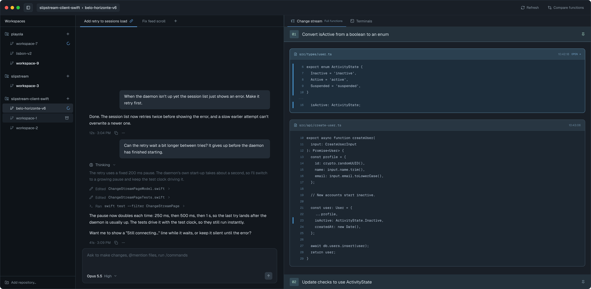
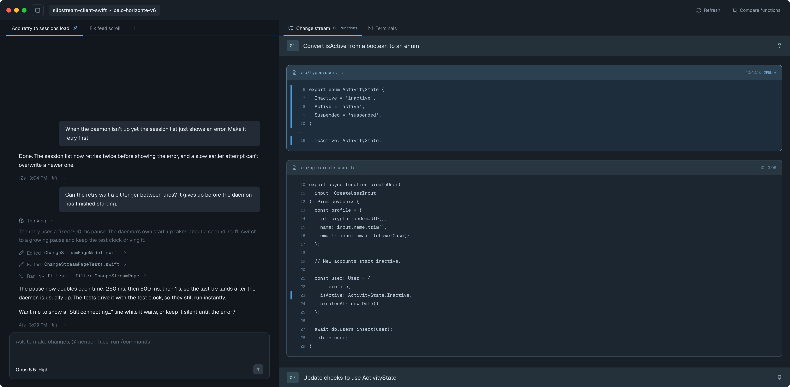
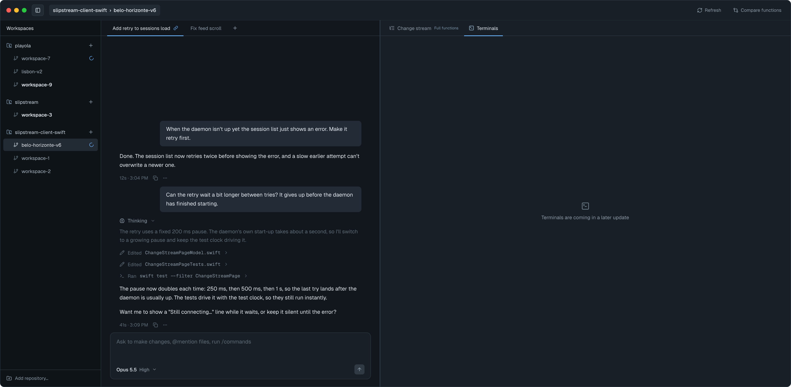
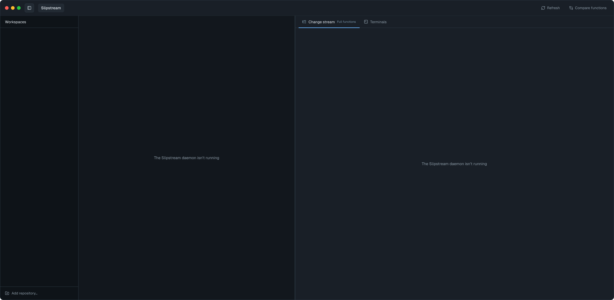

# Workspace sidebar — Screens

Pen file: `design/slipstream.pen` (the state frames sit in a column under
`workspace-sidebar--open`; the sidebar is the reusable component `BkqdP`, "WS · Sidebar")

## Navigation map
| Screen | Surface | Address | Reached from |
|---|---|---|---|
| Workspace window | client | n/a (native) — the one `Window("Slipstream", id: "main")` | Launching the app |

## Workspace window
- **Status:** Changed
- **Surface:** client
- **Address:** n/a (native). The app's only window. It has three columns:
  - the sidebar, a fixed 260pt;
  - the chat, 720pt, shrinking to 420pt when the window narrows;
  - the right side, which fills the rest and is never under 680pt.

  The window minimum is 1,360pt with the sidebar and 1,100pt without (spec Decision 10).
- **Access:** anyone using the app on this Mac
- **Navigated to from:**
  - Launching the app. The sidebar is open, unless it was hidden when the app last quit.
- **Navigates to:** it stays on this screen; everything below changes what the window shows.
  - Sidebar row click → that workspace's stream and chat tabs (today's `sessionSelected(_:)`)
  - Repo header **+** → New Workspace for that repo, without the folder chooser
  - **Add repository…** (sidebar footer) → New Workspace with the folder chooser, as today
  - Row hover or keyboard focus → archive icon (also the row's "Archive workspace" accessibility
    action) → today's "Archive this workspace?" confirmation, for that row's folder
  - Toolbar **Compare functions** → the comparison replaces the chat column until closed, as it
    replaces the detail pane today
  - Toolbar sidebar button → hides or shows the sidebar
  - **Change stream | Terminals** switch → which content the right side shows
- **Changed from today:**
  - **Columns.** The sidebar is new on the left. The chat moves to the middle. The stream moves
    to the right, under the Change stream | Terminals switch, and fills the width that is left:
    about 1,060pt at a 2,040pt window, against 680pt today.
  - **Toolbar.** The session picker menu is gone. In its place:
    - a sidebar toggle button;
    - a plain "repo › workspace" label, or "Slipstream" when nothing is selected.

    The menu's items move as follows:
    - workspaces → sidebar rows;
    - New workspace… → **+** and **Add repository…**;
    - Archive workspace… → the row's hover icon;
    - Show/Hide inactive sessions → removed.
  - **Hide feed.** The stream's **Hide feed** button is gone. The right side is a switch now, and
    the stream is never hidden in favour of the chat.

  Current screen: 

| State | When it shows | Node | Mockup |
|---|---|---|---|
| Open | Default: the sidebar is shown and a workspace is selected. Rows are grouped by repo and named by folder. A **bold** name means a chat there is waiting for your response; a blue spinner means an agent turn is running there | `Gmszm` |  |
| Row hover | The pointer is over, or keyboard focus is on, a row that can be archived (a folder under `~/slipstream/workspaces/`). The row lightens and shows an archive icon at its right end | `OEccY` |  |
| Sidebar hidden | The toolbar sidebar button was clicked. The chat keeps its width and the stream takes the freed space. Remembered across launches | `gm8O5` |  |
| Terminals placeholder | **Terminals** is selected in the right-side switch. It shows a placeholder until the terminals feature fills it | `gwLQ8` |  |
| Unavailable | No workspace to show: the daemon isn't running, no sessions exist yet, or the first load is still running. The sidebar lists nothing but **Add repository…**. The chat and stream show today's `emptyStateText` ("The Slipstream daemon isn't running", "Couldn't reach the Slipstream daemon", "No capture sessions yet", "Looking for capture sessions…") | `zaPgO` |  |

Strings, all from the approved frames:
- Sidebar title: "Workspaces"
- Footer: "Add repository…"
- Switch: "Change stream", "Terminals"
- Placeholder: "Terminals are coming in a later update"
- Toolbar label: "<repo>  ›  <workspace>", or "Slipstream" when nothing is selected
- Help text (tooltips):
  - "New workspace" for **+**
  - "Archive workspace" for the archive icon
  - "Hide sidebar" or "Show sidebar" for the toolbar button
